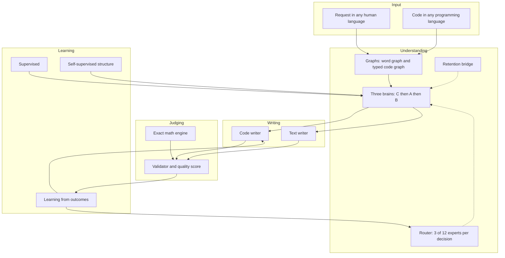
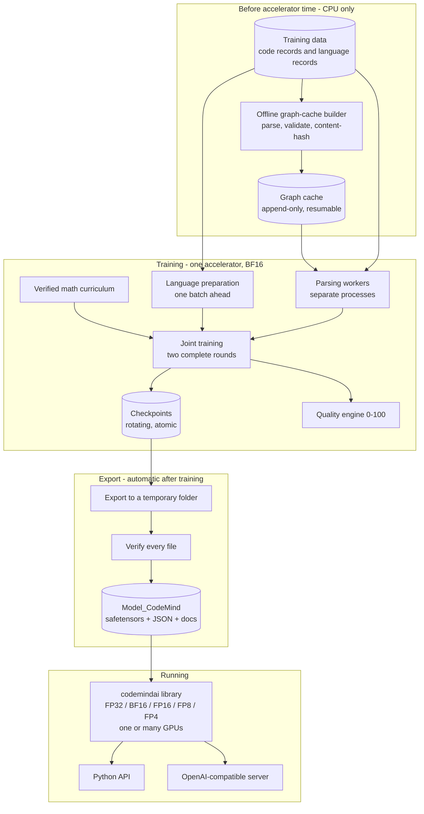
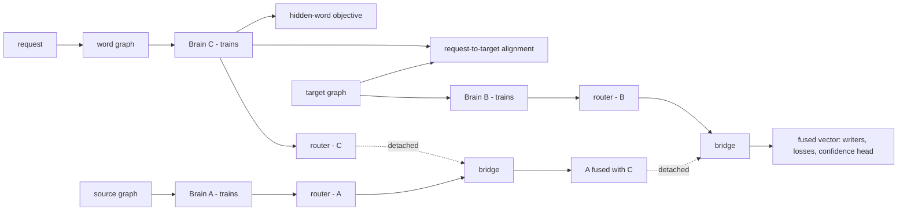
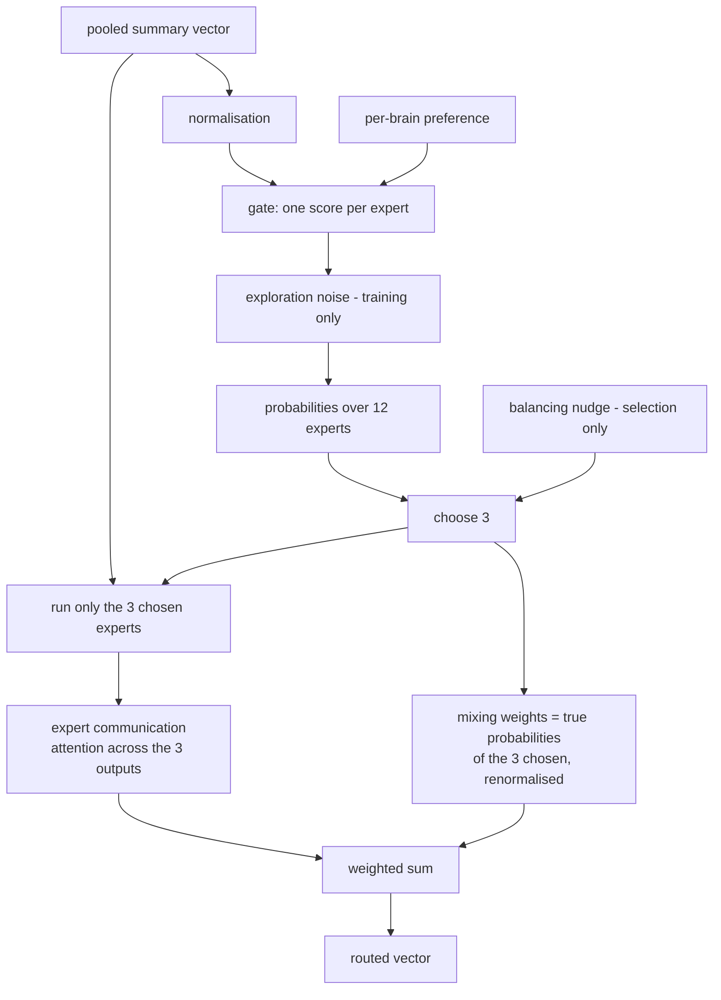
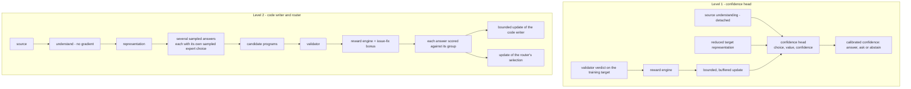

# CodeMind 2.0 — Technical Overview

**Model generation 2.0 · ≈ 6.1 billion parameters · architecture, training, release format and extension guide**

CodeMind is a self-hosted code-intelligence model. It reads and writes software in any programming language and communicates in any human language. Instead of treating code as a flat string of tokens, it turns code and text into **typed graphs** — maps of what calls what, what feeds what and what runs before what — and understands them with a chain of **three specialised graph networks ("brains")**. It writes through **two purpose-built writers**, one structural for code and one free-form for prose, checks every answer with a **layered validator**, learns from those verdicts, and computes numbers and physical quantities with a **built-in exact math engine** instead of guessing them.

---

## About this document

| | |
|---|---|
| **What it covers** | What every part of CodeMind 2.0 does, how the parts connect, why they were designed that way, how the model is trained, how it is packaged and run, and where developers can extend it. |
| **Who it is for** | Engineers evaluating, operating or building on CodeMind; technical readers who want the full picture; non-specialists, through the plain-language summary that opens every section. |
| **How to read it** | Part 0 is the whole system in a few pages. Every later section opens with **In plain words** (the idea) and **Why it matters** (the consequence and how to build on it), followed by the technical description. Read the boxes only for an overview; read everything for depth. |
| **Model generation** | 2.0 (≈ 6.1 B parameters). |
| **Status** | Trained at full scale — two complete rounds over the ≈ 280 GB training corpus — and exported in the standard release format described in Section 22. Public benchmark results are not part of this document. |

> **Confidentiality.** This document explains *what* each part does and *why*. It intentionally contains **no source code, no loss or reward coefficients, no tuned thresholds, no learning rates or schedules, no sampling ratios, no pattern lists, no training data and no weights**. Architecture-scale figures (depths, widths, expert counts, context lengths, vocabulary sizes) are included because the design cannot be understood without them. Training hyper-parameters are proprietary and are not published.

> **Repository.** [FWKTechnologies/CodeMind-Code-Intelligence](https://github.com/FWKTechnologies/CodeMind-Code-Intelligence/tree/main) · [LICENSE](https://github.com/FWKTechnologies/CodeMind-Code-Intelligence/tree/main/LICENSE) · [README](https://github.com/FWKTechnologies/CodeMind-Code-Intelligence/tree/main/README.md). The repository is the source of truth for license terms.

---

## Contents

**Part 0 — The whole picture**
- [0. CodeMind on two pages](#0-codemind-on-two-pages)

**Part I — The system as a whole**
- [1. Executive summary](#1-executive-summary)
- [2. Design principles](#2-design-principles)
- [3. The system at a glance](#3-the-system-at-a-glance)
- [4. Scale, memory and sizing](#4-scale-memory-and-sizing)

**Part II — Understanding**
- [5. Universal language support](#5-universal-language-support)
- [6. The graph vocabulary](#6-the-graph-vocabulary)
- [7. From graphs to numbers](#7-from-graphs-to-numbers)
- [8. The typed graph-attention layer and the brain](#8-the-typed-graph-attention-layer-and-the-brain)
- [9. The three-brain chain and joint training](#9-the-three-brain-chain-and-joint-training)
- [10. Expert routing](#10-expert-routing)
- [11. The retention bridge](#11-the-retention-bridge)
- [12. Graph compaction](#12-graph-compaction)

**Part III — Writing, judging and learning**
- [13. Generation](#13-generation)
- [14. Validation and quality scoring](#14-validation-and-quality-scoring)
- [15. Supervised and self-supervised learning](#15-supervised-and-self-supervised-learning)
- [16. Learning from outcomes](#16-learning-from-outcomes)

**Part IV — Built-in services**
- [17. Math, physics and engineering core](#17-math-physics-and-engineering-core)
- [18. Linguistic safety and secret protection](#18-linguistic-safety-and-secret-protection)
- [19. Grounding](#19-grounding)

**Part V — Training and operating the model**
- [20. Data pipeline and offline graph cache](#20-data-pipeline-and-offline-graph-cache)
- [21. Training runtime and reliability](#21-training-runtime-and-reliability)
- [22. The release format](#22-the-release-format)
- [23. Running the model with `codemindai`](#23-running-the-model-with-codemindai)

**Part VI — Building on CodeMind**
- [24. Extension points](#24-extension-points)
- [25. Recipes](#25-recipes)
- [26. Compatibility rules](#26-compatibility-rules)

**Part VII — Evidence, limits and reference**
- [27. Verification](#27-verification)
- [28. Limits and open questions](#28-limits-and-open-questions)
- [29. Key figures](#29-key-figures)
- [30. Glossary](#30-glossary)

---

# Part 0 — The whole picture

## 0. CodeMind on two pages

### 0.1 The idea in six sentences

1. Code is made of **relationships** — calls, data flow, control flow, dependencies — so CodeMind reads code as a **graph**, not as a flat string.
2. Human language goes through the **same machinery**: a sentence becomes a graph of words, so one system understands instructions and code in any language.
3. Understanding is done by **three specialised brains in a chain** — one for the request, one for the code, one for the edit — steered by a **router** that calls in expert sub-networks, and joined by a **bridge** that keeps earlier knowledge from being overwritten.
4. Writing is done by **two separate writers**: a structural writer for code and a free-form writer for prose.
5. Every answer is **judged** by a layered validator; the verdict decides whether the answer is given, retried or withheld — and the same verdicts are used as a **teacher** during training.
6. Anything exact — arithmetic, units, physical formulas — is **computed** by a deterministic engine rather than predicted.

### 0.2 An analogy

Picture a small engineering firm.

| Role in the firm | Part of CodeMind |
|---|---|
| A **translator** turns the client's request into a precise brief | **Brain C** — the language brain |
| An **analyst** studies the existing code, guided by the brief | **Brain A** — the code-understanding brain |
| A **planner** works out the change to make | **Brain B** — the edit brain |
| A **dispatcher** decides which specialists to call in for each job | The **router** and its 12 **experts** |
| A **records clerk** makes sure last year's lessons are not lost | The **retention bridge** |
| Two **writers** — one drafts code, the other drafts prose | The **code writer** and the **text writer** |
| A strict **inspector** approves or rejects every piece of work | The **validator** and quality engine |
| A **calculator** that never lets a wrong number through | The **math and physics core** |

The firm improves because the inspector's rulings are fed back as training.

### 0.3 The concept map



### 0.4 Key figures at a glance

| | |
|---|---|
| Parameters | ≈ 6.1 B |
| Brains | 3 (C: 15 layers · A: 8 layers · B: 7 layers), width 1,664, 64 attention heads |
| Experts | 12, of which 3 are active per decision |
| Code writer | 9 layers, up to 180,000 positions of context |
| Text writer | 8 layers, 32,000-token byte-level vocabulary, 2,048 positions |
| Graph size | up to 20,480 nodes per graph after compaction |
| Graph vocabulary | 15 node types · 31 relation types |
| Programming languages | 68 named, 1,024 open slots, any other language through a universal reader |
| Human languages | unbounded detection; about twenty languages in the training data |
| Training | ≈ 280 GB, two complete rounds, all parts trained jointly, BF16 |
| Release | `safetensors` weights + JSON configuration and tokenizers, no program code |
| Runs with | the `codemindai` library — FP32, BF16, FP16, FP8 or FP4, any number of GPUs |

### 0.5 Where to find what

| If you want to know… | Read |
|---|---|
| What CodeMind is and is not | 1, 3.4 |
| How one request flows through the system | 3.2 |
| How "any language" is actually achieved | 5 |
| What the graph is and how it becomes numbers | 6, 7 |
| Why three brains, and why they are trained together | 9 |
| What the router does | 10 |
| How it writes and how it checks itself | 13, 14 |
| How it learns — including from its own answers | 15, 16 |
| How exact numbers are guaranteed | 17 |
| How it is trained reliably at scale | 20, 21 |
| What the released model folder contains | 22 |
| How to run it, on how many GPUs, at which precision | 23 |
| How to extend it | 24, 25, 26 |
| What has been verified, and what remains open | 27, 28 |

---

# Part I — The system as a whole

## 1. Executive summary

> **In plain words.** CodeMind reads and writes software in any programming language and talks in any human language. It turns code and text into maps of relationships (graphs), understands them with three specialised networks, writes with two specialised writers, checks its own answers, and learns from those checks.
>
> **Why it matters.** Each of the four stages — understand, write, judge, learn — meets the next at a clear hand-off point, so each can be studied, improved or replaced on its own. If you read only one section, read this one and Section 3.4.

**Representation.** Source code becomes a **typed, heterogeneous graph**: functions, blocks, statements, expressions, variables, control flow, data flow, program dependence, calls and inter-procedural links, each with its own node or relation type. Human language becomes a graph of word nodes joined by order and proximity. One graph vocabulary carries both, so one set of weights serves every language.

**Understanding.** Three brains — instances of the same typed graph-attention design that differ only in depth — form a chain:

- **Brain C** (15 layers) reads the request in any human language.
- **Brain A** (8 layers) reads the code graph, informed by what Brain C understood.
- **Brain B** (7 layers) builds the edit-oriented representation, informed by what Brain A understood.

A single **router** with **12 experts** (3 active per decision) refines each brain's summary and keeps a separate preference for each brain. A single learned **retention bridge** joins the two hand-offs and penalises drift away from what was learned earlier.

**Writing.** The **code writer** (9 layers, rotary positions, up to **180,000 positions** of context) produces a sequence of **structural actions** from a closed vocabulary, which a renderer turns back into formatted source. The **text writer** (8 layers) writes prose in any language token by token with a byte-level vocabulary in which nothing is ever "unknown".

**Judging.** A layered **validator** checks syntax and static correctness, integrity (no hollow stubs, no prompt echoes, no prose disguised as code), purity, safety and — when a reference exists — behaviour and structure. A **quality engine** turns this into a 0–100 score across six dimensions.

**Learning** has three layers, all run as **joint training** — every brain, the router, the bridge and both writers learn together, over **two complete rounds of all data**:

1. **Supervised and self-supervised objectives** align requests with code, teach both writers, and make the model **discover structure on its own** by predicting relations hidden from it.
2. **Learning from outcomes.** The model writes several answers to the same task, the validator scores them, each is compared with its siblings, and the code writer — and the router's choice of experts — is moved toward the answers that actually validate. A separate small head learns **calibrated confidence**, so the model can decline to answer instead of guessing.
3. **A math and physics core inside the learning loop**: an exact engine (rational arithmetic, SI units with dimensional analysis, 121 verified formulas) feeds the model's representations, supplies labels, contributes a verified problem curriculum, scores numeric claims and corrects wrong arithmetic at generation time.

**Around the core** sit a policy-driven linguistic-safety and secret-protection module, a grounding service that sends questions to the math engine or to an optional web-search service, a check-and-repair generation loop, a repository-level project overview, and an offline graph-cache builder that keeps parsing off accelerator time.

**Scale and packaging.** About **6.1 billion parameters**, designed to train on **one high-memory accelerator** (≈ 180 GB class) in BF16. After training, the model is exported automatically in a **standard, code-free release format** — sharded `safetensors` weights, JSON configuration and tokenizers, a checksum manifest and generated English documentation — and is run with the **`codemindai`** library on Windows or Linux, at FP32, BF16, FP16, FP8 or FP4, on one GPU or many.

---

## 2. Design principles

> **In plain words.** These are the rules the design follows. When two ideas conflict, the principle decides.
>
> **Why it matters.** They tell you where it is safe to change things. For example, "nothing is locked to a language" means a feature that only works for one language is a defect to fix, not an acceptable shortcut.

| Principle | What it means in practice |
|---|---|
| **Nothing is locked to a language** | Every programming language gets a real structural graph — through an exact parser where one exists, a grammar where one is available, and a language-independent structural reader otherwise. Every human language is detected; languages never seen before are discovered and grouped, not rejected. |
| **One vocabulary, one set of weights** | A single node and relation vocabulary and a single model serve every language. There are no per-language models. |
| **Structure over text** | The model reasons over graphs and writes structural actions. Shape is a property of the representation, not a hope. |
| **Correctness is measured, not assumed** | An automated validator judges every output, and its judgement is a training signal, not only a filter. |
| **Honest uncertainty** | The model can abstain, or ask a clarifying question, instead of guessing; a calibrated confidence head decides when. |
| **Exact where exactness is possible** | Arithmetic, units and physical formulas are computed deterministically, never predicted. |
| **Policy belongs to the operator** | Safety categories, weights and actions come from a policy the operator supplies. Service limits live in runtime configuration, never in the weights, and every limit can be set to unlimited. |
| **Train simply, serve flexibly** | Training uses one accelerator and BF16, so there is no multi-device machinery to fail. Serving is the opposite: any precision, any number of GPUs, chosen by the operator. |
| **The model is data, not code** | The released model contains weights and JSON only. Loading it cannot execute anything. |
| **Prove it before paying for it** | Parsing, caching, validation and a reduced-scale end-to-end run come first, so expensive accelerator time is not spent finding bugs. |
| **Never change a result to gain speed** | Every performance change is checked for identical output on identical inputs and weights before it is accepted. |

---

## 3. The system at a glance

> **In plain words.** Three views: the life of the project (prepare → train → export → run), the journey of one request, and the four core files.
>
> **Why it matters.** Use this section as a map. When a later section feels abstract, come back here and find where it sits.

### 3.1 Lifecycle

> **In plain words.** Before any accelerator time is rented, the data is parsed on ordinary machines and saved. Training then streams that data. When training finishes, the model is exported automatically as a standard, code-free folder, which the `codemindai` library loads and serves.
>
> **Why it matters.** Cheap work is done first and elsewhere: parsing never needs an accelerator, so it never steals accelerator time; and the exported folder is all anyone needs to run the model.



### 3.2 One request, end to end

> **In plain words.** The request goes to the language brain; the code goes to the code brain; their understanding is combined; a writer produces an answer; small slips are repaired; the inspector decides. If the inspector rejects the answer, a few more candidates are tried before the system declines honestly.
>
> **Why it matters.** This is the whole runtime behaviour in one picture. Every feature plugs into one of these boxes.

```mermaid
flowchart LR
    T[Request text] --> NLD[Language detection] --> LG[Word graph] --> BC[Brain C]
    S[Source code] --> P[Parser<br/>exact, grammar or universal] --> CPG[Typed code graph] --> COL[Graph compaction<br/>up to 20,480 nodes] --> BA[Brain A]
    BC --> R1[Router - C preference] --> BR1[Retention bridge]
    BR1 --> BA
    BA --> R2[Router - A preference] --> BR2[Retention bridge]
    BR2 --> BB[Brain B]
    BB --> R3[Router - B preference]
    R3 --> MA[Quantity adapter<br/>only when numbers are present]
    MA --> DEC[Code writer]
    DEC --> MG[Arithmetic guard]
    MG --> REP[Structural repair]
    REP --> V[Validator] --> AB{valid and honest?}
    AB -- yes --> OUT[Answer]
    AB -- no --> ESC[Try more candidates<br/>ranked by the validator] --> V2[Validator] --> AB2{valid?}
    AB2 -- yes --> OUT
    AB2 -- no --> ABS[Decline, with the reason]
```



A request for prose follows the same path through Brain C and then goes to the **text writer** instead of the code writer (Section 13.4). The decision between the two is automatic, and the caller can override it.

### 3.3 The four core files

> **In plain words.** The AI itself is four files: the core model, the multi-brain machinery, the safety module and the offline graph builder.
>
> **Why it matters.** The split follows responsibility. Things that change together live together; safety is separate so its policy can evolve without touching the model.

| File | Responsibility |
|---|---|
| `CodeMind.py` | The core: language registry and parsers, graph vocabulary, encoding, graph-attention brains, both writers and the action vocabulary, validator and quality engine, learning-from-outcomes and reward logic, all training objectives, data streaming, training runtime, math engine, sizing, release export and generated documentation |
| `codemind_brain_dual.py` | Multi-brain machinery: the router and its experts, the retention bridge, graph compaction, the orchestrator that runs the brains in order, and persistence |
| `linguistic_safety.py` | Policy-driven linguistic safety, personal-data and secret detection, redaction |
| `build_graph_cache.py` | The offline, CPU-only builder that parses and validates the training data ahead of time |

None of these files is part of the released model. The release folder (Section 22) contains weights and JSON only, and is run by the `codemindai` library (Section 23).

### 3.4 What CodeMind is — and is not

> **In plain words.** A table of common misunderstandings.
>
> **Why it matters.** Correct expectations prevent wrong comparisons. For example, the expert mixture works on one summary vector per graph, so it is not comparable with models that route individual tokens.

| CodeMind is… | CodeMind is not… |
|---|---|
| A graph-based system: code becomes a typed graph, text becomes a word graph | A language model whose basic unit is a flat token sequence |
| Three brains of **one** design (language, understanding, edit) joined by a learned bridge | One stack doing everything, or three unrelated models |
| A system whose expert mixture acts on **one summary vector per graph** | A token-level sparse expert layer inside every block |
| Trained by supervised and self-supervised objectives **and** by learning from validated outcomes | Trained only by next-token prediction |
| A code writer restricted to a **closed vocabulary of structural actions** | A free sampler over open text (that is the separate text writer's job) |
| Language-independent: one vocabulary and one set of weights for all languages | A family of per-language models |
| Numerically grounded: an exact engine is **inside** the learning loop | A model that predicts numbers and hopes |
| Able to **abstain** or ask a question when it is not confident | A system that always answers |
| Released as **data only** (weights + JSON) | A bundle of code that must be trusted to run |

---

## 4. Scale, memory and sizing

> **In plain words.** How big the model is, how much memory training needs, how the size is checked against the amount of data, and how the training plan is derived from the real data.
>
> **Why it matters.** Bigger is not automatically better: a model too large for its data memorises, and one too small wastes data. This section is the check that keeps the two in proportion.

### 4.1 Parameter budget (≈ 6.1 B)

> **In plain words.** A bill of materials: which component costs how many parameters. Most of the cost is the three brains; the writers and the router are comparatively small.
>
> **Why it matters.** Depth is the main size lever, because each graph layer costs a fixed amount. To make the model smaller or larger, change the depth of a brain — Brain C first.

Hidden width is **1,664** throughout. At start-up the system logs the **real** parameter count — every module counted once, shared weights counted once — next to an analytic estimate computed by the same formulas the configuration uses.

| Component | Structure | ≈ Parameters |
|---|---|---|
| Brain C | 15 graph-attention layers | 2.57 B |
| Brain A | 8 graph-attention layers | 1.39 B |
| Brain B | 7 graph-attention layers | 1.23 B |
| Code writer | 9 layers, 16 heads, ≈ 14 K structural vocabulary, 8 memory tokens | 0.35 B |
| Text writer | 8 layers, 16 heads, 32 K byte-level vocabulary, 8 memory tokens | 0.34 B |
| Router | 12 experts + expert-communication block | 0.16 B |
| Retention bridge | gated fusion | 0.02 B |
| Encoder, fusion and small heads | hashed token encoder with open language slots, semantic fusion, confidence head, auxiliary heads, quantity adapter and head | ≈ 0.06 B |
| Structure head | self-supervised relation head (Section 15.2) | ≈ 0.011 B |
| **Total** | | **≈ 6.11 B** |

One graph-attention layer is ≈ 168 M parameters, almost all of it in the **per-node-type** projections; the per-relation transformations add only about 1.3 M per layer.

### 4.2 Training memory

> **In plain words.** Training needs about 16 bytes per parameter for the weights, their gradients and the optimiser's state. On one large accelerator that leaves a margin for everything that depends on the input, and several techniques keep the work inside that margin.
>
> **Why it matters.** Memory, not arithmetic, is usually what stops large training runs. Any new feature should be judged by how much of the margin it uses.

Weights, gradients and optimiser state cost **≈ 16 bytes per parameter**, about **98 GB** at 6.11 B. On a ≈ 180 GB accelerator that leaves roughly **80 GB** for everything that scales with the input: writer activations at long context, graph activations over up to 20,480 nodes, router and learning buffers, and allocator overhead. The design lives inside that margin through:

- **Linear-memory attention** in the writers: memory grows linearly with context while compute stays quadratic.
- **A chunked, recomputed output loss.** At long context a full table of output scores would take tens of gigabytes. The loss is computed in chunks that are recomputed during the backward pass, so the full table never exists.
- **Activation recomputation** in brains and writers, with a guard that makes every recomputed layer run in exactly the mode (training or evaluation) of its original pass.
- **A proactive memory governor** that shrinks the micro-batch *before* an out-of-memory error, and grows it back slowly after a calm period.
- **A preflight report** that estimates weights, optimiser state, graph activations and writer activations at the training context length, flags real out-of-memory risk and names the first thing to reduce.

### 4.3 Sizing from the data

> **In plain words.** A rule of thumb — about 20 training tokens per parameter — compared with the measured amount of data, giving a verdict: too little data, appropriate, or a model smaller than the data could support.
>
> **Why it matters.** The advisor reports but never rebuilds the model, because changing depth after training would make saved checkpoints unloadable. Treat it as an anchor, not a law, because CodeMind learns from graphs rather than token sequences.

Two functions tie model size to data size: an analytic parameter counter and a sizing advisor. The advisor uses three explicit, adjustable planning assumptions — source text averages about 3.5 bytes per token, the data counts as two effective passes, and a compute-efficient model wants about 20 tokens per parameter.

| Unique training data | Effective tokens (2 passes) | Compute-efficient size |
|---|---|---|
| 100 GB | ≈ 57 B | ≈ 2.9 B |
| 140 GB | ≈ 80 B | ≈ 4.0 B |
| 210 GB | ≈ 120 B | ≈ 6.0 B |
| 280 GB | ≈ 160 B | ≈ 8.0 B |

The training corpus is **≈ 280 GB** — roughly 180 GB of code records and 100 GB of human-language records in about twenty languages. The configuration deliberately stays below the 8 B the rule would allow, inside a 6.0–6.2 B budget set by single-accelerator memory, which places the model at **≈ 26 effective tokens per parameter** — inside the advisor's "appropriate" band. The advisor runs every time data is connected and reports its verdict and a recommended Brain C depth.

### 4.4 The training plan

> **In plain words.** Two complete passes over all the data, with every part of the model learning together in each pass. Almost nothing is held out, and the plan adapts to however much data is connected.
>
> **Why it matters.** Two complete passes mean every brain sees everything twice — the simplest defence against forgetting. Resuming works at the level of individual samples, so an interruption loses very little.

- **Two complete rounds.** Each round is one full pass over all connected code and language data, and in every round all brains train together. The learning-rate schedule is computed against the real total number of steps of the run.
- **Rounds end when the data ends,** not when a counter is reached.
- **A tiny, stable hold-out.** At most 0.2 % of the data is held out for validation, chosen by a stable hash so it can never leak into training.
- **Resumable at sample granularity.** Finished rounds are skipped on resume; the interrupted round is shortened by the samples already trained; a new run on an existing model gets a fresh schedule of its own.
- **Any data size gives a correct plan** — from thousands of records to hundreds of millions.

---

# Part II — Understanding

> Part II explains how CodeMind *reads*: languages, graphs, encoding, the three brains, the router, the bridge and graph compaction.

## 5. Universal language support

> **In plain words.** How the system handles every programming language and every human language without a fixed list.
>
> **Why it matters.** This is what makes the "any language" promise concrete. Start here if you want to support something unusual.

### 5.1 Programming languages: three layers of support

> **In plain words.** Python gets an exact syntax tree with full semantic analysis. Languages with an available grammar use that grammar. Everything else goes through a universal structural reader that finds blocks, calls, definitions and assignments by itself. A registry of 68 named languages supplies hints, and 1,024 open slots give any other language a place.
>
> **Why it matters.** Instead of writing one parser per language, the system recovers the skeleton that almost all languages share. That is how code in a language nobody planned for is still understood — and where the skeleton is not enough, the structure-learning objective (Section 15.2) learns relations from context.

Support is layered so that **no language is ever "unsupported"**:

1. **Exact analysis (Python).** A native walk of the language's own syntax tree builds every layer — syntax, control flow, data flow, program dependence, calls and system dependence — with real semantic analysis: definition–use chains and control dependence.
2. **Grammar-based analysis.** For languages with an available grammar, a grammar-driven builder produces the same layered graph. Grammars are looked up by name, not from a fixed list; each is downloaded once on first use and cached, and can be pre-fetched for machines without internet access (Section 23.7).
3. **The universal structural reader** handles everything else — including dialects, configuration languages and domain-specific languages the system has never seen — and still produces the full layered graph.

A **registry of 68 named languages** (general-purpose, data and query, web and UI, infrastructure and build, systems) supplies hints such as language family and comment syntax. It is **not a gate**: the registry reserves **1,024 open slots**, so a language that is not in the table is registered on first sight, receives its own embedding slot and is processed like any other. Code that an exact parser rejects is not discarded; it falls through to the universal reader.

#### The universal structural reader

Most programming languages share a skeleton: comments, strings, nested brackets, blocks opened by braces or indentation, block headers (function, condition, loop), calls of the form `name(...)`, and assignments. The reader recovers this skeleton **from the source itself**, without a per-language grammar:

- **Lexical masking.** Comments and string contents are masked, with positions preserved, so structure is never inferred from text inside a comment or a string. The line-comment marker is *learned from the file's own evidence*, with the registry's hint used only when the evidence does not contradict it. Block-comment forms are detected from what the file actually contains; multi-line strings are tracked; languages in which an apostrophe is not a string delimiter are handled.
- **Learned keywords.** Which words introduce control flow and which introduce definitions is inferred from the statistics of the file, not looked up in a keyword table.
- **Scoped definition–use.** Scopes follow brace depth or indentation, whichever the file uses. Variables are linked to their definitions within scope; calls are linked to functions defined later in the file as well as earlier.
- **Documentation retained.** Comments are attached to the construct they describe instead of being thrown away.
- **Universal syntax checking.** Unclosed, unmatched and mismatched brackets and unterminated block comments are detected for any language, outside comments and strings.

The reader is a fallback that is **stronger than raw lines**, not a replacement for real grammars: where an exact parser or a grammar exists, it is used first.

#### Deterministic self-repair

When generated code fails the universal structure check, a deterministic repair step closes unbalanced brackets and unterminated block comments **before** the validator judges it, so cheap structural slips cost nothing. If the repaired answer is still rejected, generation escalates (Section 13.3).

### 5.2 Polyglot projects

> **In plain words.** Real projects mix languages. Their graphs are merged into one, with cross-language links: an API route matched to the client that calls it, imports and requires, shared configuration.
>
> **Why it matters.** The model can reason about a whole repository rather than one file at a time, and very large repositories are processed in memory-bounded batches.

The graphs of several languages are merged into **one** graph and cross-language edges are added: HTTP routes matched to the clients that call them, `import` / `require` / `fetch` links, shared configuration wiring, same-family hints. Large repositories are indexed, grouped into memory-budgeted batches, parsed batch by batch, merged and compacted before the brains see them, so projects of thousands of files never need to be resident at once. Web code is treated like any other code.

### 5.3 Human languages

> **In plain words.** Text in any human language becomes a graph of words. A detector identifies the language and script without a fixed list, and groups unknown languages consistently.
>
> **Why it matters.** Understanding needs no tokenizer, so a language never seen before is still read.

The language brain has **no tokenizer of its own**. Text in any human language becomes a graph of `word` nodes joined by sequence and proximity edges, read with exactly the same encoder and graph-attention design as the code brains.

The **language detector** identifies language and script **without a fixed language list**. It combines script analysis, function-word evidence and learned character-trigram profiles, and returns a language code, a script and a confidence; when the script is known but the language is not, it reports an "undetermined, this script" code. Unrecognised languages are not lumped together as "unknown": their profiles are **grouped online** into a bounded number of discovered clusters, so the same unfamiliar language is recognised consistently from sample to sample and can be balanced in training like any other. The detector is thread-safe, learns only from labels present in real data and is bounded in size. It also selects the right safety rules for each message and reports which human languages the training data actually contains.

When a request arrives in a human language the model was not trained on, the answer is given in English with a short note, and the answer object says so (Section 23.3).

### 5.4 Project overview

> **In plain words.** A fast, deterministic summary of a whole repository — languages, core files, entry points, dependency cycles, isolated files and the files in worst shape with their issues — computed without the neural network.
>
> **Why it matters.** It is the cheap "big picture" tool, inspectable and easy to extend. It matches names; it does not resolve imports.

The overview answers *"what is in this repository and how does it hang together"* at the cost of parsing and validation only, for any size of project and any mix of languages. It returns:

- **Languages** with their line counts.
- **Per-file rows**: language, node count, lines, defined symbols, files it uses, how many files use it.
- **A dependency map.** A file *uses* another when it mentions a symbol the other defines. A locally defined symbol shadows other files; when a name is defined in several files, owners in the same language win; a name defined in several files of *different* languages and used from none of them is left unlinked rather than guessed.
- **Core files** (most depended upon), **likely entry points**, **dependency cycles** (found with an iterative strongly-connected-component search, so deep projects cannot overflow the stack) and **isolated files**.
- **Health.** Optionally, every file is validated in its own language and the worst files are listed first with their top issues. A file that fails to validate is reported, never allowed to hide the rest.

The neural counterpart merges the files into one graph, compacts it and runs the brains; the overview is the fast, deterministic companion.

---

## 6. The graph vocabulary

> **In plain words.** The vocabulary of the maps: 15 kinds of node and 31 kinds of relation.
>
> **Why it matters.** One vocabulary for all languages is why one set of weights can serve them all. Every relation kind has its own learned transformation, so a call and a data dependency are treated differently.

**15 node types**

| Group | Node types | Meaning |
|---|---|---|
| Program layers | `ast`, `cfg`, `dfg`, `pdg`, `call`, `sdg` | Syntax, control flow, data flow, program dependence, call graph, system dependence |
| Code structure | `func`, `block`, `expr`, `stmt`, `token` | Functions, blocks, expressions, statements, lexical tokens |
| Polyglot markers | `lang`, `api`, `config` | Language hosts, API bindings, configuration wiring |
| Human language | `word` | A word in a natural-language graph |

**31 relation types**, in families:

| Family | Examples of what they connect |
|---|---|
| Structure | syntax child, next sibling, contains, belongs to |
| Control flow | flow and branch edges between statements |
| Data and dependence | data flow, control dependence, data dependence |
| Calls | invokes, returns, inter-procedural links, call-site wrapping |
| Cross-layer mapping | links that let information move between layers (syntax ↔ flow ↔ dependence) |
| Polyglot | cross-language function links, hosting, API binding, configuration wiring, same-family and co-existence |
| Containment refinements | finer-grained containment between structural nodes |
| Language | `next` and `near` between words |

The vocabulary is the same whichever builder produced the graph — exact, grammar-based or universal — which is what allows one model to serve every language.

---

## 7. From graphs to numbers

> **In plain words.** Text on each node is hashed into embeddings — no vocabulary needs fitting — and mixed with language, family and node-type information. Many graphs are then packed into one batch.
>
> **Why it matters.** The work is split in two: a CPU-only preparation step that can run ahead on another thread, and one device step that must stay in training because the encoder learns. That split keeps the accelerator busy.

**The token-efficient encoder** turns the text of a node into a vector **without a fitted vocabulary**. Each token contributes a hashed identity embedding and a bucket embedding; a projection combines them; **language** and **language-family** embeddings (sized by the open slot space, so newly registered languages have a place) and a **node-type** embedding are mixed in through small learned gates. Position embeddings and an attention pooling with a learnable query add sensitivity to word order through a gate that starts almost closed, so the encoder begins close to a plain average and learns how much order matters. Because it is hash-based it works for every script — which is why the language brain needs no tokenizer. Hash results are cached, and whole batches of nodes are embedded in a single operation.

**The graph tensorizer** converts graphs into per-type feature tensors and per-relation edge lists, and packs many graphs into one **block-diagonal batch** with per-graph indices so that pooling stays per graph. It works in two stages:

1. **Preparation (CPU only).** Subsampling to the node budget, per-type node positions, language and family slots, and relation edge lists. It touches no accelerator and no gradient, so it is a pure function of the graph and can run ahead of time on a worker thread.
2. **Assembly (device).** Because the encoder is learnable, this stage stays inside training — but it is a **single pass**: every node of every graph in the batch is encoded together in length-bucketed chunks (padding stays small, and masked pooling makes the result independent of it), edge offsets are computed on the CPU, and each tensor crosses to the accelerator once.

A **semantic fusion** module then combines the encoder's view of each node with the brain's output.

---

## 8. The typed graph-attention layer and the brain

> **In plain words.** The core building block. Every kind of node has its own way of asking, answering and passing on information, and every kind of relation has its own transformation. Each node gathers messages from its neighbours, weighted by attention.
>
> **Why it matters.** This is the mechanism behind "typed" reasoning: a function call and a data dependency are read through different learned transformations.

### 8.1 The layer

- Every **node type** has its own query, key, value and output projections, and its own normalisation.
- Every **relation** — a (source type, relation, destination type) triple — has its own learned transformation **per attention head**; a neighbour's key passes through that transformation before scoring.
- **Normalisation.** For each relation, attention weights are normalised over the edges of that relation arriving at each destination node. The messages of all relations that end in the same node type are then gathered into the destination in **one operation** and averaged by the node's total in-degree, combined with a skip connection, passed through dropout and normalised per node type.
- **Computed once.** Key and value projections depend only on the source type, so each is computed once per pass and reused by every relation that starts there.
- **Fully vectorised.** The per-destination normalisation and the aggregation are scatter operations over all edges at once; there are no per-node loops.

### 8.2 The brain

A brain is a per-type input projection, a stack of graph-attention layers (recomputed during training to save memory), **learnable weighted pooling** across node types and a semantic head. Pooling starts from a prior that favours functions, calls and data flow over raw syntax, and is then learned.

Each brain carries small task heads on its pooled vector: *understand*, *generate*, a *validity* score, and a **multi-label issue head** over six categories — syntax, security, safety, undefined name, unused import, other — trained from what the validator actually found. This gives a quick learned self-check that complements the slower rule-based analysis.

All three brains share the same width (1,664) and head layout (64 heads of 26 dimensions); they differ only in depth.

---

## 9. The three-brain chain and joint training

> **In plain words.** Three brains of the same design: C reads the request, A reads the code, B reads the target of the edit. They are trained together, not one after another.
>
> **Why it matters.** Joint training is the answer to forgetting: there is no "later phase" that can overwrite earlier skills.

### 9.1 Roles

| Brain | Depth | Reads | Job | Router preference |
|---|---|---|---|---|
| **C** | 15 layers | The request as a word graph | Understand what is asked, in any human language | C |
| **A** | 8 layers | The source code graph | Understand code structure, informed by C | A |
| **B** | 7 layers | The target code graph | Build the edit-oriented representation, informed by A | B |

Brain C is the deepest because its job is the broadest — every human language rather than one code vocabulary. Brain B is one layer shallower than A by design: close enough that the retention machinery stays balanced, lighter because editing builds on understanding.

### 9.2 One joint training step



What happens in a joint step, and why:

- **All three brains learn from the same sample**, with the same router and bridge, in every step of every round.
- **Brain C gets its own signal.** In the chain, Brain C reaches Brain A through a detached fusion, so the main loss alone would not train it. Joint steps add an explicit **alignment objective** — the request's representation is pulled toward its target's and pushed away from a bank of recent unrelated targets — together with a hidden-word objective. The alignment is emphasised in the first round and relaxed in the second, so language understanding is learned first and then maintained while code skills and writing take over.
- **Hidden words only in some steps,** because hiding words would also change what Brain A is conditioned on.
- **Retention across rounds.** At the end of each round the bridge's reference point is refreshed and blended with its history, so the next round is penalised for drifting from what the previous one learned (Section 11).
- **Structure learning rides on Brain A.** In a share of steps, some of the source graph's edges are hidden and must be recovered (Section 15.2).
- **Learning from outcomes starts gently.** Answers sampled from a barely trained writer are mostly broken, so outcome-based steps run less often in the first round and at full cadence in the last. They always run **after** the batch's backward pass (Section 16).
- **Language data trains Brain C directly.** Language-only records are trained in separate **language micro-batches** through Brain C: hidden-word prediction plus, for records with a response or translation, an **in-batch alignment** between text and response, in which the other pairs of the batch serve as negatives — for translation pairs this aligns two languages. A plain text is split at a sentence boundary into prompt and continuation, so it yields a pair too. A language micro-batch is a full accumulation slot, so the optimiser treats both kinds of data uniformly. Its CPU preparation for the *next* micro-batch runs on a worker thread while the current one trains, and a share of language micro-batches also trains the **text writer**.
- **The writers train before the main backward pass,** from the representation already in hand, so the shared computation is still intact for the brain-side loss.
- **A round-end checkpoint** is written after every round in addition to the periodic ones.

### 9.3 Sequential schedule (optional)

The older C → A → B schedule, in which each brain trains in its own phase and Brain C is frozen afterwards, remains available as a baseline for measuring what joint training adds, or for starting a smaller two-brain model.

### 9.4 Training mode and answering mode

Each brain and the shared router set their mode from **whether gradients are enabled**. With gradients: training behaviour — dropout, router exploration, expert statistics updating, recomputation. Without: evaluation behaviour — deterministic, no dropout, no exploration and **no change to any persistent state**. This matters because the experts' running statistics are saved in checkpoints: answering a question must never alter what a resumed training run will see.

### 9.5 Extra lessons for the language brain

- **Hidden-word objective.** Some words of a request are hidden and Brain C must recover their *input features* from context. It needs no per-language vocabulary and reuses the main forward pass.
- **Loss balancing.** The language term is kept at a target share of the total by adapting its weight to measured loss sizes (smoothed, bounded, with warm-up), so neither code nor language dominates.
- **Register and severity head (optional).** A classifier on Brain C's representation predicts two independent axes — how severe and how casual a message is — trained only when the operator supplies a labelled file. It is off by default.

---

## 10. Expert routing

> **In plain words.** After a brain summarises a graph into one vector, a router picks 3 of 12 expert sub-networks to refine it. Each brain can prefer different experts.
>
> **Why it matters.** The router adds task-specific processing at small cost. It works on one vector per graph, so it is a representation mixer, not a token-level sparse layer.

### 10.1 What kind of expert mixture this is

The mixture is applied **once per graph, after a brain has pooled its output**. It does not route individual nodes or tokens. A brain produces one summary vector; the router chooses **3 of 12** experts; the chosen experts transform it; the mixed result **replaces** the brain's vector on its way to the bridge and the writers. **One router serves all three brains** (≈ 0.16 B of ≈ 6.1 B parameters).



### 10.2 Routing step by step

1. **Normalise** the pooled vector.
2. **Score with a per-brain preference.** A gate scores the 12 experts, and a learned **preference row for the calling brain** is added, so Brains C, A and B can learn different expert preferences. The preferences start equal and diverge only as training separates them.
3. **Explore** with small random noise during training only.
4. **Select** 3 experts. During training the ranking includes a small balancing nudge; when answering, it follows the gate alone.
5. **Mix** with the **true gate probabilities** of the chosen experts, renormalised — the balancing nudge never enters the output.
6. **Run only the chosen experts,** let them exchange information, and combine.

### 10.3 Experts and expert communication

Each expert is a small two-layer network (≈ 11 M parameters) carrying a **slowly moving average of its own recent outputs**, which damps abrupt changes from batch to batch; the averages are saved with the model. The **expert-communication block** treats the three selected outputs as a tiny sequence and lets them attend to each other, behind a gated connection that **starts almost closed** — early behaviour is a plain weighted sum, and the exchange opens only if training finds it useful.

### 10.4 Four guards against expert collapse

"Collapse" means a few experts end up doing all the work. Four complementary guards prevent it:

1. **A load-balance objective** built from *measured* expert load over many calls, which moves probability away from over-used experts without fighting specialisation.
2. **A penalty on extreme gate scores,** so the probabilities cannot saturate.
3. **An importance objective,** because an expert chosen rarely but always with a large weight is invisible to load alone.
4. **A gradient-free balancing nudge** that slightly favours under-used experts at *selection* time only, with no extra loss competing with the main objective.

The balancing terms from **every** router call in a step are averaged and applied once, so every brain and every graph receives balancing signal. Each call reports its routing entropy, maximum expert load and chosen experts to the training log, so collapse is visible early.

### 10.5 Exploring expert choices when learning from outcomes

Ordinary routing is a deterministic choice of the top experts — and a deterministic choice cannot learn from outcomes, because there is nothing to explore. For outcome-based learning the router therefore has a **sampling mode**: the three experts are drawn without replacement in proportion to the gate's probabilities, each decision is recorded, and after the answers are scored the gate is moved toward the choices that produced better answers.

- **Only the selection learns.** This update changes the gate, the per-brain preferences and the normalisation, through a **separate optimiser**; the experts themselves are not touched.
- **No interference with the main objective.** The update is computed separately, and any gradients pending from the main objective are restored afterwards.
- **Off everywhere else.** Sampling is switched on only around the forward passes that produce the answers being compared, and is always switched off afterwards, even if something fails. Normal training and answering are unchanged.

---

## 11. The retention bridge

> **In plain words.** A learned gate that carries one brain's knowledge into the next, with a gentle penalty for drifting from what was learned before.
>
> **Why it matters.** It is the memory-preserving link of the chain. Its reference point is blended with its history, so even early rounds leave a trace.

One bridge joins **both** hand-offs (C → A and A → B) and does three jobs:

1. **Gated fusion.** Upstream and downstream vectors are projected, and a learned gate decides per sample how much the result leans on the upstream brain versus a joint view of both.
2. **A drift penalty.** The upstream representation is penalised for moving away from a stored reference point, weighted per dimension by how much each dimension mattered. The penalty is scaled and capped relative to the main loss, so it can regularise but never dominate.
3. **A retention signal.** The similarity between the upstream representation and the fused output, smoothed over time, shows whether upstream knowledge survives fusion; it feeds the outcome-based reward.

Reference points are updated from recent examples and **blended with their history** rather than overwritten, so after several rounds they still carry traces of earlier learning.

---

## 12. Graph compaction

> **In plain words.** Large graphs are shrunk to a node budget by merging exact duplicates and bypassing unimportant chains, never touching functions, calls or data flow.
>
> **Why it matters.** A larger budget loses less structure at roughly linear extra memory, which is why the budget is generous.

Before a brain sees a graph, the compactor brings it within **20,480 nodes**, in training and when answering; graphs already within budget pass untouched. The stages:

1. **Exact-duplicate merge** in linear time, except for structurally load-bearing node types.
2. **Edge remapping and de-duplication.**
3. **Chain bypass** of low-importance nodes that have one predecessor and one successor — never functions, calls, data flow, system dependence or entry-point-like names — with dangling edges cleaned up.
4. **Importance trimming,** only if the graph is still over budget, never cutting entry, call or data-flow structure.

Every stage reports what it did, so compaction is inspectable.

---

# Part III — Writing, judging and learning

> Part III explains how CodeMind *writes*, how it *judges* what it wrote, and how it *learns*.

## 13. Generation

> **In plain words.** Two writers — one for code, one for prose — and the logic around them: repair, retries, abstention and checking.
>
> **Why it matters.** Because the writers are separate, neither can degrade the other, and each can be improved on its own.

### 13.1 Writing code as structural actions

> **In plain words.** Code is written as a sequence of actions from a closed vocabulary: the kind of line, whole common lines, or learned pieces of a line.
>
> **Why it matters.** The vocabulary is closed, so the output is always well-shaped; whether it is *correct* is the validator's job.

The **action vocabulary** walks a target program in source order and expresses it as **structural actions**. Each line costs one *kind* action and, for lines with text, a *label*:

- **Kinds:** function and statement lines; **comment** lines (whole, marker included, in whatever syntax the file uses — line comments and every line of a block comment alike); **blank** lines; and **indent / dedent** markers that carry block structure.
- **Whole-line vocabulary.** About 8,000 of the most frequent complete lines in the corpus are single entries, so a common line costs two actions.
- **Line pieces.** Any other line is spelled from a learned piece vocabulary of about 6,000 entries plus single characters — roughly three characters per action — instead of one character at a time.
- **Whole lines, never stubs.** The understanding graph shortens long labels; the action vocabulary restores the full line so nothing is silently cut.
- **No duplicate calls.** Call nodes are not generated separately, because the statement line already contains the call.

A **renderer** turns an action sequence back into formatted source for each language family. Generation always uses the same generic graph granularity for the target code — for every language, Python included — so one writer learns from all languages at once, while understanding keeps the richer exact and grammar-based builders.

### 13.2 The code writer

The code writer is a decoder-only transformer (**9 layers, 16 heads**) in which every step depends on what has actually been written so far. The fused understanding from the brains enters as **eight memory tokens** that every position can attend to, so generation is conditioned on the graph itself, not on metadata in a prompt. Input and output embeddings share weights.

- **Positions:** rotary position encoding, with mild automatic scaling — rather than failure — if a request exceeds the trained length.
- **Long context:** a **180,000-position ceiling** and a **150,000-position training length**, reached through a length curriculum that starts short and grows during the run, a share of deliberately long samples, and position-offset augmentation.
- **Model limit versus service limit.** The position ceiling belongs to the weights. How long an answer an operator allows is a separate runtime setting, and can be unlimited.
- **Incremental decoding** with cached keys and values; at the ceiling the window slides and the cache is rebuilt with slack, so rebuilding is rare.
- **Memory-safe loss:** computed in recomputed chunks (Section 4.2).

### 13.3 How answers are chosen

> **In plain words.** The first answer is deterministic. If the validator rejects it, a few varied candidates are tried and the best is kept. If none is acceptable, the system declines and says why.
>
> **Why it matters.** Deterministic first answers are repeatable, and extra compute is spent only when it is needed.

- **Deterministic first answer** with a repetition guard that triggers only on genuine runaway loops (ordinary code legitimately repeats closing braces and directives).
- **Arithmetic guard.** Before validation, wrong "expression = value" statements in the output are corrected by the exact engine (Section 17.2).
- **Structural repair.** Unbalanced brackets and unterminated block comments are closed deterministically (Section 5.1).
- **Escalation.** The first answer stays the answer whenever the validator accepts it. Only if it is rejected does the system sample a few varied candidates and rank them with the same validator. The first answer is always one of the candidates, so the result can tie or improve but **never get worse**.
- **Abstention.** If the output is unsafe to ship — a cheating pattern, hollow code, demonstrably wrong behaviour, too many errors — the model declines unless the caller forces an answer. The explanation is written in the comment syntax of the requested language.
- **Clarifying questions.** When confidence is low, the answer can carry the reason and the questions that would resolve the uncertainty (Section 23.3).
- **Best-of-several on request.** Callers who want to spend more compute can ask for several candidates ranked by the validator, within their output budget.
- **Efficient candidate selection.** Per-step candidate ranking happens on the accelerator, and only a few dozen candidates per step are transferred back.

### 13.4 Free-form text

> **In plain words.** A separate writer for prose in any language, with a byte-level vocabulary so nothing is ever "unknown".
>
> **Why it matters.** Code has structure worth enforcing; prose does not. Keeping the two apart lets each be as good as its data allows.

A second writer of the same transformer design — **8 layers, its own 32,000-token vocabulary and its own optimiser** — writes text token by token with no structural constraint, in any language and any form.

- **Tokenizer.** A byte-level piece vocabulary whose base alphabet is the 256 byte values, so every string in every script is representable. Its pieces are learned from the language data itself.
- **What it reads.** The prompt itself (nothing is squeezed through a single vector), plus Brain C's understanding of the prompt as eight memory tokens, so meaning, register and cross-lingual structure learned by Brain C reach the writer. Training supervises the answer only, never the prompt.
- **How it learns.** Inside the language micro-batches; every text in every language contributes, because a plain text is split into prompt and continuation. A small fixed share of its learning signal reaches Brain C through the same limited bridge as the code writer's.
- **Generating.** Nucleus sampling with a repetition penalty. An optional *system* text steers tone and directness. An answer that collapses into a loop or comes out empty is re-sampled under stricter settings, and the least degenerate attempt is returned together with its degeneration score.
- **One entry point.** In automatic mode, a request that asks for code goes to the code writer and everything else to the text writer; the caller can force either.

### 13.5 Very large code

Files from 10,000 to more than 500,000 lines are edited or generated by splitting at function and class boundaries, carrying a **meaning summary** from chunk to chunk in addition to the text just before the chunk, and stitching the results with indentation preserved. The work streams, so the whole file is never in memory at once.

### 13.6 Review and check-and-repair

> **In plain words.** One tool reviews any code with the validator; another loops "write → check → rewrite with the problems as hints", keeping the best result.
>
> **Why it matters.** Because the best answer is always kept, the loop can only tie or improve on its first attempt.

- **Review** judges any code — written by the model or by a person — in any language, with the same validator the training loop uses, and returns validity, score, a cheating flag and each issue with its severity, line, rule and message. It needs no trained weights.
- **Check-and-repair** generates a best-of-several answer, reviews it, and, if it is invalid (and not a cheating pattern), regenerates with the concrete problems appended to the request, for a bounded number of rounds. A new answer replaces the previous one only if it is valid or strictly better, so the loop **cannot return something worse than its first answer**. The score of every round is returned with the code and its final review.
- **Relation suggestions.** The structure head (Section 15.2) can be run over pairs of nodes that are *not* connected, returning the most plausible missing relations with their scores and source lines — a way to surface structure a parser missed.

---

## 14. Validation and quality scoring

> **In plain words.** The inspector: independent checks combined so that one failure cannot be hidden by strength elsewhere, plus a 0–100 quality score.
>
> **Why it matters.** The validator is both the filter when answering and the teacher during training.

The **validator** layers independent checks:

1. **Static analysis** — syntax, undefined names and unused imports where an exact parser exists; the universal structure check for every other language; and a non-blocking **safety** check for dangerous constructs.
2. **Integrity** — catches *cheating*: hollow stubs, echoes of the prompt, prose mixed into code.
3. **Purity** — how much of the output is actually code.
4. **Optional execution** — in an isolated subprocess, skipped when a dangerous pattern was found. With a reference, a behaviour comparison checks that the code does the right thing, not merely that it runs.
5. **Structural similarity** — a data-flow and control-flow comparison against a reference graph that works **without execution**, for any language.
6. **Project validation** — a multi-language project is scored file by file, each against its own language's rules.

The result carries validity, a score from −1 to 1, the issues, feedback, execution status, integrity, safety, purity, a cheating flag, advice on whether to abstain and, when evidence exists, a logic score and a behaviour match.

The **quality engine** turns these results into a 0–100 score across six dimensions — syntax, static checks, graph coverage, semantic similarity, execution and *mastery* — deliberately multi-dimensional so that a low loss with hollow outputs never looks like quality.

---

## 15. Supervised and self-supervised learning

> **In plain words.** What the model is taught directly: match requests with code, predict validity and issues, understand structure — and predict structure that has been hidden from it.
>
> **Why it matters.** The self-supervised part needs no outside labels at all, which is what keeps unusual languages from depending on a perfect parser.

### 15.1 Supervised objectives

The main objective combines six parts:

| Objective | What it teaches |
|---|---|
| **Contrastive alignment** | The representation of a source should be close to that of its target and far from unrelated targets; a bank of recent targets supplies genuine negatives |
| **Semantic consistency** | The fused understanding should be coherent with the target |
| **Validity prediction** | Predict the validator's verdict |
| **Graph structure** | Representations should respect the graph's structure |
| **Confidence** | Track the confidence head's own objective |
| **Issue types** | Predict the six issue categories the validator actually found |

On top of these come the router's averaged balancing terms, the quantity head's objective for rows with engine-computed labels and — in joint training — Brain C's alignment, hidden-word and retention terms and the language micro-batch objective.

**The writers train inline**, from the representation already computed, with their own optimisers and schedules — no second forward pass and no separate writer stage.

**A controlled gradient bridge.** The writers see the brains' representation at full value, but only a **small, fixed share** of their learning signal flows back into the brains. Cutting it entirely would mean writing quality never informs understanding; letting all of it through would let the writers' loss — on a very different scale — pull the representations apart. The confidence head's inputs are fully detached, because they are buffered across many steps.

### 15.2 Learning structure without ready-made relations

> **In plain words.** Hide some edges, then predict that they exist and which relation they were. The same head can later suggest relations a parser missed.
>
> **Why it matters.** It answers "what if my language has no good grammar?": the model learns how nodes relate from context. Relation names are hashed, so new relation kinds need no model change.

Every other structural signal is *given*: a parser or the universal reader decides what the edges are. For languages without a grammar the reader is heuristic, so the model risks learning only what the heuristic happened to produce. The **structure head** removes that dependence:

1. **Hide edges.** In a share of joint steps, some of the source graph's edges are withheld from message passing.
2. **Predict that they exist.** From Brain A's node states, each hidden edge must score above an equal number of random node pairs of the same types.
3. **Predict which relation they were.** Relation names are **hashed into a fixed number of buckets** (64), so new relation kinds, new languages or new graph builders need no change to the model.

Because it trains on whatever graph the pipeline produced, it applies equally to exact, grammar-based and universal graphs, and the only way to predict a hidden edge is to have learned how nodes relate. It adds about 11 M parameters, is switched off for the run if it ever fails, and is saved with the rest of the model.

---

## 16. Learning from outcomes

> **In plain words.** The model learns from the inspector's verdicts on its *own* answers, at two levels: one teaches the writer and the router what works, the other teaches the model how confident to be.
>
> **Why it matters.** Imitating examples can never teach "the program I wrote by myself actually works". This can.

### 16.1 Two levels, two jobs



| | Level 1 — confidence head | Level 2 — writer and router |
|---|---|---|
| Nature | A single decision on the pooled understanding | A sequence of decisions: every written action, and every expert choice |
| Trains | The small confidence head | The **code writer** and the **router's selection** (gate, per-brain preference, normalisation) |
| Reward from | The validator's verdict on the training target | The validator's verdict on the **model's own answers** |
| Baseline | A learned value estimate | **The group itself** — no extra network |
| Purpose | **Calibrated confidence**: knowing when to answer, ask or abstain | **Behaviour**: code that validates |
| Reaches the brains' weights? | No | No |

Neither level sends learning signal into the brains' graph-attention weights. The brains are shaped by the supervised and self-supervised objectives (plus the small controlled share of the writers' signal). This is a deliberate separation: understanding stays anchored by direct supervision, while outcome-based learning tunes behaviour where a non-differentiable result — "does it validate?" — is what matters.

### 16.2 Level 2 — learning from groups of answers

Every few steps the training loop runs one **group**:

1. **Write several answers for one task.** The source is understood once; each answer is sampled with incremental, cached decoding and no gradient, at slightly different settings. The structural rules and the repetition guard act as a **mask over allowed actions**, and the exact allowed set at every step is recorded. The first answer uses ordinary routing as an anchor; the others use sampled expert choices (Section 10.5).
2. **Score each answer** with the full validator — optionally compared with the target's real behaviour and structure — plus an **issue-fix bonus** for removing problems the static analysis found in the source, which ties detection and repair to one signal. An answer that never reaches a proper end receives a negative reward: a bad answer teaches as much as a good one.
3. **Compare within the group.** Each answer's advantage is its reward relative to its siblings. There is no value network and no drifting baseline. **A group in which every answer scored the same carries no information and is skipped.**
4. **Recompute probabilities in one parallel pass.** Sampling is sequential, but the probability of the sampled actions under the current weights is not: each answer is replayed in a single pass, under exactly the same mask and settings as at sampling time, which makes the update's probability ratios valid.
5. **Bounded update.** The writer moves toward better answers by a limited step — with more room to raise a good action's probability than to lower a bad one's, which keeps exploration alive — averaged over the actions of the whole group so long answers are not under-weighted, plus a small exploration bonus. A few passes are made over the group, and the update **stops early if the behaviour has moved too far** from the one that produced the answers.
6. **Router update.** The same advantages train the router's selection through its own optimiser (Section 10.5).

Dropout is off for the whole group, because the behaviour that sampled must be the behaviour that is updated. The group runs after the batch's backward pass, any failure is logged once and never interrupts training, and the model's mode is always restored. Group rewards are logged as a trend over a window, because a single group is a noisy estimate.

### 16.3 Level 1 — the confidence head

A small head takes the pooled understanding of the source as its input, a reduced representation of the target as its choice (one of 1,024), and has three outputs: a **choice**, a **value** estimate and a **confidence** trained to match reality rather than to be optimistic. It uses buffered, mini-batched, bounded updates with an anchor to a frozen reference, early stopping when it moves too far, gradient clipping, skipping of non-finite steps and full diagnostics. It is what makes *"not confident — ask or decline instead of guessing"* an actual mechanism.

### 16.4 The reward

The reward is assembled from separate, visible dimensions and clamped to a bounded range; the primary terms dominate by design.

| Dimension | Rewards or penalises |
|---|---|
| **Correctness** | The validator's score — the largest primary term |
| **Curiosity** | Novelty of the input, scaled by integrity so that novel garbage earns nothing |
| **Calibration** | Confidence that matches reality; over-confidence is penalised |
| **Honesty** | Abstaining when the answer is invalid is rewarded; cheating is penalised heavily |
| **Integrity** | Real code — no hollow stubs, no prose |
| **Safety** | How safe the code is |
| **Logic** | Behavioural or structural evidence of correctness, when a reference exists |
| **Retention** | Upstream knowledge surviving the bridge |
| **Linguistic safety, register, arithmetic correctness** | Small, bounded auxiliary terms |

A separate **trust score** moves with outcomes over time.

### 16.5 Keeping the reward honest

Any loop that learns from a judge invites shortcuts, so:

- Only the **auxiliary** terms adapt, each within a hard range, and only from **independent measurements** that do not pass through the reward — the validator pass rate, the measured rate of wrong arithmetic, the measured severity of text.
- A **shortcut detector** pulls the multipliers back toward neutral and raises a flag if the average reward climbs while the real pass rate does not.
- Reward weights are **never learned by gradient**: a model allowed to learn its own reward would learn to game it.
- Novelty is backed by a bounded, persisted memory of patterns already seen; a **mastery record** tracks how well each kind of code is already learned, so training can prioritise what is not.

---

# Part IV — Built-in services

> Part IV covers the services around the core: exact mathematics, safety and grounding.

## 17. Math, physics and engineering core

> **In plain words.** A deterministic calculator wired into the learning system: exact arithmetic, units with dimension checks, 121 verified formulas and numerical tools.
>
> **Why it matters.** Numbers are where language models fail quietly. Here they are computed, not predicted.

Language models do arithmetic unreliably, and a model that sees numbers only as text cannot learn what a quantity *is*. CodeMind carries an exact engine that needs no model and wires it into four places in the learning system.

### 17.1 The engine

- **Exact arithmetic.** Integers and fractions stay exact; only genuinely irrational results become floating point. Division by zero, enormous powers and unknown functions are rejected, not approximated.
- **Units and dimensions.** Every value is stored in SI with a seven-component dimension vector, with **69 units** and **32 physical and mathematical constants**. Mismatched dimensions are *errors* — `1 m + 1 s` is rejected — and results can be converted to any compatible unit.
- **Safe evaluation.** A restricted expression language: no imports, no attribute access, no calls outside an allow-list.
- **121 formulas** across mechanics and orbits, fluids and thermodynamics, gravitation, relativity and cosmology, quantum and atomic physics, optics, electromagnetism and circuits. **Every formula carries a dimensional self-check**, and every formula added in the latest expansion also carries a **reference value computed independently** of its expression.
- **Numerical tools.** Exact rational linear-system solving, bracketed root finding, adaptive integration, extrapolated numerical derivatives and an adaptive higher-order differential-equation integrator.
- **Engineering helpers.** Standard component series (E6 to E192), nearest and round-up standard values, PCB trace width, decibel conversion, best standard-value resistor dividers, LED series resistors.
- **Claim checking.** Scans text for "expression = value" statements and recomputes them.

### 17.2 Four roles in the learning system

All uses go through one thread-safe service with length caps, time budgets and bounded caches, so pathological input cannot stall it.

1. **Seeing quantities.** A small bounded feature vector — presence of math, claim counts and correctness, quantity counts, sign and magnitude, average SI dimension, exactness — is turned by a small learned **adapter** into a correction to the request's representation. The adapter is harmless by construction: its last layer starts at zero and its output is gated by the "has math" feature, so text without numbers is changed by *exactly zero*.
2. **Learning from computed labels.** A small head predicts the **SI dimension** of the answer, its **order of magnitude** and whether a stated claim is **correct**, with labels the engine computes itself. This teaches the relationship between a problem and the kind of answer it needs.
3. **A verified curriculum in the same stream.** Problems generated from deterministic templates — energy, escape velocity, pendulum, Ohm's law, quadratics, linear systems, the Lorentz factor, photon energy — in more than one human language are mixed into the same training stream.
4. **Reward and guard.** Claim checking contributes a small reward term wherever the model writes its own output, and at generation time a conservative **arithmetic guard** corrects wrong "expression = value" statements (plain `=` with dimensionless arithmetic only — never comparisons, approximations or assertions).

The adapter and head together are under a million parameters.

---

## 18. Linguistic safety and secret protection

> **In plain words.** A policy-driven mechanism for flagging or blocking content, plus detection and masking of personal data and secrets. The operator supplies the policy.
>
> **Why it matters.** The code provides the mechanism, not the judgement — the operator decides what is acceptable for their service.

The module's founding principle: **there is no fixed, built-in definition of right and wrong in the code.** Category names, weights, thresholds and actions (block, flag, ignore) come from the operator's policy; shipped word lists are only mild examples.

- **Policy model.** Named categories with weights, actions and optional per-category thresholds; optional neutral "deflection" replies (available in 16 languages, never quoting the flagged content); which categories count as casual register; whether a sarcasm marker may lift a block (off by default).
- **Matching built against real failures.** Word-boundary matching for scripts written with spaces; substring matching plus an editable safe-word list for scripts written without spaces; a compiled multi-pattern matcher per language; word-list infrastructure for **44 languages**.
- **Obfuscation handling that does not damage normal text.** Digit-for-letter substitution undone only inside mixed tokens; stretched letters; separator tricks; invisible characters; look-alike letters inside Latin words; stacked combining marks.
- **Sarcasm** can lower a severity score but **cannot unblock** a message unless the policy allows it.
- **Personal data and secrets: 23 detector kinds** — cloud and API key formats, tokens, private-key headers, connection strings, e-mail addresses, phone numbers, IP addresses, bank account numbers, payment cards, national identifiers, passports, licence markers and a high-entropy check — with **real checksum validation** rather than naive digit counting. **Reports store only masked values.**
- **Robustness.** Each message is scanned once; redaction is linear-time; patterns are length-bounded against adversarial input; very long messages are scanned at head and tail and marked as clipped.
- **Where it is used.** As small auxiliary reward terms in training, and as the request and answer screen when serving (Section 23.6). With no policy configured, it blocks nothing; if it fails, requests pass through rather than failing. It never decides whether code is valid.

---

## 19. Grounding

> **In plain words.** For any question, decide whether it needs the calculator, a web search, or nothing — and report wrong numeric claims in the question itself.
>
> **Why it matters.** One entry point gives exact numbers and sourced facts in one consistent format, for CodeMind or for any other model.

Grounding routes a question to one of three paths:

- **Pure arithmetic or physics → the exact engine** — exact, instant, never touches the network.
- **External facts → web search**, when the operator has configured a web-search service. The standard release answers without internet access.
- **Nothing to ground.**

It also scans the question for wrong numeric claims and reports them as computed, not guessed. The result is a ready-to-insert context block in one format.

When web search is configured, fetched content is treated as **untrusted data, never as instructions**: queries containing secrets are never sent, private network addresses are refused, fetched text is screened for instruction-injection phrasing and masked for secrets, and it is wrapped in an envelope that the fetched content cannot close or forge.

---

# Part V — Training and operating the model

> Part V covers how the model is fed, trained, packaged and run.

## 20. Data pipeline and offline graph cache

> **In plain words.** How the data is read, mixed, parsed ahead of time and cached.
>
> **Why it matters.** A steady, well-mixed stream matters as much as the model. The accelerator should never wait for data.

### 20.1 Two kinds of record, streamed

The corpus is two families of JSON-lines files — code and human language — about 280 GB together and tens of millions of records. Nothing is tied to file names or counts; every record is classified by the same parsers that training uses.

- **Code records** — a request and a code target. They feed the three-brain chain and the code writer. A record that carries **code only** is not dropped and not fed with an empty request: a request is synthesised from the code itself — its docstring or leading comment, otherwise the names it defines, otherwise a completion or rewrite request — so the model always sees a request-shaped input. Provenance tags that some datasets keep in the prompt field (licences, repository names) are recognised and ignored rather than mistaken for a request or a language.
- **Language records** — instruction and response, prompt and response, plain text (with its language label and kind when the file provides them), chat messages and multi-turn conversations. They train **Brain C directly** and, through it, the text writer.

**Long records are kept.** Very long code is cut, if at all, only at a **line boundary**, never mid-line. Human-language codes are kept apart from the programming-language registry, so a language label can never claim a programming-language slot.

**Measuring the mix.** At the start of a run the stream samples each file at several offsets, classifies the samples with the same parsers and logs the measured mix. Line counts of large files are cached next to them, so a restart does not recount hundreds of gigabytes.

**Streaming far beyond memory** relies on four mechanisms:

1. **Size-weighted interleaving** of many units, with each very large file cut into byte ranges, so a single huge file is never read as one long, possibly ordered run, and the code/language mix stays steady from the first sample to the last.
2. **A shuffle buffer bounded by measured bytes,** not by an assumed sample size.
3. **A priority buffer with random tie-breaking,** so the feeder is never the bottleneck and the stream is genuinely shuffled from the very start.
4. **Language records ride the same stream** through a queue.

### 20.2 Parallel parsing and the disk budget

Upcoming samples are parsed ahead of the accelerator by **separate worker processes** (threads would be serialised by the interpreter), and the validator runs in the same workers. Language micro-batches have their own lighter pipeline on a worker thread. The number of workers is derived from the machine's **real** CPU and memory limits, including container limits, leaving CPUs for the trainer.

Three caches share **one disk budget**: a **pinned shard cache** (a pass visits every file once, so least-recently-used eviction would drop a unit just before it is needed again — pinning keeps the first units for later rounds), an **adaptive graph cache** that measures its record size and stops writing when it could cover too small a share of the samples, and a spill cache. Sizes are tracked rather than re-scanned, and the small learning memories (mastery, novelty, trust) stay in memory only above a million samples.

### 20.3 Offline pre-building

Parsing needs no accelerator, so the **offline graph-cache builder** does it once, on ordinary CPU machines, **before any accelerator time is rented**. It uses the *same* parsers, worker logic and validator as training, so a pre-built graph is byte-identical to one training would compute. It is **resumable and append-only**, **crash-tolerant** (a torn last line is detected and repaired), **duplicate-free**, compatible with the training configuration's cache keys, and it leaves enough free disk for training's checkpoints.

---

## 21. Training runtime and reliability

> **In plain words.** What happens in each step, and what keeps a long run alive.
>
> **Why it matters.** A run that lasts days must survive interruptions, memory pressure and bad batches without losing work or corrupting results.

### 21.1 One training sample, end to end

1. **Stream** the next sample; occasionally a verified math problem is inserted ahead of it.
2. **Parse and compact** source and target, or take them from the graph cache.
3. **Forward** Brain C on the word graph, Brain A on the source with C fused (in some steps with part of the edges hidden for the structure head), and Brain B on the target with A fused — all with gradients, each through the router with its own preference.
4. **Quantity adapter** adds its correction (exactly zero for text without numbers).
5. **Validate and label.** The validator scores the target; its findings become issue labels.
6. **Writer step.** The code writer trains from the representation already computed, before the main backward pass.
7. **Confidence step.** State, choice and reward are buffered; the confidence head updates when its buffer is full.
8. **Assemble the loss and run backward.** Gradients accumulate to the configured boundary, where a clipped update is applied; non-finite steps are skipped.
9. **Language micro-batches** run between code micro-batches whenever one is ready; the next one is already being prepared.
10. **After the backward pass, periodically:** one outcome-learning group, a checkpoint, a validation and quality pass with bounded output, and a memory-governor check.

### 21.2 Optimisation and precision

All brain-side modules share one adaptive optimiser with decoupled weight decay, warm-up and cosine decay computed against the real number of steps; the writers and the confidence head have their own. Biases, normalisation parameters and embeddings are excluded from weight decay, and optimiser state is restored on resume.

**Training precision is BF16** (FP16 with dynamic loss scaling where BF16 is unavailable; full precision only on CPU). Numerically sensitive parts — router scores, probability normalisation, expert communication — run in full precision internally. Lower serving precisions (FP8, FP4) are applied only at load time by the library (Section 23.2); they are never used for training.

### 21.3 Reliability

- **Memory governor.** Reads the real peak memory of the previous mini-batch and shrinks the micro-batch **before** an out-of-memory error, growing it back slowly after a calm period. An out-of-memory recovery path that halves the batch remains as a second line.
- **Allocator tuning,** because apparent memory growth in long runs was fragmentation, not a leak.
- **Per-layer guards against non-finite values,** and skipping of non-finite steps.
- **A memory budget** of three quarters of the machine's real RAM, bounded caches everywhere.
- **Checkpoints.** Weights in `safetensors` plus JSON metadata — never pickle. Three rotating slots, atomic writes with retry, a round-end checkpoint after every round, and an interval that adapts to how long the last save took, so saving never eats a large share of training time.
- **Graceful shutdown.** A stop signal saves a checkpoint instead of losing an interval.
- **Preflight.** Before training starts, the configuration is checked against any checkpoint it is meant to resume, and free disk space is checked against what checkpoints will need.
- **Compatible growth.** Components missing from an older checkpoint start from their initial values with a warning, so a model extended with a new head still loads its trained parts.

### 21.4 Throughput: never let the accelerator wait, never change a result

Every throughput change was checked for **identical output** on identical inputs and weights before it was accepted:

| Stage | Design |
|---|---|
| Code parsing and validation | Separate worker processes sized from real machine limits |
| Language preparation | CPU stage on a worker thread, one micro-batch ahead |
| Node encoding | One pass per batch, length-bucketed |
| Host-to-device transfer | One transfer per tensor |
| Graph-layer aggregation | One gather per destination node type instead of per relation |
| Validation during training | Bounded number of samples, output bounded by each reference's length |
| Outcome-learning step | After the batch's backward pass |

---

## 22. The release format

> **In plain words.** When training finishes, the model is exported automatically to a folder named `Model_CodeMind` in the standard format used across the industry: weight files, JSON configuration and tokenizers, a checksum manifest and English documentation. There is no program code in it.
>
> **Why it matters.** The folder is all anyone needs to run the model, it can be inspected with standard tools, and loading it cannot execute anything.

### 22.1 Contents

```
Model_CodeMind/
  config.json                        model configuration (architecture only)
  model-00001-of-0000N.safetensors   weights, in shards
  model.safetensors.index.json       which tensor lives in which shard
  model.meta.json                    model metadata read with the weights
  gen_codec.json                     code action vocabulary (the code tokenizer)
  text_codec.json                    text tokenizer
  tokenizer_config.json              tokenizer settings
  generation_config.json             default generation settings
  manifest.json                      SHA-256 and size of every file
  README.md                          install and use
  API_REFERENCE.md                   every function, option, endpoint and error
  MODEL_CARD.md                      what the model is, how it was trained, its limits
```

- **Weights** are `safetensors`, split into shards (5 GB each by default; a single file when the model is small enough), with the standard index file. Weights are exported in BF16 by default.
- **Configuration and tokenizers** are plain JSON.
- **Documentation is generated from the real model at export time** — parameter count, context, languages, precisions and their memory — so it cannot go stale.
- **No program code, no pickle.** The folder is data only.

### 22.2 How the export protects itself

1. The model is written to a **temporary folder** next to the destination.
2. **Every file is verified** — presence, size and SHA-256 against the manifest.
3. Only then is the temporary folder **swapped into place**. An interrupted or failed export never leaves a half-written model where a working one used to be.

Export runs automatically at the end of training; it can be skipped with a flag and run later on its own. Anyone holding the folder can re-check it at any time (`codemindai verify`).

---

## 23. Running the model with `codemindai`

> **In plain words.** `codemindai` is the Python library that runs CodeMind — installed with `pip`, on Windows or Linux — the same way other models are run by their libraries. It loads the model folder, runs it at the precision you choose on as many GPUs as you have, and can serve it as an OpenAI-compatible API.
>
> **Why it matters.** Users and developers never need the training code. Everything they build, they build on the library and the model folder.

### 23.1 Requirements and installation

| | |
|---|---|
| Operating system | Windows 10 / 11 (64-bit) or Linux (x86-64) |
| Python | 3.11, 3.12 or 3.13 |
| PyTorch | 2.4 or newer, with CUDA for GPU use |
| GPU | NVIDIA; memory depends on the precision (below). CPU works for testing, slowly |

```bash
pip install torch --index-url https://download.pytorch.org/whl/cu128   # pick the build for your system
pip install "codemindai[server]"
codemindai info --model ./Model_CodeMind                               # model, runtime, PyTorch, GPUs
```

The library ships a compiled runtime that matches the model generation automatically — a 2.x model folder is run by the 2.x runtime.

### 23.2 Precision

| Precision | Approximate memory for one copy of the 6 B model | Agreement with FP32 (output cosine similarity, measured) | Typical use |
|---|---|---|---|
| `fp32` | ≈ 28 GB | 1.000 (reference) | Most exact |
| `bf16` | ≈ 15 GB | 1.000 | Ampere and newer; the recommended default for quality |
| `fp16` | ≈ 15 GB | 1.000 | GPUs without BF16 |
| `fp8` | ≈ 8 GB | ≈ 0.998 – 0.999 | FP8-capable GPUs compute in FP8; others store FP8 and compute in BF16 |
| `fp4` | ≈ 5.5 GB | ≈ 0.983 – 0.991 | Smallest memory; slightly less exact |

Memory figures are approximate (weights plus working memory) and also appear in the model folder's README, computed from the real model. Agreement figures were measured on test builds of the model against FP32 output.

- **`precision="auto"`** (default) chooses FP8 when the GPU passes a numeric self-test, otherwise BF16 (FP16 where BF16 is missing), and FP32 on CPU.
- **Every precision has a self-test and a safe fallback.** If a GPU cannot run FP8 or FP4 correctly, the library falls back to BF16 instead of producing wrong numbers.
- **FP4** stores weights in 4 bits with one scale per small block of weights; **FP8** offers several kernels (`rowwise`, `tensor`, `dequant`) chosen automatically.

### 23.3 The Python API

```python
import codemindai

model = codemindai.load("./Model_CodeMind")              # first GPU (or CPU), precision="auto"

print(model.chat("Explain what a race condition is, with a short example."))

answer = model.code("Write a function that merges two sorted lists", language="python")
print(answer.text)
if answer.uncertain:                                       # the model says when it is not sure
    print(answer.reason, answer.questions)

report = model.validate("def f(x):\n    return x +", language="python")
print(report["valid"], report["issues"])
```

| Call | Purpose |
|---|---|
| `codemindai.load(path, precision=…, device=…, devices=…, safety=…, before=…, after=…)` | Load the model folder |
| `model.chat(prompt or messages=[…], system=…, mode=…, temperature=…, top_p=…, max_tokens=…)` | Answer in text, or in code when asked (`mode="auto"`) |
| `model.code(prompt, language=…)` | Answer with code |
| `model.chat_many([...])` | Many requests at once, spread over all loaded copies |
| `model.validate(code, language=…)` | Run the validator: `valid`, `score` (0–1), `feedback`, and `issues` (severity, line, rule, message) |
| `model.ground(query)` | Exact math and physics with units, from the built-in engine |
| `model.count_tokens(text)` | Token count of a text, for budgeting |
| `model.info` | Parameters, precision, devices, runtime |
| `model.close()` | Free GPU memory |

Every answer is an object whose text is `str(answer)`, with additional fields: `mode` (text or code), `uncertain`, `confidence`, `reason`, `questions`, the detected human `language`, `language_supported` (false when the request's language was not trained — the reply is then in English), and `score` for checked code. A conversation is passed as a list of role/content messages, the same layout the server accepts.

### 23.4 One GPU, many GPUs

- `device="cuda:1"` — one specific GPU.
- `devices="all"` or `devices=["cuda:0", "cuda:2"]` — **one copy of the model per GPU**; calls are sent to the least busy copy. There is no limit on the number of GPUs.
- `model.chat_many([...])` — runs many requests in parallel across the copies.
- The server goes further: it fits **several copies per GPU** when memory allows and scales the number of copies with demand.

### 23.5 Your own logic around every answer (hooks)

```python
def before(ctx):                   # ctx: system, prompt, mode, language, temperature, top_p, max_tokens
    ctx["system"] = "Answer as a senior engineer. " + ctx["system"]
    return ctx                     # raise ValueError("...") to refuse a request

def after(ctx, answer):
    return answer.text.strip()     # return an Answer, a string, or None to keep the original

model = codemindai.load("./Model_CodeMind", before=before, after=after)
```

The server accepts the same idea as a module or `.py` file with `before_request` and `after_response` functions (`--hooks my_hooks.py`). Hooks are the supported way to add company rules, retrieval of your own documents, logging, translation, formatting or post-processing without touching the model.

### 23.6 The API server

```bash
mkdir my-server && cd my-server
codemindai init                                 # .env with an admin token, and a Model_CodeMind/ folder
# copy the model folder's files into my-server/Model_CodeMind/
codemindai serve --supervise --host 0.0.0.0     # all GPUs, restart after a crash, port 8000
codemindai create-key --owner my-app            # an API key for an application (shown once)
```

The server speaks the **OpenAI API format**, so any OpenAI client library works by changing its base URL:

| Endpoint | Purpose |
|---|---|
| `POST /v1/chat/completions` | Chat, with streaming |
| `POST /v1/completions` | Plain completion |
| `POST /v1/code/validate` | Run the validator |
| `POST /v1/ground` | Grounding: exact math, or web search when configured |
| `GET /v1/models`, `GET /health`, `GET /ready` | Model list, liveness, readiness |
| `GET /v1/me`, `GET /v1/usage` | The calling key's settings and usage |
| `/admin/...` | Key management, audit log, workers, statistics, model reload (admin token) |
| `GET /metrics` | Metrics for monitoring |

**Limits are the operator's choice — and `0` means unlimited** for the request queue, open connections, output tokens per answer, requests per minute and parallel requests per key. Each key can also carry its own rate, token and concurrency limits, and optional IP and website allow-lists.

**Security by default.** The server listens only on the local machine unless `--host 0.0.0.0` is given. API keys are stored only as keyed hashes; admin actions need the admin token and are logged; request sizes are capped; requests and answers pass the content screen; secrets in answers are redacted; and the `--supervise` mode restarts the server after a crash. For public use, put HTTPS in front (a reverse proxy, or `--ssl-certfile` / `--ssl-keyfile`).

### 23.7 Other commands

| Command | Purpose |
|---|---|
| `codemindai chat "..."` | Ask once from the command line |
| `codemindai info` | Model, runtime, PyTorch and GPUs, without loading the weights |
| `codemindai verify` | Check every model file against its SHA-256 |
| `codemindai prefetch` | Download the code-parser grammars once, before going offline |
| `codemindai doctor` | Full check: GPUs, FP8 support, model files, disks, key database |
| `codemindai create-key`, `list-keys`, `revoke-key`, `gen-token` | Manage API keys and tokens for the server |

---

# Part VI — Building on CodeMind

> Part VI is for developers: where CodeMind can be extended, worked examples, and the rules that keep extensions compatible with the trained weights.

## 24. Extension points

> **In plain words.** A map of the places where you can add your own behaviour, from the simplest (a few lines around every answer) to the deepest (new training objectives).
>
> **Why it matters.** Most extensions need no retraining and no access to the training code. Choosing the shallowest level that does the job keeps your work compatible with future model releases.

### 24.1 Levels of extension

| Level | What you change | Retraining? | Needs the core files? |
|---|---|---|---|
| **1. Request and answer** | System text, conversation history, temperature, output length, `mode`, `language` | No | No |
| **2. Hooks** | Your own code before and after every answer — in the library (`before` / `after`) or the server (`--hooks`) | No | No |
| **3. Policy and limits** | Safety policy (categories, weights, actions, deflections), per-key limits, allow-lists, server limits (any of them unlimited) | No | No |
| **4. Orchestration** | Pipelines built from the public calls: validate-then-retry loops, grounding before answering, `chat_many` batch jobs, multi-GPU deployment | No | No |
| **5. Integration** | Any OpenAI-compatible client, IDE plug-ins, CI checks with `/v1/code/validate`, websites and apps through the server | No | No |
| **6. Continued training** | More data in the same record formats, a new run on the trained model | Yes — a new run | Yes |
| **7. Architecture** | New checks, objectives, heads, relation kinds or languages | Yes | Yes |

### 24.2 What each core area offers to an extension

| Area | Natural extensions | What to keep fixed |
|---|---|---|
| **Languages** (5) | Add hints for a language to the registry; or add nothing — the universal reader and the structure head handle it | The node and relation vocabulary |
| **Graph vocabulary** (6) | A new relation kind for a structure your parser can see | Existing names and meanings |
| **Validator** (14) | A new check layer — a linter, a security rule, a test runner — combined with the existing layers | "One failure cannot be hidden by strength elsewhere" |
| **Reward** (16.4) | A new auxiliary ingredient, small and bounded | Primary terms dominate; weights are never learned by gradient |
| **Math core** (17) | New formulas, each with a dimensional check and an independent reference value | Exactness: reject rather than approximate |
| **Safety** (18) | New categories, languages, word lists, deflection texts — all in the policy | The code holds no judgement of its own |
| **Grounding** (19) | A search service of your own | Fetched text is data, never instructions |
| **Generation** (13) | New outer loops around the writers (as check-and-repair is) | The first answer is always a candidate, so results never get worse |

## 25. Recipes

### 25.1 Enforce a house style on every answer (hooks)

```python
import codemindai

STYLE = "Follow PEP 8. Use type hints. Prefer standard-library solutions."

def before(ctx):
    if ctx["mode"] in ("code", "auto"):
        ctx["system"] = (STYLE + " " + ctx["system"]).strip()
    return ctx

model = codemindai.load("./Model_CodeMind", before=before)
```

### 25.2 Accept code only if it validates

```python
def code_until_valid(model, prompt, language="python", tries=3):
    best = None
    for _ in range(tries):
        ans = model.code(prompt, language=language)
        rep = model.validate(ans.text, language=language)
        if rep["valid"]:
            return ans.text
        if best is None or rep["score"] > best[1]:
            best = (ans.text, rep["score"])
        issues = "; ".join(i["message"] for i in rep["issues"][:5])
        prompt = f"{prompt}\n\nFix these problems: {issues}"
    return best[0]
```

The model's own escalation and check-and-repair already do this internally; an outer loop like this lets you add your *own* acceptance rules (tests, linters, company policy).

### 25.3 Refuse requests outside your product's scope

```python
def before(ctx):
    if "password" in ctx["prompt"].lower() and "crack" in ctx["prompt"].lower():
        raise ValueError("This service does not help with that request.")
    return ctx
```

A `ValueError` raised in a hook becomes a clean refusal to the caller.

### 25.4 Use every GPU for a batch job

```python
model = codemindai.load("./Model_CodeMind", precision="bf16", devices="all")
answers = model.chat_many([f"Write a docstring for:\n{src}" for src in sources])
```

### 25.5 Plug an existing OpenAI-based application into CodeMind

```python
from openai import OpenAI
client = OpenAI(base_url="https://your-server.example/v1", api_key="YOUR_KEY")
reply = client.chat.completions.create(
    model="codemind-2.0",
    messages=[{"role": "user", "content": "Explain this stack trace: ..."}],
)
print(reply.choices[0].message.content)
```

### 25.6 Validate code in continuous integration

Call `POST /v1/code/validate` for every changed file and fail the build when `valid` is false; the response lists each issue with its line, rule and severity, in any programming language.

### 25.7 Continue training on new data (core files required)

Add records in the same two formats (code records; language records) and start a new run from the trained model. The run gets a learning-rate schedule of its own, counts only the new run's steps, and exports a new release folder when it finishes. Keep the architecture unchanged (Section 26) so the trained weights load.

## 26. Compatibility rules

> **In plain words.** What you can change without invalidating the trained weights, and what you cannot.
>
> **Why it matters.** Six billion trained parameters are the most expensive part of the project. These rules protect them.

| Change | Effect on the trained model |
|---|---|
| Prompts, system text, hooks, policy, limits, precision, devices | None — runtime only |
| Re-exporting with a different shard size or weight precision | None — the same weights in a different container |
| New data in the existing record formats | Compatible — continued training |
| A new validator check, reward ingredient or formula | Compatible — affects future training and answers only |
| A new auxiliary head | Compatible — it starts from initial values and the rest loads unchanged |
| A new relation kind | Loads; the new relation's transformations start untrained until trained |
| A new node type | Requires training for the new type's projections |
| Hidden width, head count, brain depths, writer depths, expert count | **Incompatible** — a different model; train from scratch |
| Action vocabulary or text tokenizer | **Incompatible with the writers** — they must be retrained |

Release folders carry their model generation in `config.json`; the `codemindai` library selects the matching runtime automatically, and a model folder exported from a 2.x model always runs with the 2.x runtime.

---

# Part VII — Evidence, limits and reference

## 27. Verification

> **In plain words.** What has been checked, how, and with what result.
>
> **Why it matters.** Read this before relying on any claim in this document. Figures come from the built-in test suite, from real source files, from reduced-scale runs and from tests of the release and the library, as stated in each table.

### 27.1 The model and its components

| Check | Result |
|---|---|
| Built-in self-test (math, action vocabulary, graphs, validators, caches, language detection, safety, planning) | **159 / 159 passed** |
| Two-round joint training, end to end, on a reduced configuration with every feature switched on and a multilingual language file | Completes with no failed steps; language micro-batches and outcome-learning groups executed |
| Outcome learning: probabilities recomputed in one parallel pass versus the step-by-step sampler, under the same mask | Equal to ≈ 5 × 10⁻⁶ |
| Outcome learning: parameters move when a group has spread; model mode and router sampling state are restored afterwards, also after a failure | Verified |
| Structure head | Trains in the joint run; save → load gives identical parameters; returns scored relation suggestions with source lines |
| Review and check-and-repair | An unclosed bracket is reported with line and rule; valid code in another language is accepted; the loop returns code, review and score history |
| Project overview on a mixed Python / JavaScript / Rust example | Correct core, entry and isolated files; the broken file ranked worst; no false link from a name shared across languages |
| Chunked output loss versus the full reference | Equal within floating-point noise (≈ 10⁻⁹) |
| Recomputed layers versus ordinary layers | Identical gradients |
| Unknown-language grouping on synthetic multilingual text | ≈ 98 % purity |
| Universal structure check on deliberately broken code in several unrelated languages | Detected; repaired deterministically where the repair is unambiguous |

### 27.2 Math, physics and engineering

| Check | Result |
|---|---|
| Declared result dimension of every formula versus the dimension its expression produces | **121 / 121** |
| Independent reference values of the formulas added in the latest expansion | **76 / 76** match |
| Literature and textbook values (stellar, atomic, optical, acoustic, relativistic and plasma quantities) | **27 / 27** within tolerance |
| Misuse (wrong-dimension inputs, domain errors, degenerate parameters) | **4 / 4** rejected |
| E96 series generated by rule versus the standard table | Identical |

### 27.3 Writing code: round trip on real source files

Each file was converted to structural actions and back, then compared line by line (ignoring blank lines and indentation width).

| Language (real files) | Files | Non-blank lines identical | Additional check |
|---|---|---|---|
| Python | 136 | **130** | **133** still compile |
| C headers (comments, preprocessor directives, multi-line macros) | 94 | **92** | — |
| Go | 94 | **84** | — |
| Shell scripts | 86 | **75** | — |

The remaining differences concentrate in constructs a line-oriented representation normalises (unusual continuation layouts, here-documents, exotic formatting).

### 27.4 Text tokenizer and data pipeline

| Check | Result |
|---|---|
| Exact round trip on strings including unseen scripts, emoji, control characters and very long unbroken runs | **14 / 14** |
| Supervised positions are exactly the answer and its end marker | Verified |
| Every record read exactly once across byte ranges | No gaps, no duplicates |
| Code/language mix through a full pass | Stays near the true proportion |
| Language records in five different shapes; code-only records; records near the length limit | All recognised; sensible synthesised requests; kept whole |

### 27.5 Throughput changes: identical results

| Change | Equivalence | Host-side speed |
|---|---|---|
| One gather per destination type in the graph layer | Maximum difference **0.0** | ≈ 3× |
| Single-pass batch encoding and CPU-side edge assembly | Features and indices **identical** | ≈ 1.8× |

### 27.6 Release and library

| Check | Result |
|---|---|
| Export → verify → reload | Every file matches its manifest; reloaded weights identical |
| Library API on Python 3.12 and 3.13, with 2.x and 3.x model folders | All checks pass |
| Precision agreement with FP32 output | BF16 and FP16 1.000; FP8 ≈ 0.998 – 0.999; FP4 ≈ 0.983 – 0.991 |
| Several copies over several devices, least-busy dispatch, hooks | All checks pass |
| Server: authentication, limits, unlimited settings, streaming, validation, hooks, supervised restart | All checks pass |

The library's automated tests run on Linux. Operators should run `codemindai doctor` once on their own hardware — Windows machines and specific GPU models included — before going live.

## 28. Limits and open questions

> **In plain words.** Honest limits, and where further work would help most.
>
> **Why it matters.** The most useful section if you are deciding where to invest next.

- **Attention normalisation in 2.0.** Attention weights are normalised within each relation. Where a node receives only one edge of a given relation — common in syntax trees — that edge's weight is fixed, so for such nodes the layer learns through its value, relation and normalisation paths rather than through the attention scores. The next model generation normalises over all incoming edges jointly.
- **Outcome learning does not reach the brains' weights.** It trains the code writer, the router's selection and the confidence head. Letting it refine understanding would be a deliberate architectural change.
- **Early outcome learning is sparse.** When most sampled answers are equally poor, most groups carry no signal and are skipped; outcome learning matters most once the writer produces a mix of good and bad answers.
- **Fidelity of writing code varies by language** (Section 27.3). Generated code has no built-in syntax guarantee; validity comes from the validator, structural repair, escalation, outcome learning and abstention.
- **The universal reader is heuristic.** It recovers the common skeleton of programming languages, not a full grammar; unusual syntaxes produce coarser graphs.
- **The project overview is name-level.** It links files by shared names, not by resolving imports, so it can miss dependencies expressed only through paths or dynamic loading.
- **Text quality comes from the language data.** Fluency, directness and register come from training data, not code. The text writer reads up to 2,048 positions, has no retrieval of its own (hooks can add it), and the validator does not judge the reasoning of prose.
- **Validator scores are an in-distribution measure.** Several independent checks combine so one failure cannot be hidden, but how they predict quality on unfamiliar codebases is a question for external evaluation.
- **Reward shortcuts are a bounded, real risk** in any loop that learns from a judge. Fixed primary terms, bounded auxiliaries, measurement-driven adaptation and the shortcut detector reduce the incentive; they do not remove it.
- **Execution-based validation needs a real sandbox** whenever it is enabled; untrusted generated code must never run unsandboxed.
- **Long context costs compute.** Linear-memory attention makes 150,000 training positions fit; compute still grows quadratically with length.
- **Safety does exactly what the policy says** — and nothing if the policy is empty.
- **Grounding with web search depends on configuration.** Without a configured search service, grounding covers exact math only.
- **Sizing is an anchor.** CodeMind trains on graphs, so tokens per parameter is a planning check, not a guarantee.

## 29. Key figures

*(Architecture scale only. Training hyper-parameters, loss weights, learning rates, sampling ratios and reward coefficients are not published.)*

| Item | Value |
|---|---|
| **Parameters** | **≈ 6.1 B** (the exact count is logged at start-up and written into the model card) |
| Training hardware | One high-memory accelerator (≈ 180 GB class), BF16 |
| Training memory, static | ≈ 16 bytes per parameter (≈ 98 GB) |
| Hidden width | 1,664 |
| Attention heads | 64 in the brains (26 dimensions each); 16 in each writer |
| Brain depths | C 15 · A 8 · B 7 layers (≈ 168 M parameters per layer) |
| Node / relation types | 15 / 31 |
| Programming languages | 68 named + 1,024 open slots; any other through the universal reader |
| Human languages | Unbounded detection; unknown languages grouped online; ≈ 20 in the training data |
| Routing | 12 experts, 3 active; per-brain preferences; one router, one bridge; ≈ 11 M parameters per expert |
| Expert communication | One attention layer across the 3 chosen experts, gated |
| Code writer | 9 layers; ≈ 14,100-entry action vocabulary (≈ 8,000 whole lines, ≈ 6,000 line pieces, characters and markers); 8 memory tokens; rotary positions |
| Code writer context | 180,000 positions ceiling; 150,000 training length |
| Text writer | 8 layers; 32,000-token byte-level vocabulary; 8 memory tokens; 2,048 positions |
| Graph budget | 20,480 nodes after compaction |
| Confidence head | 1,024 choices |
| Structure head | 64 relation buckets; ≈ 11 M parameters |
| Escalation | Up to 3 validator-ranked extra candidates, only when the first answer is rejected |
| Math core | 69 units · 32 constants · 121 formulas · under 1 M learned parameters |
| Safety | Word-list infrastructure for 44 languages; deflections in 16; 23 personal-data and secret detectors |
| Training data | ≈ 280 GB (≈ 180 GB code, ≈ 100 GB language); ≈ 26 effective tokens per parameter |
| Training plan | Joint training, two complete rounds, hold-out ≤ 0.2 % |
| Checkpoints | Three rotating slots, atomic writes, round-end checkpoint, adaptive interval |
| Release | Sharded `safetensors` (5 GB shards by default) + JSON + SHA-256 manifest + generated docs; no code |
| Serving precisions | FP32 · BF16 · FP16 · FP8 · FP4, each with a self-test and fallback |
| Serving devices | CPU, one GPU, or any number of GPUs; several copies per GPU in the server |
| Platforms | Windows 10/11 and Linux; Python 3.11 – 3.13 |

## 30. Glossary

| Term | Meaning |
|---|---|
| **Graph** | Nodes (things) joined by typed edges (relationships). Code and text are both turned into graphs. |
| **Typed graph-attention layer** | The building block of the brains: separate projections for each node type and a separate transformation for each relation type. |
| **Brain C / A / B** | The language brain (the request), the code-understanding brain (the source) and the edit brain (the target). |
| **Router, expert** | A gate that chooses which specialist sub-networks (experts) refine a brain's summary. |
| **Retention bridge** | The learned link that carries knowledge from one brain to the next while penalising drift from what was learned. |
| **Writer** | A network that produces the answer — the code writer (structural actions) or the text writer (prose). |
| **Structural action** | One step of writing code: the kind of line, a whole common line, or a piece of a line. |
| **Validator** | The layered checker that judges an answer. |
| **Quality engine** | Turns validator results into a 0–100 score across six dimensions. |
| **Supervised / self-supervised** | Learning from provided answers / learning by predicting hidden parts of the input. |
| **Learning from outcomes** | Learning from the validator's score on the model's own answers. |
| **Group comparison** | Scoring each of several answers to the same task against the others. |
| **Abstain** | Declining to answer when the validator or the confidence head says the answer is not safe to give. |
| **Joint training** | Training every brain, the router, the bridge and both writers together, over two complete passes. |
| **Expert collapse** | A few experts doing all the work; prevented by four balancing guards. |
| **Graph compaction** | Shrinking a graph to the node budget without touching functions, calls or data flow. |
| **Grounding** | Routing a question to exact computation or to a configured search service before answering. |
| **Hook** | Your own function run before or after every answer. |
| **Release folder** | The exported model: weights, JSON configuration and tokenizers, manifest and documents — no code. |
| **Shard** | One of several weight files that together hold the model. |
| **Precision** | The number format used for weights and computation (FP32, BF16, FP16, FP8, FP4). |
| **Ablation** | Switching one feature off to measure what it contributes. |

---

*CodeMind 2.0 — Technical Overview. Architecture-level description; source code, training hyper-parameters, data and weights are proprietary.*
