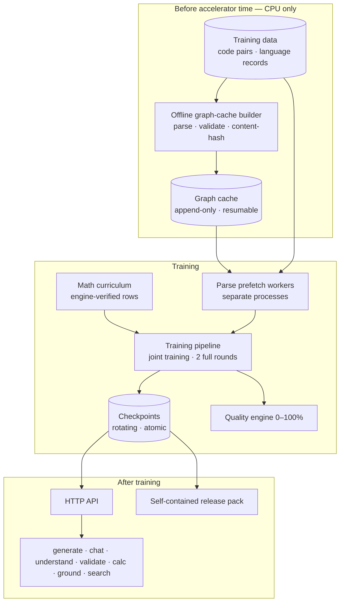
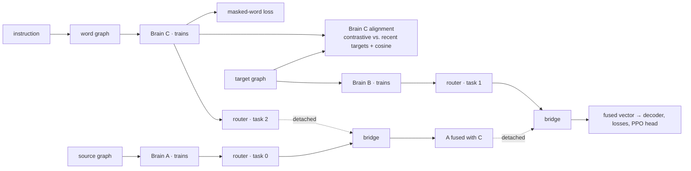
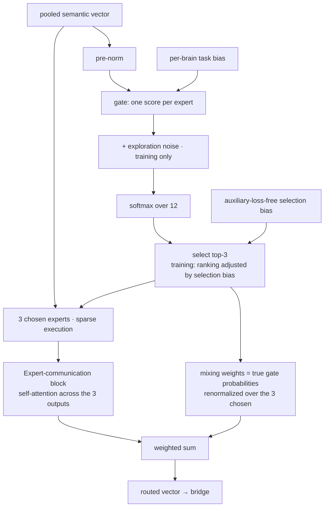
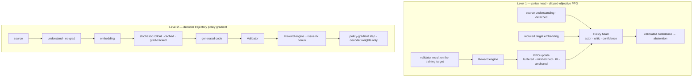

# CodeMind — Architecture Overview

**A self-hosted code-intelligence system that reads and writes software in any programming language and communicates in any human language. It represents code and text as typed graphs, understands them with a chain of three specialized graph-transformer "brains", and generates through two purpose-built decoders — one structural for code, one free-form for prose — under a validator-driven reinforcement-learning loop and a built-in deterministic math, physics and electronics core.**

> **Scope and confidentiality.** This document explains *what each part does, how the parts fit together, and why they were built that way*. It deliberately contains no source excerpts, no loss or reward coefficients, no tuned thresholds or learning rates, no regular expressions, no training data and no model weights. Architecture-scale figures (depths, widths, expert counts, context lengths) are included because they are necessary to understand the design.
>
> **Status.** The system has been **trial-trained at reduced scale and verified component by component; it has not yet been trained at full scale.** Section 22 lists exactly what was measured and, just as importantly, what was not. No claim in this document is a benchmark claim.

**Repository:** [FWKTechnologies/CodeMind-Code-Intelligence](https://github.com/FWKTechnologies/CodeMind-Code-Intelligence/tree/main) · [LICENSE](https://github.com/FWKTechnologies/CodeMind-Code-Intelligence/tree/main/LICENSE) · [README](https://github.com/FWKTechnologies/CodeMind-Code-Intelligence/tree/main/README.md). The repository is the source of truth for license terms.

---

## Contents

**Part I — The system as a whole**
1. [Executive summary](#1-executive-summary)
2. [Design principles](#2-design-principles)
3. [The system at a glance](#3-the-system-at-a-glance)
4. [Scale, memory and data-driven sizing](#4-scale-memory-and-data-driven-sizing)

**Part II — Understanding**
5. [Universal language support](#5-universal-language-support)
6. [The graph schema](#6-the-graph-schema)
7. [Encoding: graphs to tensors](#7-encoding-graphs-to-tensors)
8. [The HGT layer and brain](#8-the-hgt-layer-and-brain)
9. [The three-brain chain and joint training](#9-the-three-brain-chain-and-joint-training)
10. [Mixture-of-experts routing](#10-mixture-of-experts-routing)
11. [The anti-forget bridge](#11-the-anti-forget-bridge)
12. [Graph collapsing](#12-graph-collapsing)

**Part III — Generation, judgement and learning**
13. [Generation](#13-generation)
14. [Validation and quality scoring](#14-validation-and-quality-scoring)
15. [Supervised objectives](#15-supervised-objectives)
16. [Reinforcement learning](#16-reinforcement-learning)

**Part IV — Built-in services**
17. [Math, physics and engineering core](#17-math-physics-and-engineering-core)
18. [Linguistic safety](#18-linguistic-safety)
19. [Web search](#19-web-search)

**Part V — Running the system**
20. [Data pipeline and offline graph cache](#20-data-pipeline-and-offline-graph-cache)
21. [Training runtime, memory and reliability](#21-training-runtime-memory-and-reliability)
22. [Verification and trial results](#22-verification-and-trial-results)
23. [Serving, CLI, packaging and security](#23-serving-cli-packaging-and-security)

**Part VI — Reference**
24. [Engineering notes: real problems, real fixes](#24-engineering-notes-real-problems-real-fixes)
25. [Key parameters](#25-key-parameters)
26. [Scope, limits and open questions](#26-scope-limits-and-open-questions)
27. [Component index](#27-component-index)

---

# Part I — The system as a whole

## 1. Executive summary

CodeMind represents source code as a **typed, heterogeneous graph** — functions, calls, statements, variables, control flow, data flow, dependencies — instead of a flat token sequence, and reasons over that graph with **Heterogeneous Graph Transformer (HGT)** stacks. Human language goes through the *same* machinery: a sentence becomes a graph of word nodes and is read by the same kind of stack. One graph vocabulary carries everything, whether the input is code in any language or text in any language.

**The core is a chain of three brains** — instances of one HGT class that differ only in depth:

- **Brain C** (15 layers) reads the human-language instruction.
- **Brain A** (8 layers) reads the code graph, informed by what Brain C understood.
- **Brain B** (7 layers) is the edit-oriented brain, informed by what Brain A understood.

They are joined by **one learned anti-forget bridge** and steered by **one mixture-of-experts router** (12 experts, 3 active per decision) that keeps a separate routing preference for each brain. A causal transformer, the **code decoder** (9 layers, rotary positions, up to **180,000 positions** of context), turns the fused understanding into a sequence of *structural actions* from a closed vocabulary, and a renderer turns those actions back into source text. A second, free-form **text decoder** (8 layers) writes prose in any language, token by token.

**Learning has three layers**, run as **joint training** — all three brains, the bridge, the router and both decoders train together, for **two full rounds over all connected data**:

1. **Supervised objectives** align instructions, code understanding and code targets, and teach the decoders by teacher forcing.
2. **A two-level reinforcement-learning system.** *Level 1* is a clipped-objective PPO head that learns calibrated confidence, so the model knows when to abstain. *Level 2* is a trajectory-level policy gradient on the decoder driven by a multi-layer automated validator, which teaches the decoder to produce code that actually validates — something cross-entropy cannot teach.
3. **A math and physics core inside the architecture.** A deterministic engine (exact arithmetic, SI units with dimensional analysis, 121 verified physics, electronics and engineering formulas) feeds the model's representations, supplies self-computed labels, contributes a verified problem curriculum to the same training stream, scores generated claims in the RL reward, and corrects wrong arithmetic at generation time.

**Around the core** sit a policy-driven linguistic-safety module, a web-search subsystem engineered never to hang, leak or trust what it fetches, and a resumable offline graph-cache builder so that accelerator time is never spent on parsing.

**Scale.** The architecture arithmetic gives **about 6.10 billion parameters**, inside a 6.0–6.2 B budget, designed to train on **a single high-memory accelerator (≈180 GB class)**. Model size is not a fixed constant: it is cross-checked against the *measured* size of the training data, and Brain C's depth is the knob that moves it.

---

## 2. Design principles

| Principle | What it means in practice |
|---|---|
| **Nothing is locked to a language** | Any programming language gets a real structural graph — through a grammar when one exists, through a language-agnostic structural reader otherwise. Any human language is detected, and languages never seen before are discovered and clustered rather than rejected. |
| **One schema, one set of weights** | A single node/relation vocabulary and a single family of models serve every language. There are no per-language models. |
| **Structure over text** | The model reasons over graphs; it generates structural actions. Syntax is a property of the graph and the validator, not a hope. |
| **Correctness is measured, not assumed** | An automated validator judges every output, and that judgement is a training signal, not just a filter. |
| **Honest uncertainty** | The system can *abstain* instead of guessing, and it has a calibrated confidence head to decide when. |
| **Exact where exactness is possible** | Arithmetic and physics are computed by a deterministic engine, not by a network. |
| **Policy belongs to the operator** | Safety categories, weights and actions come from a policy the operator supplies; service limits live in runtime configuration, not in the weights. |
| **Single-accelerator, mixed precision** | Training is built around one accelerator and BF16 (FP16 with loss scaling as the fallback); there is no multi-device machinery to fail. |
| **Prove it before paying for it** | Parsing, caching, validation and a reduced-scale end-to-end run are done first so that expensive training time is not spent finding bugs. |

---

## 3. The system at a glance

### 3.1 Lifecycle

### 3.2 One request, end to end

```mermaid
flowchart LR
    T[Instruction text] --> NLD[Language detector] --> LG[Word graph] --> BC[Brain C]
    S[Source code] --> P[Parser<br/>grammar or universal reader] --> CPG[Code graph<br/>AST · CFG · DFG · PDG · calls · SDG] --> COL[Graph collapser<br/>≤ 20,480 nodes] --> BA[Brain A]
    BC --> R1[Router · task 2] --> BR1[Anti-forget bridge]
    BR1 --> BA
    BA --> R2[Router · task 0] --> BR2[Anti-forget bridge]
    BR2 --> BB[Brain B]
    BB --> R3[Router · task 1]
    R3 --> MA[Math adapter<br/>only when quantities present]
    MA --> DEC[Code decoder + action codec]
    DEC --> MG[Math guard]
    MG --> REP[Structural repair]
    REP --> V[Validator] --> AB{valid and honest?}
    AB -- yes --> OUT[Answer]
    AB -- no --> ESC[Escalate: re-rank candidates] --> V2[Validator] --> AB2{valid?}
    AB2 -- yes --> OUT
    AB2 -- no --> ABS[Abstain / report]
```

### 3.3 The five source files

| File | Role |
|---|---|
| `CodeMind.py` | The core: math engine, language registry and parsers, graph schema, encoder, HGT layers and brains, both decoders and the action codec, validator and quality engine, PPO and reward engine, losses, data connector, training pipeline, sizing advisor, runtime configuration, HTTP API, CLI, release packaging |
| `codemind_brain_dual.py` | Multi-brain machinery: router, experts and expert-communication block, anti-forget bridge, graph collapser, the orchestrator that runs the brains, persistence |
| `build_graph_cache.py` | Offline, CPU-only builder of parsed graphs and validator results |
| `search.py` | Web search and page retrieval (deliberately neutral) |
| `linguistic_safety.py` | Policy-driven linguistic safety, PII and secret detection |

### 3.4 What CodeMind is — and is not

| It is… | It is not… |
|---|---|
| A graph-based system: code becomes a typed heterogeneous graph; text becomes a word graph | A large language model whose primary unit is a flat token sequence |
| Three stacks of **one** HGT class (language, understand, edit) joined by a learned bridge | One shared stack doing everything, or three unrelated models |
| A system whose expert mixture operates on **one pooled vector per graph** | A token-level sparse MoE inside the transformer layers |
| Trained by supervised objectives **and** reinforcement learning against an automated validator | Trained purely by next-token prediction |
| A model where **RL shapes the decoder and the confidence head** while supervised losses shape the brains | A system where policy-gradient signal reaches every layer |
| A code generator restricted to structurally valid actions from a closed vocabulary | A free-form sampler over open text (that is the *text* decoder's job, and it is separate) |
| Language-agnostic: one schema and one set of weights for all programming and human languages | A family of per-language models |
| Numerically grounded: an exact engine is *inside* the learning loop | A model that guesses numbers and hopes |
| Honest about uncertainty: it can **abstain** | A system that always answers |

---

## 4. Scale, memory and data-driven sizing

### 4.1 Parameter budget (≈ 6.1 B)

Computed analytically from the configuration by the same formulas the code uses; hidden width is 1,664 throughout. At start-up the system logs the **real** count (every module, shared weights counted once) next to this estimate.

| Component | Structure | ≈ Parameters |
|---|---|---|
| Brain C | 15 HGT layers | 2.57 B |
| Brain A | 8 HGT layers | 1.39 B |
| Brain B | 7 HGT layers | 1.23 B |
| Code decoder | 9 layers, 16 heads, ≈ 14 K structural vocabulary, 8 memory-prefix tokens | 0.35 B |
| Text decoder | 8 layers, 16 heads, 32 K byte-level BPE vocabulary, 8 memory-prefix tokens | 0.34 B |
| Router | 12 experts + expert-communication block | 0.16 B |
| Anti-forget bridge | gated fusion | 0.02 B |
| Encoder, fusion, policy head, small heads, math core | hashed token encoder (with open language slots), semantic fusion, PPO head, auxiliary heads, math adapter + head | ≈ 0.06 B |
| **Total** | | **≈ 6.10 B** |

One HGT layer is ≈ 168 M parameters, almost all of it the **per-node-type** query/key/value/output projections; the per-relation attention tensors add only ≈ 1.3 M per layer. Depth is therefore the main size lever: each layer costs ≈ 0.17 B, and Brain C — the newest and least proven brain — is the one adjusted first.

### 4.2 Memory

Weights, gradients and optimizer state cost **≈ 16 bytes per parameter** — about **98 GB** at 6.10 B. On a ≈ 180 GB accelerator that leaves roughly **80 GB** for everything that scales with the input: decoder activations at long context, HGT activations over graphs of up to 20,480 nodes, router and PPO buffers, and allocator overhead. Several design decisions exist specifically to live inside that margin:

- **Linear-memory attention** in the decoder (fused kernel): memory grows linearly with context, compute stays quadratic.
- **Chunked, checkpointed output loss.** At a 150,000-position training length a naïve logits tensor would be tens of gigabytes. The loss is computed in chunks, each recomputed in the backward pass, so the full logits tensor never exists.
- **Gradient checkpointing** in the brains and decoders, with a wrapper that guarantees a recomputed layer runs in exactly the mode (train/eval) of its original forward pass.
- **A proactive VRAM governor** (Section 21.3) that shrinks the micro-batch *before* an out-of-memory error.
- **A preflight memory report** that estimates static weights plus optimizer state, graph activations and decoder activations at the training context length, flags real out-of-memory risk, and names the first thing to reduce.

In the default joint schedule nothing is frozen, so the full static budget is resident throughout. The optional sequential schedule can release Brain C's optimizer state after its phase (≈ 35 GB back).

### 4.3 Data-driven sizing

Model size follows data size. Two functions tie them together: an analytic parameter counter, and an *advisor* that compares the count with what the measured data can support and reports a verdict plus a recommended Brain C depth. The reasoning is a Chinchilla-style cross-check with three explicit, adjustable assumptions — source code averages about 3.5 bytes per token, the data counts as two effective passes, and a compute-optimal model wants about 20 tokens per parameter.

| Unique training data | Effective tokens | Compute-optimal size (20 tokens/param) |
|---|---|---|
| 100 GB | 57 B | ≈ 2.9 B |
| 140 GB | 80 B | ≈ 4.0 B |
| 210 GB | 120 B | ≈ 6.0 B |
| 280 GB | 160 B | ≈ 8.0 B |

For the current corpus (≈ 275–285 GB) the rule supports roughly 8 B parameters. The configuration deliberately stays below that, inside a 6.0–6.2 B budget set by memory headroom, which puts the 6.10 B model at **≈ 26 effective tokens per parameter** — comfortably in the "appropriate" band (the advisor's verdicts are *too little data* below 10, *appropriate* from 10 to 60, *model smaller than the data supports* above 60). Because CodeMind consumes graphs rather than token sequences, the rule is an *anchor, not a law*. The advisor runs every time data is connected; it **reports but never rebuilds**, because changing depth after training would make checkpoints unloadable.

### 4.4 The training plan from real data

- **Two full rounds.** Each round is one complete pass over *all* connected data — both code and language files — and in every round **all brains train together**. Sample-exposures are twice the connected record count, and the learning-rate schedule is computed against that real total.
- **Almost no data is held out.** In streaming mode the validation hold-out is capped at 0.2 %, selected by a stable hash so it never leaks into training; a small validation set is read from it so quality tracking reports a real number.
- **Rounds are complete.** A round ends when the data stream is exhausted, not when a counter is reached; mastered-sample skipping is off in joint rounds.
- **Resumable at sample granularity.** Completed rounds are skipped on resume and the interrupted round is shortened by the number of samples already trained.
- Data of any size produces a correct plan — tens of thousands of samples or a hundred million.

---

# Part II — Understanding

## 5. Universal language support

### 5.1 Programming languages

Support is layered so that **no language is ever "unsupported"**:

1. **Python** uses a native walk of the standard-library `ast`, building every layer — syntax, control flow, data flow, program dependence, calls, system dependence — with real semantic analysis (definition–use chains, control dependence).
2. **Languages with a grammar** (looked up dynamically by name, not from a fixed list) use a tree-sitter-backed builder.
3. **Everything else** — including languages, dialects and DSLs the system has never seen — goes to the **universal structural reader**, described below. It still produces the full layered schema.

A registry of **68 named languages** (general-purpose, data and query, web and UI, infrastructure and build, systems) supplies hints such as family and comment syntax. Crucially it is *not a gate*: the registry also reserves **1,024 open hash slots**, so a language that is not in the table is registered ad hoc, gets its own embedding slot, and is processed like any other. Code that Python's parser rejects is not discarded either; it falls through to the universal reader.

#### The universal structural reader

Most programming languages share a skeleton: comments, strings, nested brackets, blocks opened by braces or indentation, block headers (function, condition, loop), calls of the form `name(...)`, and assignments. The universal reader recovers this skeleton **from the source itself**, with no per-language grammar:

- **Lexical masking.** Comments and string contents are masked (positions preserved) so that structure is never inferred from text inside a comment or a string. The line-comment marker is *learned from the file's own evidence*, with the registry's hint used only when the evidence does not contradict it; block-comment syntaxes are detected from what the file actually contains; multi-line strings are tracked; languages where an apostrophe is not a string delimiter are handled.
- **Learned keywords.** Which words introduce control flow and which introduce definitions is learned from statistics of the file, not looked up in a keyword table.
- **Scoped definition–use.** Scopes follow brace depth or indentation, whichever the file uses. Variables are linked to their definitions within scope, and calls are linked to functions defined *later* in the file.
- **Documentation retained.** Comments are attached to the construct they describe instead of being thrown away.
- **Universal syntax checking.** Bracket balance (unclosed, unmatched, mismatched) and unterminated block comments are detected for any language, outside comments and strings.

The reader is a *fallback that is stronger than raw lines*, not a replacement for real grammars: where a grammar or `ast` exists, it is used first.

#### Self-repair

When generated code fails the universal structure check, a deterministic repair step closes unbalanced brackets and unterminated block comments *before* the validator is asked to judge — so cheap structural slips cost nothing. If the result is still rejected, generation escalates (Section 13.3).

### 5.2 Polyglot projects

`PolyglotProject` and `PolyglotLinker` merge the graphs of several languages into **one** graph and add cross-language edges: API routes matched to HTTP clients, `fetch`/`require`/`import` links, shared configuration wiring, same-family hints. `MultiProjectConnector` makes this work on real repositories: it indexes files, groups them into memory-budgeted batches, parses batch by batch, merges through the linker, and collapses before the HGT sees the result, so projects of thousands of files never need to be resident at once. Web code is treated like any other code: JSX and its relatives are read through the grammar or universal path, and no browser-markup linters or validators are involved.

### 5.3 Human languages

Brain C has no tokenizer of its own. `build_language_graph` turns text in **any** human language into a graph of `word` nodes joined by sequence and proximity edges, and Brain C reads it with exactly the same encoder and HGT class as Brains A and B.

`NLDetector` identifies language and script **without a fixed language list**. It combines script analysis, function-word evidence and learned character-trigram profiles, returns a language code, a script and a confidence, and reports `und-<Script>` when the script is recognized but the language is not. Languages that are *not* recognized are not collapsed into "unknown": their trigram profiles are **clustered online** into discovered groups (`x-<script>-N`, bounded in number), so the same unfamiliar language is recognized consistently from sample to sample and can be balanced in the training order like any other. The detector is thread-safe, learns only from labels it sees in real data, and is bounded so it cannot grow without limit. It also picks the right safety rules per message and powers the `langs` command that reports which human languages the training data actually contains.

---

## 6. The graph schema

**15 node types**

| Group | Node types | Meaning |
|---|---|---|
| Program layers | `ast`, `cfg`, `dfg`, `pdg`, `call`, `sdg` | Syntax, control flow, data flow, program dependence, call graph, system dependence |
| Code structure | `func`, `block`, `expr`, `stmt`, `token` | Functions, blocks, expressions, statements, lexical tokens |
| Polyglot markers | `lang`, `api`, `config` | Language hosts, API bindings, configuration wiring |
| Human language | `word` | A word in a natural-language graph (Brain C) |

**31 typed relations**, in families: structure (syntax child, next sibling, contains, belongs-to); control flow (flow and branch edges); data and dependence (data flow, control and data dependence); calls (invokes, returns, inter-procedural system-dependence edges, call-site wrapping); cross-layer mapping (`maps_to` links so information can cross layers); polyglot (cross-language function links, hosting, API binding, configuration wiring, language same-family and co-existence); containment refinements; and language (`next`, `near` between words).

Every relation has **its own learned attention weights** inside the HGT. Because the model learns a different transformation per relation, a *call* edge and a *data-flow* edge are attended to differently — the concrete mechanism behind "typed" reasoning. The schema is the same whichever builder produced the graph, which is what lets one set of weights serve every language.

---

## 7. Encoding: graphs to tensors

**`TokenEfficientEncoder`** turns a node's text into a vector with **no fitted vocabulary**. Each token contributes a hashed-identity embedding and a bucket embedding; a projection combines them; **language** and **language-family** embeddings (sized by the *open* slot space, so ad-hoc languages have a place) and a **node-type** embedding are mixed in through small learned gates. Per-position embeddings and an attention pooling with a learnable query add word-order sensitivity through a gate that starts almost closed, so the encoder begins near a plain average and learns how much order matters. Being hash-based, it needs no fitting and works for every script — which is exactly why Brain C needs no tokenizer. Hash results are memoized and whole batches of nodes are embedded in a single tensor operation.

**`GraphTensorizer`** converts a graph into per-type feature tensors and per-relation edge-index tensors, and can pack many graphs into one **block-diagonal batch** with per-graph index vectors so pooling stays per graph. **`SemanticFusion`** combines the token-efficient encoding with the HGT output.

---

## 8. The HGT layer and brain

### 8.1 `HGTLayer`

The layer implements type-specialized attention (Hu et al., WWW 2020):

- Every **node type** has its own query, key, value and output projections.
- Every **relation** — (source type, relation, destination type) — has its own learned tensor **per attention head**; a neighbor's key is transformed through that relation's tensor before scoring.
- Attention is normalized **per destination node** across all incoming edges, aggregated per destination, combined with a skip connection, passed through dropout and layer-normalized **per node type**.
- Key and value projections depend only on the source type, so each is computed **once per forward pass** and cached.
- The per-destination softmax is **fully vectorized** with scatter reductions.

### 8.2 `HGTBrain`

A brain is a per-type input projection, a stack of HGT layers (gradient-checkpointed during training), **learnable weighted pooling** across node types (initialized from a prior that favors functions, calls and data flow over raw syntax, but trained), and a semantic head. Each brain carries task heads on its pooled vector: *understand*, *generate*, a *validity* scalar, and a **multi-label issue head** over six categories (syntax, security, safety, undefined variable, unused import, other) trained from what the validator actually found — so `understand()` can return a per-category self-check rather than one number.

All three brains share the same width (1,664) and head count (64 heads of 26 dimensions); they differ only in depth.

---

## 9. The three-brain chain and joint training

### 9.1 Roles

| Brain | Depth | Reads | Job | Router task |
|---|---|---|---|---|
| **C** | 15 layers | Human-language graph (the instruction) | Understand what is being asked, in any language | 2 |
| **A** | 8 layers | Code graph (the source) | Understand code structure, informed by C | 0 |
| **B** | 7 layers | Code graph (the target side of an edit) | Edit-oriented representation, informed by A | 1 |

Brain C is deepest because its job is broadest — every human language rather than one code schema. Brain B is one layer shallower than A by intent, close enough that the anti-forget machinery stays balanced.

### 9.2 Joint training (default)

In a joint step **all three brains train together on the same sample**, with the same router and bridge:

- **Why joint.** A sequential schedule trains each brain once and never returns to it — the classic recipe for forgetting. In joint training every brain sees all of the data in every round, and nothing needs protecting from a later phase because there is no later phase.
- **Brain C needs its own signal.** In the chain, Brain C reaches Brain A through a *detached* fusion, so the main loss does not train it. Joint steps therefore add an explicit **alignment term** (a contrastive objective against a bank of recent target embeddings plus a cosine term; the target side is detached, so it trains Brain C alone) together with a masked-word objective. The alignment is weighted **stronger in round 1 and relaxed in round 2**, so language understanding is learned first and then maintained while code skills and generation take over.
- **Masked words in only some steps**, because hiding words would also feed a masked prompt into Brain A's conditioning.
- **Anti-forgetting across rounds.** At the end of each round the bridge's anchor is refreshed and blended with its history, so the next round is penalized for drifting from what the previous one learned (Section 11).
- **Decoder RL waits for a decoder worth rolling out.** Rollouts from a barely trained decoder are mostly broken, so decoder RL runs several times less often in round 1 and at its normal cadence in the final round.
- **The language file trains Brain C directly.** Language-only records are trained in separate **language micro-batches** through Brain C alone, with masked-word prediction and — for records with a response or translation — a **symmetric in-batch contrastive alignment** between text and response (the other pairs in the batch are the negatives; for translation pairs this aligns the two languages). A plain-text record is split at a sentence boundary into prompt and continuation, so it yields an alignment pair too. A language micro-batch is a full gradient-accumulation slot, so the optimizer and schedule treat both kinds of data uniformly. A fraction of language micro-batches also trains the **text decoder** from the Brain C embeddings already computed.
- **Decoder training runs before the main backward pass**, from the embedding already in hand, so the shared graph is still intact for the brain-side loss.
- A **round-end checkpoint** is written after every round in addition to periodic ones.

### 9.3 Sequential schedule (optional)

The three-phase alternative (C → A → B, with Brain C frozen and its optimizer state released afterwards) remains available for experiments or for starting a smaller two-brain model. In that mode a quality-target stop at the end of one phase does not cancel the remaining phases.

### 9.4 Train mode versus inference mode

Each brain forward — and the shared router — sets its mode from **whether gradients are enabled**. With gradients: training mode (dropout, router noise, expert statistics updating, checkpointing). Without: evaluation mode — deterministic, no dropout, no router noise, and **no mutation of any persistent state**. This matters because the experts' running averages are saved in checkpoints; inference must never contaminate the statistics that training later resumes from.

### 9.5 Brain C's language-specific objectives

- **Masked-word feature objective.** A fraction of a prompt's words are hidden behind a mask vector, and Brain C must recover the *input features* of the hidden words from context. It needs no per-language vocabulary and reuses the main forward pass.
- **`LossBalancer`.** Keeps the language term at a target *share* of the total by adapting its weight to measured loss sizes (smoothed, bounded, with warm-up).
- **`AppropriatenessHead`.** An optional, off-by-default classifier on Brain C's embedding predicting two independent axes — *severity* and *casualness* (register) — trained only when the operator supplies a labelled file.

---

## 10. Mixture-of-experts routing

### 10.1 What kind of MoE this is

The mixture-of-experts is a **representation mixer applied once per graph, after a brain has pooled its output**. It is *not* a sparse feed-forward layer inside the transformer, and it does not route per node or per token. A brain produces one semantic vector; the router chooses **3 of 12** experts for it; the chosen experts transform it; the mixed result **replaces** the brain's vector on its way to the bridge and decoder. **One router serves all three brains.** It is a small part of the model (≈ 0.16 B of ≈ 6.1 B parameters) that adds task-conditioned transformations on top of the brains rather than being where capacity lives.

### 10.2 Routing, step by step

1. **Pool and normalize** the input to one vector.
2. **Score with task conditioning.** A linear gate scores the 12 experts and a **learned per-brain bias row** is added, so Brains C, A and B can learn *different* expert preferences. The table starts at zero, so all three begin identically and diverge only as training separates them.
3. **Explore** with small Gaussian noise in training.
4. **Select** the top 3. In training the ranking includes a small balancing bias; at evaluation it follows the gate alone.
5. **Mix** with the **true gate probabilities** of the chosen experts (the selection bias never enters the output) renormalized to sum to one.
6. **Execute sparsely, let the experts talk, combine.** Only the 3 chosen experts run.

### 10.3 Experts and expert communication

Each expert is a pre-normalized two-layer feed-forward network (≈ 11 M parameters) carrying a **temporal ensemble** — a slowly moving average of its own recent outputs that damps abrupt batch-to-batch swings; the averages are checkpointed. The **expert-communication block** treats the 3 selected outputs as a tiny sequence whose tokens are experts: one self-attention layer plus a small feed-forward layer, each behind a **gated residual that starts almost closed**, so early behavior stays near a plain weighted sum and the block opens only if training finds the conversation useful.

### 10.4 Four mechanisms against expert collapse

1. **Load-balance loss** built from *measured* expert load (a running average across calls), so gradient pushes probability off over-loaded experts without fighting sparse specialization.
2. **Router z-loss**, penalizing large gate logits so the softmax cannot saturate.
3. **Importance loss**, because an expert chosen rarely but always with a large weight is invisible to load alone.
4. **Auxiliary-loss-free selection bias**, a small bounded nudge that favors under-used experts at *selection* time only, with no gradient and no extra loss against the main objective.

Auxiliary losses from **every** router call in a step are averaged and added once per step, so every task and every graph in a batch receives balancing gradient. Each routing call reports entropy, maximum load (near 1/12 is balanced, near 1.0 is collapse) and chosen experts into the training log so collapse is visible early.

### 10.5 Execution

The router runs eagerly by design (expert selection depends on tensor values, which would force compiler graph breaks). The bridge — pure matrix arithmetic — is compiled instead, with a permanent eager fallback if compilation fails on first real use.

---

## 11. The anti-forget bridge

One `AntiForgetBridge` joins **both** hand-offs (C → A and A → B) and does three jobs:

1. **Gated fusion.** Upstream and downstream vectors are projected; a learned gate decides per sample how much the result leans on the upstream brain versus a joint projection of both.
2. **An EWC-lite penalty.** A diagonal, Fisher-style approximation penalizes the upstream embedding for drifting away from a stored anchor, weighted per dimension by how much each dimension mattered — scaled and capped relative to the main loss so it can regularize but never dominate.
3. **A bridge reward.** The cosine similarity between the upstream embedding and the fused output, smoothed, tells whether upstream knowledge survived fusion; it feeds the feedback-learning reward.

Anchors are maintained **online-EWC style**: updated from recent replay embeddings and **blended with exponential decay** rather than overwritten, so after several rounds the anchor still carries traces of earlier learning.

---

## 12. Graph collapsing

`GraphCollapser` shrinks a graph toward the node budget — **20,480 nodes** in training and serving — before the HGT sees it; graphs already under budget pass through untouched. Stages: (1) exact-duplicate merge in linear time, except for structurally load-bearing types; (2) edge remap and de-duplication; (3) **linear-chain bypass** of low-importance nodes with one predecessor and one successor, never touching anchor types (function, call, data-flow, system-dependence) or entry-point-like names, with dangling edges cleaned up; (4) **importance trimming** only if still over budget, never cutting entry, call or data-flow structure. `CollapseStats` makes each step inspectable. A larger budget loses less structure at roughly *linear* extra memory — unlike decoder context, which costs quadratic compute — which is why the budget was raised.

---

# Part III — Generation, judgement and learning

## 13. Generation

### 13.1 The action codec

`GraphActionCodec` walks a target program in source order and emits **structural actions** from a **closed vocabulary**. Each line costs one *type* action and, for text lines, a *label*:

- **Types:** `func` and `stmt`; **`comment`** (a whole comment line, marker included, in whatever syntax the file uses — line comments and every line of a block comment alike); **`blank`**; and `INDENT`/`DEDENT` markers that carry block structure.
- **Whole-line vocabulary.** The ≈ 8,000 most frequent labels in the corpus are single ids, so a hit costs two actions.
- **Sub-line pieces.** Any other line is spelled from a learned byte-pair vocabulary (6,000 merges plus single characters) — about three characters per action, comparable to an LLM's tokens — instead of one character at a time.
- **Whole lines, not stubs.** The understanding graph truncates long labels; the codec restores the full line so nothing is silently cut.
- **Call nodes are not generated**, because the statement line already contains the call.

`GraphRenderer` turns an action sequence back into formatted source per language family. No language is special-cased on this path, so there is no guarantee-by-construction of syntax validity as a language's own unparser would give; validity comes from the validator, structural repair, the RL loop and abstention. Generation always uses the *generic* builder for target code — for every language including Python — so all languages are encoded at the same granularity and one decoder learns from all of them, while understanding keeps the richer builders.

### 13.2 The code decoder

`CodeDecoder` is a decoder-only transformer (9 layers, 16 heads) in which every step depends on what has actually been generated. The fused brain embedding is injected as **eight memory-prefix tokens** that every position can attend to, so generation is conditioned on the graph itself rather than on metadata in a prompt. Output embedding and projection share weights.

- **Positions:** rotary embeddings, with minimal automatic scaling instead of failure if inference meets an untrained length.
- **Long context:** a **180,000-position ceiling** and a **150,000-position training length**, reached through a **length curriculum** (training starts near a few thousand positions and rises over the first quarter of the run), a fraction of deliberately long samples, and positional-offset augmentation.
- **Structural ceiling vs. service limit.** The position ceiling belongs to the weights; operator-facing output limits live in separate runtime configuration and default to unlimited.
- **Incremental decoding** with cached keys and values; at the ceiling the window slides and the cache is rebuilt with slack, so the rebuild is amortized over many steps.
- **Loss without the giant tensor.** Training loss is computed in recomputed chunks (Section 4.2).

### 13.3 Decoding behavior

The production decoder is **deterministic greedy** with an anti-cycle guard that triggers only on genuine runaway repetition (ordinary code legitimately repeats closing braces and directives). Greedy decoding gives repeatable answers; for callers that want to spend more compute, CodeMind provides:

- **`generate_rl`** — a stochastic, gradient-tracking sampler used by reinforcement learning.
- **`generate_best_of`** — diverse candidates re-ranked by the validator.
- **Math guard** — before validation, wrong "expression = value" claims are corrected by the deterministic engine (Section 17.6).
- **Structural repair** — deterministic closing of unbalanced brackets and unterminated block comments (Section 5.1).
- **Escalation.** The deterministic answer is the fast path and stays the answer whenever the validator accepts it. Only if the validator rejects it (invalid or unsafe, but not "cheating", which abstention handles) does `generate()` spend extra compute: a few stochastic candidates are sampled and re-ranked by the same validator, with the first answer kept as candidate 0 so the result can tie or improve but never get worse. Answers that pass pay nothing.
- **Abstention.** If validation says the output is unsafe to ship (a cheating pattern, hollow code, demonstrably wrong behavior, too many errors), `generate()` abstains unless forced. Abstention text is language-neutral, written in the comment syntax of the requested language.
- **Accelerator-side top-k.** Per-step candidate selection happens on the accelerator and transfers only a few dozen (id, logit) pairs; the decision rule is unchanged except for a full-path fallback when every candidate would extend a cycle.

### 13.4 Free-form text generation

Code has structure to exploit; **prose has none worth constraining**. A second decoder of the same transformer class — **8 layers, its own 32,000-token vocabulary, its own optimizer** — writes text token by token with no grammar mask, in any language and any form. It is separate from the code decoder, so neither can degrade the other.

- **Tokenizer.** A **byte-level BPE**: the base alphabet is the 256 byte values, so every string in any script is representable with no unknown token; merges are learned from the language data itself.
- **What it sees.** `BOS · prompt · SEP · answer · EOS`, with loss on the answer tokens only. It reads the **prompt itself** — nothing is squeezed through a pooled vector — plus Brain C's understanding of the prompt as 8 memory-prefix tokens, so meaning, register and cross-lingual structure learned by Brain C reach the generator.
- **How it learns.** Inside the language micro-batches, by teacher forcing; a plain-text record is split at a sentence boundary into prompt and continuation, so every text in every language teaches fluency. A small fixed fraction of this loss reaches Brain C through the same gradient-limited bridge as the code decoder.
- **Generating.** Nucleus sampling with a repetition penalty. A `system` string can steer tone and directness. An answer that collapsed into a loop or came out empty is re-sampled (slightly hotter, with a stricter penalty) and the least degenerate attempt is returned with its degeneration score.
- **One entry point.** `respond` / `/chat` with `mode = auto` routes a request that asks for code to the structural decoder and everything else to the text decoder; `text` or `code` overrides.

How good the answers are — vocabulary, register, directness, whether the model says plainly what it does not know — is determined by the language data and training, not hard-coded. See Section 26.

### 13.5 Large code

`LargeCodeHandler` edits or generates code from 10,000 to 500,000+ lines by chunking at function and class boundaries, carrying a **semantic context embedding** from chunk to chunk in addition to textual tail context, and stitching outputs with indentation preserved. It streams, so the whole file is never resident.

---

## 14. Validation and quality scoring

`CodeValidator` layers independent checks, combined so one failure cannot be hidden by strength elsewhere:

1. **`StaticAnalyzer`** — syntax, undefined names and unused imports where a real parser exists; for any other language, the universal structure check; plus a (non-blocking) **safety** check for dangerous constructs.
2. **`IntegrityChecker`** — catches *cheating*: hollow stubs, prompt echoes, prose mixed with code.
3. **`CodePurityChecker`** — how much of the output is actually code.
4. **Optional execution** — in an isolated subprocess, skipped when a dangerous pattern was found; with a reference, a behavior comparison checks the code is behaviorally right, not merely that it ran.
5. **Structural similarity** — against a reference graph, a data-flow / control-flow comparison that works **without execution**, for any language.
6. **Project validation** — `validate_project` scores a polyglot project file by file against each file's own rules.

`ValidationResult` carries validity, a score in [-1, 1], issues, feedback, execution status, integrity, safety, purity, a cheating flag, abstain advice and, when evidence exists, a logic score and behavior match.

**`QualityEngine`** turns this into a 0–100 **model quality** score along six dimensions — syntax, static checks, graph coverage, semantic similarity, execution and *mastery* — deliberately multi-dimensional so a low loss with hollow outputs does not look like quality.

---

## 15. Supervised objectives

`CodeMindLoss` combines six objectives: **contrastive alignment** between source and target embeddings (a small bank of recent targets supplies genuine negatives, since a single pair per step would make the similarity matrix trivial); a **semantic** objective on the fused understanding; **validity** prediction against the validator; a **graph-structure** objective; a **policy** term (logging the PPO head's loss); and the **issue-type** multi-label objective trained from real validator findings. Auxiliary terms are added on top: the router's averaged balancing loss, the math head's loss for rows with engine-computed labels, and — in joint training — the Brain C alignment, masked-word and anti-forget terms and the language micro-batch loss.

**The decoders are trained inline** with the main step, from the embedding already computed, by teacher-forced cross-entropy — no second forward pass and no separate decoder stage — each with its own optimizer and schedule.

**A controlled gradient bridge.** The decoder does not see the brain's embedding raw. A *soft bridge* passes forward the full value but lets only a **small, fixed fraction** of the decoder's gradient flow back into the brains. Cutting it entirely would mean generation quality never influences understanding; letting all of it through would let the decoder's loss, whose scale differs greatly from the understanding losses, pull representations until the objectives collide. The PPO head's states, by contrast, are *fully* detached, because they are buffered across many steps and keeping their graphs alive would be enormously expensive.

Gradient accumulation gives an effective batch of roughly a thousand samples per optimizer update.

---

## 16. Reinforcement learning

### 16.1 Two levels, two jobs

| | Level 1 — policy head | Level 2 — decoder RL |
|---|---|---|
| Nature | Single-step (contextual bandit) on the pooled understanding | Sequential decisions: each generated action is a step of a genuine MDP |
| Trains | The small policy head (actor, critic, confidence) | The **decoder's own weights** |
| Reward source | Validator result on the **training target** | Validator result on the **model's own generation** |
| Purpose | **Calibrated confidence** — knowing when to abstain | **Behavior shaping** — code that validates, which cross-entropy cannot teach |
| Reaches the brains? | No (states detached) | No (`understand()` runs without gradient) |

**An honest consequence:** neither RL level sends gradient into the three brains. The brains are shaped by supervised objectives (including the small controlled fraction of decoder gradient); RL shapes the **decoder** and the **confidence head**. That is a deliberate design choice: the brains' representations stay anchored by supervised signal while RL tunes behavior where a non-differentiable outcome matters.

### 16.2 Level 2 — decoder trajectory RL

Teacher-forced cross-entropy teaches imitation of the next action. It can never teach "the code I generated on my own actually works", because that signal arrives at the end of a whole generation. Every few steps the loop performs one **rollout**: embed the source in inference mode; sample a full action sequence stochastically with the anti-cycle guard as a probability mask; a rollout that never reaches a proper end still yields a **negative reward** (a bad rollout teaches as much as a good one); otherwise the code goes through the full validator, optionally compared against the target's real behavior and data-flow structure; the reward engine scores it with the model treated as *committing* to its answer; an **issue-fix bonus** rewards removing the source's statically detected issues, tying *detection* and *repair* to one signal. The advantage is the reward minus a **running baseline** (a single smoothed scalar — no value network, no extra parameters), and the update is the trajectory's log-probability times the advantage, with clipping, through the decoder's own optimizer. Because each rollout is used for exactly one on-policy update, a clipped surrogate would add nothing; Level 2 is a baseline-subtracted policy gradient. The step is wrapped so any failure is logged once and never interrupts training.

### 16.3 Level 1 — the policy head

The head takes the pooled source understanding (after the math adapter) as **state**, a deterministic reduction of the target-code embedding onto a 1,024-way discrete space as **action**, and has three outputs: **actor**, **critic** and a **confidence head** trained to match reality rather than to be optimistic. It should be read as **a calibrated value-and-confidence learner with real PPO mechanics**, not as a generative policy. The machinery: buffered updates; reward normalization with running statistics; GAE advantages; minibatched epochs with a clipped surrogate, a clipped value loss and an annealed entropy bonus with a non-zero floor; **KL anchoring** to a frozen reference policy with an adaptive coefficient; early stopping when the policy moves too far; gradient clipping and skipping of non-finite steps; warm-up plus cosine decay; and full diagnostics (KL, clip fraction, explained variance, reward breakdown). The confidence head is what makes *"not confident, so don't answer instead of cheating"* an actual mechanism.

### 16.4 The reward engine

`CuriosityPPOReward` assembles the reward from separate, visible dimensions:

| Dimension | What it rewards or penalizes |
|---|---|
| **Correctness** | The validator's score; the largest primary term |
| **Curiosity** | Novelty of the input, scaled by integrity so novel garbage earns nothing |
| **Calibration** | Confidence should match reality; over-confidence is penalized |
| **Honesty** | Abstaining when invalid is rewarded; cheating is penalized heavily |
| **Integrity** | Real code, no hollow stubs, no prose |
| **Safety** | How safe the code is |
| **Logic** | Real behavioral or structural evidence of correctness (zero without a reference) |
| **Bridge retention** | Upstream knowledge surviving fusion (only at the extremes) |
| **Linguistic safety, register, math correctness** | *Auxiliary* — small, bounded terms |

The total is **clamped to a bounded range**; primary terms dominate by design. A separate **trust score** moves with outcomes.

### 16.5 Keeping the reward honest

A learned reward invites gaming, so: **`RewardWeightAdapter`** tunes *only* the auxiliary terms, each within a hard range, from real measurements that do not pass through the reward (validator pass rate, measured wrong-arithmetic rate, measured text severity); a **hack detector** pulls multipliers back toward neutral and raises a flag if average reward climbs while the real pass rate does not; and the weights are **not learned by gradient**, because letting the policy learn its own reward weights would teach it shortcuts. Curiosity is backed by a bounded, persisted hashed memory of patterns already seen. `ExperienceBank` tracks how well each kind of code is already mastered, with a bounded hot cache over a persistent store, so training can prioritize low-mastery samples.

---

# Part IV — Built-in services

## 17. Math, physics and engineering core

Language models do arithmetic unreliably, and a model that sees numbers only as text cannot learn what a quantity *is*. CodeMind carries a deterministic engine that needs no model and wires it into **four layers of the learning system**.

### 17.1 The engine

- **Exact arithmetic:** integers and fractions stay exact; only genuinely irrational results become floating point. Division by zero, enormous powers and unknown functions are rejected, not approximated.
- **Units and dimensions:** every value is stored in SI with a 7-component dimension vector. **69 units** and **32 physical and mathematical constants**. Mismatched dimensions are *errors* (`1 m + 1 s` is rejected). Results can be converted.
- **Safe evaluation:** a restricted expression language with no imports, attribute access or non-whitelisted calls.
- **121 formulas** across mechanics and orbits, fluids and thermodynamics, gravity/relativity/cosmology, quantum and atomic physics, optics, and electromagnetism and circuits. **Every formula carries a dimensional self-check, and every added formula also carries a reference value computed independently of its expression.**
- **Numerical tools:** exact rational linear-system solving, bracketed root finding, adaptive integration, derivatives with Richardson extrapolation, and an adaptive Runge–Kutta integrator.
- **Engineering helpers:** standard component series (E6–E192), nearest/round-up standard value, PCB trace width, decibel conversion, best standard-value resistor divider, LED series resistor.
- **Claim verification:** `verify_text` scans "expression = value" statements and recomputes them.

### 17.2 Four roles in the learning system

All uses go through one thread-safe `MathPhysicsService` that is protected against pathological input (length caps, time budgets, bounded caches).

1. **Feature — the model *sees* quantities.** A 16-dimensional bounded feature vector (math presence, claim counts and correctness, quantity counts, average sign/magnitude, average SI dimension, exactness) is turned by a small learned **adapter** into an additive correction to the instruction embedding. The adapter is harmless by construction: its last layer starts at zero and its output is gated by the "has math" feature, so text without numbers is changed by *exactly zero*.
2. **Label — the model learns from engine-computed answers.** A small head predicts the **SI dimension of the answer**, its **order of magnitude**, and **claim correctness**, with labels the engine computes itself. This teaches the relationship between a problem and the kind of answer it needs, instead of memorized answer code.
3. **Data — a verified curriculum in the same stream.** Problems from deterministic templates (energy, escape velocity, pendulum, Ohm's law, quadratics, linear systems, Lorentz factor, photon energy), in more than one human language, are mixed into the *same* training loop at a small configurable fraction.
4. **Reward and guard.** `verify_text` feeds an auxiliary reward term wherever the model produces its own output, and at generation time a conservative **math guard** corrects wrong "expression = value" statements (plain `=` with dimensionless arithmetic only; never `==`, `≈` or lines containing `assert`).

The adapter and head are under a million parameters, live in the same optimizer and checkpoint, and — because of the zero-initialized adapter — a checkpoint without them loads with no change in behavior.

### 17.3 Grounding

For any question — from CodeMind or an external model — `ground()` decides what to do about numbers and facts: **pure arithmetic or physics → the engine** (exact, instant, never touches the web); **external facts → web search**; or **nothing to ground**. It also scans the question for wrong claims and reports them as computed, not guessed. The result is a ready-to-insert context block in one format for any model.

---

## 18. Linguistic safety

The module's founding principle: **there is no fixed, built-in definition of "right" and "wrong" in the source.** Category names, weights, thresholds and actions (block, flag, ignore) come from the operator's own policy file; the shipped wordlists are only mild examples. The code provides the *mechanism*, not the judgment.

- **Policy model.** Named categories with weights, actions and optional per-category thresholds; whether neutral "deflection" replies are enabled (available in 16 languages and never quoting flagged content); which categories count as casual register; whether a sarcasm marker may lift a block (off by default).
- **Matching engineered against concrete failures.** Word-boundary matching for space-delimited scripts; substring matching plus an editable safe-words list for scripts written without spaces; a multi-pattern (Aho–Corasick) matcher compiled per language and cached; wordlist infrastructure for **44 languages**.
- **Obfuscation handling** that does not damage legitimate text: digit-for-letter substitution undone only inside mixed tokens, repeated-letter stretching, separator tricks, invisible characters, look-alike letters inside Latin words, stacked combining marks.
- **Sarcasm markers** lower a *severity score* but **cannot unblock** a message unless the policy allows it.
- **PII and secrets:** **23 detector kinds** (cloud and API key formats, tokens, private-key headers, connection strings, e-mail, phone, IP, IBAN, card, national IDs, passports, license markers, plus a high-entropy check) with **real validation** (Luhn, check digits, IBAN mod-97) rather than naive digit counting. **Reports store only masked values.**
- **Robustness.** PII is scanned once per message; redaction is linear-time; patterns are length-bounded against adversarial input; over-long messages are scanned at head and tail and flagged `scan_clipped`.
- **Where it is used.** As small auxiliary reward terms and as an API screen. With no policy configured, the module starts empty and blocks nothing; if it fails, requests pass through rather than failing. It never decides whether code is valid.

---

## 19. Web search

`search.py` provides search and page retrieval with one priority above all: **never hang, never stall the server, never leak, never trust.** It is intentionally **neutral**: the math core's `ground()` decides *whether* to call it, but its own behavior does not change for CodeMind.

- **Reliability.** A shared worker pool with a per-request deadline that returns what it has; a true total-time ceiling on every HTTP call; per-backend circuit breakers; single-flight for identical concurrent queries; a cap on concurrent searches; a cache with stale-if-error.
- **Quality.** Keyless backends (Wikipedia, StackExchange, GitHub, arXiv, PubMed) and optional keyed ones, with safe-search forced on; a curated **catalog of 589 official and reputable domains in 21 categories** with an official-only mode; freshness filters; Reciprocal Rank Fusion followed by ranking on trust, recency and a rarity-weighted relevance score; per-domain caps and mirror-title de-duplication; **deep search** that expands the query, fetches top pages, extracts the most query-relevant passage and assembles one numbered context with a rank-weighted per-page budget.
- **Security.** **SSRF protection** (public addresses only, normalization of unusual numeric forms, connections pinned to the validated address); robots.txt respected; hard blocks for dangerous domains; **queries containing a secret are never sent**; **fetched text is untrusted data** — scanned for prompt-injection phrasing in many languages, secrets masked, and wrapped in an untrusted-content envelope whose closing tag cannot be forged.

---

# Part V — Running the system

## 20. Data pipeline and offline graph cache

### 20.1 Two kinds of record, streamed

`DataConnector` streams training data without loading it all. The corpus is two JSONL families — one of code, one of natural language — about 275–285 GB together and tens of millions of records. Nothing is hard-wired to file names or counts; every record is classified by the same parsers training uses.

- **Code pairs** — an instruction and a code target. These feed the three-brain chain and the decoder.
- **Language-only records** — instruction + response, prompt + response, plain text, chat messages, or ShareGPT-style conversations. They train **Brain C directly** and, through it, the text decoder. (An earlier loader silently skipped them.)

**Measuring the mix.** At the start of a run the connector probes each file at several offsets, classifies a sample through the same parsers, extrapolates the mix and logs it.

**Streaming far beyond RAM** relies on four mechanisms: (1) **size-weighted interleaving** of many units, with each very large file cut into byte ranges so a single huge file is not read as one long, possibly ordered, run — size-weighting keeps the code/language mix steady from the first sample to the last; (2) a **shuffle buffer bounded by measured bytes**, not an assumed sample size; (3) a **heap-based buffer with random tie-breaks**, so the feeder is not the bottleneck and the stream is genuinely shuffled even before any sample is mastered; (4) language records riding the same stream through a queue.

### 20.2 Parallel parsing and the SSD budget

`_ParsePrefetcher` parses upcoming samples ahead of the accelerator on **real separate processes** (threads would be serialized by the interpreter lock). The number of workers is derived from the pod's *real* CPU and memory limits (cpuset affinity, CFS quota, cgroup memory), leaving CPUs for the trainer. The validator also runs in the workers.

One **SSD budget** is shared by three caches: a **pinned shard cache** (a pass visits every file once, so LRU would evict a unit just before it is needed again; pinning keeps the first units cached for later rounds), an **adaptive graph cache** (it measures its record size and stops writing when it could cover too small a fraction of the samples), and a spill cache. Sizes are tracked rather than re-scanned, and the three small memories (mastery, curiosity, trust) are RAM-only above a million samples.

### 20.3 Offline pre-building

Because parsing needs no accelerator, `build_graph_cache.py` does it once, on ordinary CPU hardware, **before any accelerator time is rented**. It imports the *same* parser, worker function and validator as training, so a pre-built graph is byte-identical to one training would compute. It is **resumable and append-only**, **crash-tolerant** (torn trailing lines are detected and repaired), **duplicate-free**, and key-compatible with the training configuration.

---

## 21. Training runtime, memory and reliability

### 21.1 One training sample, end to end

1. **Stream** the next sample; with the configured probability a math-curriculum row is inserted ahead of it.
2. **Parse and collapse** source and target (or fetch from the graph cache).
3. **Forward** Brain C on the word graph, Brain A on the source with C fused, Brain B on the target with A fused — all with gradient, each through the router with its task id.
4. **Math adapter** adds the quantity correction (zero for text without numbers).
5. **Validate and label.** The validator scores the target; its findings become issue labels.
6. **Decoder step.** The decoder is trained inline by teacher-forced cross-entropy (before the main backward pass, so shared graphs are still intact).
7. **Policy head step.** State, action and reward are stored; PPO updates when its buffer is full.
8. **Loss assembly and backward.** Supervised terms, the joint-training terms, the step-averaged router loss and the math-head loss; gradients accumulate to the configured boundary, where a clipped update is applied (non-finite steps are skipped).
9. **Language micro-batches** run between code micro-batches whenever a full batch is queued.
10. **Every few steps:** one decoder RL rollout; periodically a checkpoint, a validation/quality pass and a VRAM-governor check.

### 21.2 Optimizer and precision

Every brain-side module sits in **one AdamW optimizer** with warm-up and cosine decay computed against the real total step count; the decoders and policy head have their own. Biases, normalization parameters and embeddings are excluded from weight decay; momentum is restored on resume.

**Precision is BF16 or FP16 only.** BF16 autocast is the default; FP16 with dynamic loss scaling is the fallback where BF16 is unavailable; full precision exists only on CPU. Numerically sensitive pieces (router scores, softmax, expert communication) run in full precision internally.

### 21.3 Memory management and reliability

- **VRAM governor.** Reads the real peak memory of the previous mini-batch against the allowed cap and **shrinks the micro-batch before an out-of-memory error**, growing it back slowly after a calm period. It complements, rather than replaces, the OOM-recovery path that halves the batch on failure.
- **Compiled bridge with a runtime fallback** to eager mode.
- **Allocator tuning** (expandable segments with a fallback), because apparent VRAM growth in long runs was fragmentation, not a Python leak.
- **Per-layer NaN/Inf guards** and non-finite-step skipping.
- **RAM budget** of 75 % of the pod's memory (honoring cgroup limits), bounded caches everywhere, `safetensors` and JSON only for spills.
- **Checkpoints.** One `.safetensors` file for the whole model plus JSON metadata; components missing from an older checkpoint start from initial values with a warning; three rotating slots with atomic writes and retry; rotation survives restarts; graceful shutdown on `SIGTERM`/`SIGINT` saves instead of losing an interval; a preflight validates the configuration against any checkpoint it is meant to resume and checks disk space.

---

## 22. Verification and trial results

This section states exactly what has been measured. **The system has been trial-trained at reduced scale; it has not been trained at full scale, and none of the figures below is a benchmark result.** Figures come from real source files, synthetic data, or reduced-scale runs, as stated. None comes from the full training corpus.

### 22.1 Reduced-scale end-to-end trial

A complete **two-round joint-training run** was executed end to end on a deliberately tiny configuration and a few-sample dataset. It completed **with zero failed training steps**. At that scale the loss values are noise and say nothing about model quality — the purpose of such a trial is to exercise the whole path (data stream, parsing, all three brains, router, bridge, decoder, reward engine, round bookkeeping, checkpointing) and expose defects before full-scale time is spent. It did expose several (Section 24), all now fixed and re-run clean.

### 22.2 Component and invariant checks

| Check | Result |
|---|---|
| Built-in self-test suite (math, codec, graphs, validators, caches, language detection, safety, planning) | **159 checks passed, 0 failed** |
| Static analysis of all five files (compilation, undefined names, mutable defaults, bare `except`) | Clean apart from one benign optional-import notice |
| Chunked output loss vs. the full-logits reference | Equal to within floating-point noise (~10⁻⁹) |
| Gradient checkpointing with the mode-restoring wrapper vs. un-checkpointed layers | Gradients identical; an earlier version showed a large gradient discrepancy (Section 24) |
| Unknown-human-language clustering on synthetic multi-language text | ≈ 98 % cluster purity |
| Universal structure check on deliberately broken samples (unbalanced brackets, unterminated block comments, across several unrelated languages) | Detected, and repaired deterministically where the repair is unambiguous |

### 22.3 Math, physics and engineering (the engine's computations)

| Test | Result |
|---|---|
| Formula table: declared result dimension vs. the dimension the expression actually produces | **121 / 121** |
| Reference values stored with the 76 added formulas, computed independently of the expression strings | **76 / 76** match |
| Literature and textbook values (Hawking temperature of the Sun, solar luminosity, Wien peak, critical density, electron Compton wavelength, Balmer H-α, Fermi energy of copper, plasma and cyclotron frequencies, speed of sound, skin depth, Snell and Brewster angles, relativistic kinetic energy and velocity addition, and others) | **27 / 27** within tolerance (10⁻⁶ – 1 %) |
| Misuse is rejected (wrong-dimension inputs, domain errors, degenerate parameters) | **4 / 4** rejected |
| E96 series generated by the IEC rounding rule vs. the standard 96-value table | Identical |
| Engineering helpers (nearest standard value, round-up for a limiting resistor, trace width, decibels, dividers, LED resistor) | As expected; every invalid input rejected |

### 22.4 Code codec round trip (real-world source files)

Each file was encoded to structural actions, decoded and rendered back, then compared line by line (ignoring blank lines and whitespace width).

| Language (real-world files) | Files | Non-blank lines identical | Additional check |
|---|---|---|---|
| Python | 136 | **130** | **133** still compile (all 136 originals compile) |
| C headers (comments, preprocessor directives, multi-line macros) | 94 | **92** | — |
| Go | 94 | **84** | — |
| Shell scripts | 86 | **75** | — |

The remaining mismatches are concentrated in constructs the line-oriented codec normalizes (unusual continuation layouts, here-documents, exotic formatting) and are tracked rather than hidden. Python files that compile after a round trip, and comment and directive preservation across the C family, are the figures that matter most for generation.

### 22.5 Text tokenizer and data pipeline (synthetic data shaped like the real files)

| Test | Result |
|---|---|
| Tokenizer exact round trip on strings including unseen scripts, emoji, control characters and 500-character unbroken runs | **14 / 14** exact; ≈ 4 bytes per token on held-out English after learning from only 1 MB |
| Sequence construction: supervised targets are exactly the answer tokens plus end marker; no prompt token supervised | Verified |
| Language-only records recovered from five record shapes | All usable ones (the old loader dropped every one) |
| Interleaving: every record read exactly once across byte ranges | No gap, no duplicate |
| Cross-file mixing in the first 2,000 samples (language switches) | One file at a time → well mixed |
| Mix steadiness through a pass (size-weighted choice) | Language share stays near truth; uniform choice drifted badly |
| Priority buffer cost per sample | Microseconds (was milliseconds, growing with buffer size) |
| Shard cache second pass | Identical records, stable unit count |
| Graph cache | Stops writing when it cannot help; bundle import never stops |

### 22.6 What has *not* been verified

- **Full-scale training.** Convergence, final quality, and the effect of the 6.1 B configuration are unknown.
- **Throughput and peak memory at full scale.** The memory budget in Section 4.2 is an engineering estimate backed by reduced-scale runs, not a measured figure for the full model at the full context length.
- **Benchmark performance** of any kind, including how well the internal validator's scores transfer to unfamiliar codebases.
- **Text-decoder fluency**, which depends entirely on the language data and the training that has not yet been run.
- **Ablations** of Brain C's contribution, the expert-communication block, the router losses and the math core.

---

## 23. Serving, CLI, packaging and security

### 23.1 Command line

| Command | Purpose |
|---|---|
| `train` | Connect data and train |
| `serve` | Start the HTTP API |
| `project` | Recursively read and understand a whole directory |
| `status` | Model, data, sizing and checkpoint status |
| `cache` | View or clear the SSD shard cache |
| `release` | Export a distributable release pack |
| `demo` | Auto-detect + polyglot + train demonstration |
| `calc`, `mathgen`, `mathtest` | Math engine (no model load) |
| `langs` | Inspect human languages present in data |
| `graphcheck` | Validate code and language graphs on real data |
| `search` | Test the search system |
| `fittext` | Learn the text tokenizer from the language data (CPU only) |
| `chat` | Ask a question and get a free-form answer (`--mode auto/text/code`, `--system`) |

### 23.2 HTTP API

| Endpoint | Purpose |
|---|---|
| `GET /health`, `GET /status` | Liveness and full system status |
| `GET /docs` | Machine-readable API description generated from the same endpoint table used for documentation |
| `POST /generate` | Generate code (abstains unless forced; math guard and repair apply) |
| `POST /understand`, `POST /validate` | Deep understanding; run the validator |
| `POST /chat` | Free-form answer in any language, or code when requested (`mode = auto`) |
| `POST /feedback` | Learn from user feedback through the reward engine |
| `POST /calc`, `POST /engineering` | Deterministic math and physics; component values, trace width, dividers, the formula table |
| `POST /ground` | Route a question to the engine, to web search, or to neither |
| `POST /search`, `GET /search/health` | Web search and its health |

Inputs are type-checked and size-capped; requests pass the linguistic-safety screen when a policy is configured; an **API key** may be required (compared in constant time); starting a server that accepts outside connections without one prints a prominent warning. **Backpressure** is available (requests beyond a configurable bound receive a retry-after response). **Every service limit defaults to unlimited** — acceptable length is a property of the operator's service, not of the model.

### 23.3 Release pack

`export_release` writes a self-contained folder: weights (optionally down-cast for roughly half the size), the **action codec**, a **sanitized config**, README / MODEL_CARD / API documents generated from the real model at export time (so they cannot go stale), and a **manifest of SHA-256 hashes**. **No source files are included** — the pack is a model, not a codebase. `from_pretrained` loads it in one line.

### 23.4 Security posture

- No pickle in caches or checkpoints; `safetensors` plus JSON; restricted-mode loading.
- Constant-time API-key comparison; size-capped bodies; validated inputs; open-bind warning.
- Code execution (validator) is isolated and skipped for dangerous patterns; it requires genuine sandboxing as an operational matter (Section 26).
- Web content is untrusted data; secrets are never sent in queries or copied into logs; SSRF is closed with address pinning.
- Regular-expression hot paths were audited against adversarial long inputs; the math scanner is time-boxed.

---

# Part VI — Reference

## 24. Engineering notes: real problems, real fixes

These come from the system's own change history and from the reduced-scale trials — concrete defects found and fixed, not generic lessons.

**Found by running the real training path at reduced scale**

- **Router state modified in place before backward.** A running statistic was updated while still referenced by the autograd graph; the first batch failed. Fixed by detaching a copy.
- **Recompute under the wrong mode.** Checkpointed layers re-ran with different dropout behavior than their original forward pass, producing a tensor-count mismatch. Fixed with a wrapper that restores each layer's train/eval mode at recompute.
- **Silent wrong gradients from late-bound closures.** Checkpointed layers captured a loop variable by reference, so every recompute used the *last* layer — a gradient discrepancy of 0.61 against zero for the correct version, with no error raised. Fixed by binding each layer explicitly.
- **Batched decoder training failing every step.** The decoder step ran after the main backward pass had freed the shared graph. Reordered so it runs first.
- **Compiled-bridge buffer donation** conflicted with retaining the graph; fixed by compiling in default mode and disabling donation.
- **The giant logits tensor** at long context; replaced by chunked, recomputed loss.
- **Codec dropped block comments and C preprocessor directives, and turned tabs into placeholders.** Found by measuring round trips on real C headers; fixed (Section 22.4 shows the result).

**Model and training**

- **Dead contrastive term.** One pair per step made the largest alignment term exactly zero; a detached bank of recent targets supplies real negatives.
- **Router ignored its task id.** One shared bias served every brain; now a per-brain table.
- **Load-balance formulation.** A per-call "equalize all probabilities" penalty fought sparse specialization; replaced by measured-load form plus z-loss, importance loss and selection bias, with auxiliary losses averaged over every call in a step.
- **Bridge anchor amnesia.** Anchors were overwritten each phase; now blended with decay.
- **Inference silently ran in training mode.** Dropout and router noise were active at inference and wrote into persistent expert averages; mode now follows whether gradients are enabled.
- **Collapser dangling edges** after chain bypass, visible only on large graphs.
- **Edge-softmax fast path never ran** because a guard matched the wrong shape; throughput, not numbers, was affected.
- **Eight relations missing from the schema** had no attention weights of their own.
- **Brain C untrained in a joint chain** because its only route to the loss was detached; an explicit alignment term was added.
- **Parameter count under-reported**, double-counting shared weights; every module is now counted once and compared with the analytic estimate.
- **Sequential phases forget.** Joint training became the default.

**Data, codec and generation**

- **Ten percent of the corpus thrown away with no validation anyway.** The hold-out is now tiny and a real validation set is read from it.
- **Half the corpus would have been discarded.** Language-only records were skipped by the loader; they now train Brain C.
- **Spelled-out labels cost three times an LLM's tokens.** A learned piece vocabulary cut the action count by a factor of roughly 2.7 on held-out source.
- **Generated code had no indentation.** `INDENT`/`DEDENT` were trained but masked out at inference.
- **Body written one level too shallow after a continuation line**, so a quarter of real Python files did not survive a round trip.
- **Every call written twice.** Call nodes are no longer generated.
- **Comments and blank lines could not be generated at all.**
- **The anti-cycle guard blocked legitimate code** (repeated braces and directives); threshold raised and spelling exempted.
- **A streaming feeder** limited to a few samples per second, that did not shuffle at the start, and mixed only within one file — replaced by an interleaved, size-weighted heap buffer.
- **Cache accounting** ignored disk blocks and rescanned directories from the training thread; unified into one budget with tracked sizes.
- **Parse-worker pool sized from the host rather than the pod.** Now derived from the pod's real CPU and memory limits.

**Reliability and security**

- Graceful shutdown; allocator fragmentation; compiled-bridge fallback; pickle replaced by safetensors; checkpoint rotation reset on restart; optimizer momentum lost on resume; proactive VRAM governor; unbounded request pile-up; quadratic-time regular expressions bounded; scan-window evasion in safety closed; untrusted-content envelope made un-forgeable.

---

## 25. Key parameters

*(Architecture scale only. Training hyperparameters, loss weights, learning rates and reward coefficients are intentionally not published.)*

| Parameter | Value |
|---|---|
| **Total parameters** | **≈ 6.1 B** (analytic estimate 6.10 B; budget 6.0–6.2 B; authoritative count logged at start-up and in the model card) |
| **Design target** | A single high-memory accelerator (≈ 180 GB class), BF16/FP16 |
| Static training memory | ≈ 16 bytes per parameter (≈ 98 GB) |
| Hidden width | 1,664 |
| Attention heads | 64 in the brains (26 dims each); 16 in each decoder |
| Brain depths | C = 15, A = 8, B = 7 HGT layers (≈ 168 M parameters each) |
| Node / relation types | 15 / 31 |
| Programming languages | 68 named + 1,024 open slots; any other language handled by the universal structural reader |
| Human languages | Unbounded: script + function-word + learned-trigram detection, unknown languages clustered online |
| Routing | 12 experts, top-3; 3 per-brain bias rows; one router, one bridge; experts ≈ 11 M parameters each |
| Expert communication | One self-attention layer (8 heads) over the 3 selected experts, gated residual |
| Code decoder | 9 layers; ≈ 14,100-entry structural vocabulary (≈ 8,000 whole-line labels + 6,000 sub-line pieces + characters and markers); 8 memory-prefix tokens; rotary positions |
| Text decoder | 8 layers; 32,000-token byte-level BPE; 8 memory-prefix tokens; 2,048 context |
| Decoder context | **180,000** positions ceiling; **150,000** training length; length curriculum |
| Graph budget | **20,480** nodes after collapse |
| PPO policy head | 1,024-way action space; buffered updates; decoder RL at an adaptive cadence |
| Escalation | Up to 3 validator-ranked stochastic candidates, only when the first answer is rejected |
| Math core | 69 units, 32 constants, 121 formulas (each with a dimensional check; added ones with independent reference values), < 1 M learned parameters |
| Search catalog | 589 trusted domains in 21 categories |
| Safety | Wordlist infrastructure for 44 languages; deflection in 16; 23 PII/secret detector kinds |
| Training plan | **Joint training, 2 full rounds** over all connected data (hold-out ≤ 0.2 %) |
| Current data | ≈ 275–285 GB; ≈ 26 effective tokens per parameter (sizing assumptions: 3.5 bytes/token, 2 effective passes, 20 tokens/parameter target) |
| Checkpoints | 3 rotating slots; atomic writes; round-end checkpoint |
| Precision | BF16 autocast (FP16 + loss scaling fallback; full precision on CPU only) |

---

## 26. Scope, limits and open questions

- **A solo, actively evolving system.** The change history shows a system that has been run, broken and fixed repeatedly. That is real evidence of engineering care, but a different kind of evidence from an external benchmark.
- **Trial-trained, not fully trained.** Everything verified so far comes from reduced-scale runs and component tests. The 6.1 B configuration has not been validated end to end; the parameter count is an analytic estimate until measured on the real model.
- **Free-form text quality is data-dependent.** The mechanism is in place and its pieces have been tested, but fluency, directness, register and calibrated honesty about what the model does not know come from the language data and training, not from code. The answer depends on the prompt tokens and an 8-token summary from Brain C — there is no retrieval — and training sequences are bounded in length.
- **Reasoning quality in language is not measured by the validator,** which judges code.
- **Brain C's depth is an experiment,** not a derivation.
- **Memory and speed at full scale are projections.** The static budget is arithmetic; activation behavior at the full context length and node budget, and the cost of a joint round, are measurements still to be taken.
- **Codec fidelity varies by language.** Section 22.4 shows near-perfect round trips for some languages and visible residual error for others; generated code has no built-in syntax guarantee — validity comes from the validator, structural repair, the RL loop and abstention.
- **The universal structural reader is heuristic by nature.** It recovers the shared skeleton of programming languages without a grammar; it does not replace a real grammar where one exists, and unusual syntaxes will produce coarser graphs.
- **RL does not reach the brains.** Level 1 trains a confidence head on detached states; Level 2 trains the decoder only. Letting policy-gradient signal refine understanding would be a deliberate architectural change.
- **Level 1 is a confidence learner, not a generative policy;** behavior shaping comes from Level 2, whose single-rollout variance is why trends are logged over windows.
- **Internal validator scores are a strong in-distribution proxy,** because several independent checks combine so one failure cannot be hidden. How that transfers to unfamiliar codebases is a separate question only external benchmarking can settle.
- **Reward hacking is a bounded, real risk** in any RL-from-a-learned-validator loop. Fixed primary terms, small bounded auxiliary terms, measurement-driven adaptation and the hack detector reduce — but do not remove — the incentive.
- **Execution-based validation needs genuine sandboxing** whenever it is enabled; running untrusted candidate code always does.
- **Long-context compute is real.** A 150,000-position training length is feasible through linear-memory attention, but compute still grows quadratically; the curriculum mitigates this, it does not remove it.
- **Safety is policy-driven by design.** The module does exactly what the supplied policy says — and nothing if the policy is empty.
- **Search depends on configuration.** Without a keyed backend, general web search is limited to the keyless sources.
- **Model size follows data size, and the rule is an anchor.** CodeMind trains on graphs, so the tokens-per-parameter ratio is a planning cross-check, not a guarantee.

The honest summary: the mechanisms described here are real, were exercised end to end at reduced scale, and interoperate as described. That is a stronger claim than "the architecture sounds plausible", but it is not "independently benchmarked" — which remains open until full-scale training and external evaluation.

---

## 27. Component index

| Concept | Main components | File |
|---|---|---|
| Language table and detection | `LanguageRegistry`, `LanguageSpec`, `NLDetector` | CodeMind.py |
| Parsers | `MultiLanguageParser`, `CPGBuilder` (Python `ast`), `TreeSitterASTBuilder`, `GenericASTBuilder` (universal structural reader) | CodeMind.py |
| Structural check and repair | universal lexical layer, `_universal_syntax_issues`, `_repair_structure` | CodeMind.py |
| Polyglot | `PolyglotProject`, `PolyglotLinker`, `MultiProjectConnector` | CodeMind.py |
| Human-language graphs | `build_language_graph`, `NLDetector` | CodeMind.py |
| Encoding | `TokenEfficientEncoder`, `GraphTensorizer`, `SemanticFusion` | CodeMind.py |
| HGT | `HGTLayer`, `HGTBrain` | CodeMind.py |
| Three-brain orchestration | `DualBrainOrchestrator`, `DualBrainState` | codemind_brain_dual.py |
| MoE routing | `FlyPromptRouter`, `TemporalEnsembleExpert`, `ExpertCommsBlock` | codemind_brain_dual.py |
| Bridge | `AntiForgetBridge` | codemind_brain_dual.py |
| Graph collapsing | `GraphCollapser`, `CollapseStats` | codemind_brain_dual.py |
| Generation (code) | `GraphActionCodec`, `CodeDecoder`, `GraphRenderer`, `LargeCodeHandler` | CodeMind.py |
| Generation (text) | `TextCodec`, text decoder, `chat_ex`, `respond` | CodeMind.py |
| Validation | `CodeValidator`, `StaticAnalyzer`, `IntegrityChecker`, `CodePurityChecker`, `QualityEngine` | CodeMind.py |
| Supervised losses | `CodeMindLoss`, `LanguageMaskHead`, `LossBalancer`, `AppropriatenessHead` | CodeMind.py |
| RL — policy head | `CodePolicyHead`, `PPOAgent` | CodeMind.py |
| RL — decoder | `generate_rl`, decoder RL step, `RunningBaseline` | CodeMind.py |
| RL — reward | `CuriosityPPOReward`, `RewardWeightAdapter`, `CuriosityMemory`, `TrustTracker`, `ExperienceBank` | CodeMind.py |
| Math engine | `evaluate`, `calc`, `Quantity`, `FORMULAS` (121), `engineering_calc`, `verify_text`, numerical tools | CodeMind.py |
| Math in the learning system | `MathPhysicsService`, `MathPhysicsAdapter`, `MathPhysicsHead`, `ground()` | CodeMind.py |
| Sizing and hardware | `estimate_model_params`, `advise_model_size`, `detect_hardware`, VRAM governor | CodeMind.py |
| Data | `DataConnector`, `compute_training_plan`, `_ParsePrefetcher`, graph cache | CodeMind.py |
| Offline cache | `build_graph_cache.py` | build_graph_cache.py |
| Training | `TrainingPipeline`, `TrainConfig`, `PrecisionManager`, `SSDCache` | CodeMind.py |
| Serving and packaging | `RuntimeConfig`, `ApiEndpoint`, `export_release`, `from_pretrained` | CodeMind.py |
| Safety | `LinguisticSafety`, `SafetyPolicy`, PII and secret scanners | linguistic_safety.py |
| Search | `SearchSystem`, backends, trust catalog, `SafeHTTP`, `deep_search` | search.py |
