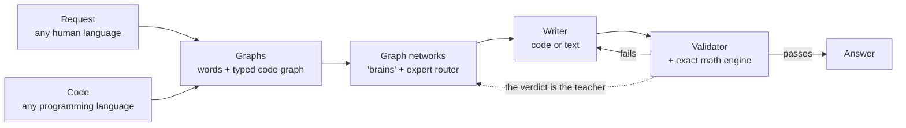

# GLA — Graph-Language Assistant

**An AI model that reads code as a map of relationships — and writes, fixes, explains and checks it.**
Made by **ATEC** (Advancement Through Engineering & Creation).

> **GLA is proprietary — it is not open source.** Every version is owned by **ATEC** and is used under its own GLA
> license, not under an open-source license (it is not MIT, Apache, GPL, Creative Commons or similar). Being able to
> download a version free of charge does **not** make it open source: the license still forbids selling it and
> requires credit to ATEC.

**Quick links:** [Library `gla-api` 1.2.6](https://pypi.org/project/gla-api/1.2.6/) ·
[GLA 1.0 overview](docs/GLA_1.0_Technical_Overview.md) · [GLA 2.0 overview](docs/GLA_2.0_Technical_Overview.md) ·
[GLA 3.0 overview](docs/GLA_3.0_Technical_Overview.md) · [Licenses](licenses/) ·
[Troubleshooting](#troubleshooting)

---

## Contents

1. [Status at a glance](#status-at-a-glance)
2. [The names](#the-names)
3. [What GLA does](#what-gla-does)
4. [How GLA works, in one picture](#how-gla-works-in-one-picture)
5. [Versions](#versions)
6. [GLA 3.0 test results so far](#gla-30-test-results-so-far)
7. [Latest work (November 2026)](#latest-work-november-2026)
8. [Availability](#availability)
9. [Install and run (GLA 2.0 and 3.0)](#install-and-run-gla-20-and-30)
10. [Troubleshooting](#troubleshooting)
11. [License at a glance](#license-at-a-glance)
12. [Repository](#repository)

---

## Status at a glance

*Updated November 2026.*

| | State |
|---|---|
| **GLA 1.0** | Complete. **Never released**: it runs only on ATEC's own server. Its overview is published for information only. |
| **GLA 2.0** | Trained at full scale (≈ 6.1 B parameters, two rounds over ≈ 280 GB). Runs with `gla-api`. |
| **GLA 3.0** | Architecture complete and checked end to end. Test phases on one consumer GPU are under way: phases 1 and 2 are done and phase 3 is training now. The full-scale run (≈ 21.2 B parameters on three ≈ 180 GB GPUs) comes after phase 3. |
| **`gla-api`** | **1.2.6**, the current version of the library: https://pypi.org/project/gla-api/1.2.6/ . It runs GLA 2.0 and 3.0 on Python 3.11 – 3.14. |

---

## The names

| Name | What it means |
|---|---|
| **ATEC** | **Advancement Through Engineering & Creation**, the company that develops and owns GLA |
| **GLA** | The AI and its models: GLA 1.0, GLA 2.0 and GLA 3.0 |
| **Graph-Language Assistant** | GLA written out in full. It is also the name of the **architecture** every GLA model is built on |
| **`gla-api`** | The official Python library that runs and serves GLA 2.0 and 3.0. The current version is **1.2.6**, the current version: https://pypi.org/project/gla-api/1.2.6/ |

GLA was previously called **CodeMind**. Older files and folders with that name (for example `Model_CodeMind/` or
`codemind.*` checkpoints) hold the same models and data, and they still work. New training writes to
`Models/Model-GLA` with files named `gla.*`.

---

## What GLA does

GLA understands software the way an engineer does. It does not see a long string of characters; it sees
**what calls what, what feeds what and what runs before what**. It turns code, and requests written in human language,
into graphs. Specialised networks understand those graphs, one writer writes the answer, and GLA **checks its own
answer** before giving it. When it is not sure, it says so, says why, and asks what it needs to know.

- **Writes code** in any programming language from a request in plain language.
- **Fixes and edits** existing code, including very large files.
- **Explains** code and answers technical questions.
- **Checks code** with a built-in validator: syntax, structure, hidden "fake" solutions and safety.
- **Computes exact numbers** with a built-in calculator instead of guessing: arithmetic, units and physics formulas.
- **Is honest about uncertainty**: an answer it is not sure of is marked, with the reason.

---

## How GLA works, in one picture



1. **Read.** The request and any code become graphs. A function call, a variable flowing from one line to another,
   and a loop running before a return are each an explicit, typed link.
2. **Understand.** Graph networks ("brains") read those links. 1.0 has two brains; 2.0 and 3.0 add a third brain for
   human language. A router calls in expert sub-networks as needed.
3. **Write.** A writer produces the answer while looking at what the brains understood.
4. **Judge.** A layered validator and an exact math engine check the answer. The answer is repaired, retried or
   marked as uncertain when needed.
5. **Learn.** In training, the same verdicts teach the model.

Each version's overview explains every step in depth.

---

## Versions

There are three versions. Each is a separate model with its **own documentation** and its **own license**.

| | **GLA 1.0** | **GLA 2.0** | **GLA 3.0** |
|---|---|---|---|
| Availability | **Not released**: no download, no distribution | **Downloadable**: run it yourself under its license | **Downloadable** under its license once the full-scale run is finished |
| License type | Proprietary **access** license | Proprietary **model** license | Proprietary **model** license |
| Size | ≈ 3.3 B parameters | ≈ 6.1 B parameters | ≈ 21.2 B parameters |
| Brains | 2 (code, edit) | 3 (+ human language) | 3, with global attention across each graph |
| Writers | 1 code writer | 1 code writer + 1 text writer | **1 writer** for code and text, one open vocabulary |
| Answers with | Code | Code and text | Code and text |
| Human languages | Requests read as instructions; answers in code | About 20 | 30 |
| Trained on | One 80 GB-class GPU | One 180 GB-class GPU (≈ 280 GB of data) | Three 180 GB-class GPUs acting as one model (≈ 742 GB of data) |
| Writing context | Up to 32,768 positions | Up to 180,000 positions | Up to 180,000 tokens |
| Runs with | Only ATEC's own GLA 1.0 server, **not** `gla-api` | `gla-api` 1.2.6 | `gla-api` 1.2.6 |
| GPU memory for the weights | — | ≈ 12 GB BF16 · 6 GB FP8 · 4 GB FP4 | ≈ 42 GB BF16 · 21 GB FP8 · 13 GB FP4 |
| Documentation | [Technical overview](docs/GLA_1.0_Technical_Overview.md) | [Technical overview](docs/GLA_2.0_Technical_Overview.md) | [Technical overview](docs/GLA_3.0_Technical_Overview.md) |
| License | [GLA 1.0 License](licenses/LICENSE-GLA-1.0.md) | [GLA 2.0 License](licenses/LICENSE-GLA-2.0.md) | [GLA 3.0 License](licenses/LICENSE-GLA-3.0.md) |

### What each version brought

**GLA 1.0: the foundation**
- Code becomes a typed graph, and two networks understand it: one for the code and one for the change to make.
- A structural code writer, a layered validator, and learning from its own validated answers.
- A standard, code-free model folder, run only by ATEC on its own server (never released).

**GLA 2.0: language and exactness**
- A third network for **human language**, so requests in many languages are understood directly.
- A separate **text writer** for prose answers, next to the code writer.
- An **exact math and physics engine** inside the learning loop.
- Expert routing (12 experts), policy-driven **safety**, and the **`gla-api`** library so anyone can run the model.

**GLA 3.0: one writer, graphs that reach**
- About **3.5× larger** (≈ 21.2 B parameters), trained on ≈ 742 GB in 30 human languages across three GPUs as one model.
- **One writer for code and text** with one open vocabulary, so any name, number, script or language can be written.
  It reads the request word by word and consults a memory of what the networks understood.
- **Graphs that reach:**
  - Every file becomes one connected graph in every language.
  - Relationships flow in both directions.
  - Every node can look up any part of its graph directly by content, so information crosses whole files instead of
    fading after a few steps.
- Learns to understand code **without a hand-written parser** for the language.
- **One reward** teaches writing, expert choice and confidence together. The model also practises **repairing its own
  mistakes**.

---

## GLA 3.0 test results so far

Before paying for the 21 B run, GLA 3.0 is trained in **small test phases on one consumer GPU** (an RTX 3060 with
12 GB). Each test model uses **exactly the same code and mechanisms** as the full model; only the widths and depths are
smaller. The purpose is to find bugs and check that learning moves in the right direction. The tests do **not** measure
how good the final model will be.

> **Read these results with the size in mind.** The phase 1 and phase 2 models have about **19 million parameters**,
> roughly **1,100 times smaller** than GLA 3.0 (21.2 billion). A model this small is expected to write weak code and
> poor prose. What matters is that each phase is clearly better than the one before.

| Phase | Model and data | What it showed |
|---|---|---|
| **1** | ≈ 19.2 M parameters, a short first run | The pipeline works end to end, but the output is broken: code fragments that do not parse, and unreadable chat. |
| **2** | ≈ 19.5 M parameters, about 354,000 samples, ≈ 3 hours plus a second round | **Clearly better than phase 1.** After round 2 the code is clean and parses, and some answers are correct (for example "sum the numbers 1 to 20", asked in Thai). Many answers are still the same template (a "largest item in a list" function given to different requests). Chat answers honestly say "not sure". The math engine is exact (kinetic energy 9 J, weight 98.1 N). |
| **3** | ≈ 22.1 M parameters, ≈ 2.2 GB of code and language data (1.17 M samples), 4 full rounds | **Training now.** Results will be added here when it finishes. |

The full test details are in [Section 27.6 of the GLA 3.0 overview](docs/GLA_3.0_Technical_Overview.md#276-test-phases-on-one-consumer-gpu).

---

## Latest work (November 2026)

These changes were made while running the GLA 3.0 test phases. Every change was checked so that the same inputs still
give the same results; nothing was made faster by switching a feature off.

**GLA 3.0**
- **Code graphs fixed:**
  - Assignment targets were counted as reads; they now count as definitions.
  - C and C++ function parameters and declarations such as `int b = a;` now take part in data flow.
  - The graph schema version changed, so graphs cached by the old parser are rebuilt automatically.
- **Safe parallel parsing:** the code parser now works on a private copy of each parsed tree, so many threads can parse
  at once and still get identical graphs.
- **Faster writing:** answers are generated with a recorded GPU program for each new token (a CUDA graph), with all
  sampling done on the GPU. This is about 10× more tokens per second on the test GPU, and greedy output is the same,
  token for token.
- **Faster understanding:**
  - The graph layers compute every node type and relation in one pass; the results match the previous layer
    (difference ≈ 5 × 10⁻⁷ in FP32).
  - Each batch reaches the GPU in a single transfer.
- **Python 3.14, free-threaded:** training runs on Python 3.14 with the GIL off. Parse workers become threads instead
  of processes there.

**All versions (1.0, 2.0, 3.0)**
- Code grammars load straight from their files when the grammar bundle is unavailable (for example on Python 3.14),
  and the log says which way they were loaded.
- An external system-tuning helper was removed. Its few useful duties (keeping the machine awake during training,
  CPU-thread limits) are now built in.

**`gla-api` 1.2.6**, the current version, contains all of the above for GLA 2.0 and 3.0, plus support for
Python 3.14 and 3.14t.

---

## Availability

| | GLA 1.0 | GLA 2.0 | GLA 3.0 |
|---|---|---|---|
| Model files available to download | ❌ No | ✅ Yes | ✅ Yes, after the full-scale run |
| Runs with the `gla-api` library | ❌ No | ✅ Yes | ✅ Yes |
| Run it on your own machine or server | ❌ No | ✅ Yes | ✅ Yes |
| How you can use it | Only through access granted by ATEC (for example an API key to its server) | Your own copy | Your own copy |

**About GLA 1.0.** GLA 1.0 is **not released and not distributed** in any form. Its weights stay with ATEC, and the
`gla-api` library cannot load it. Its technical overview is published **for information only**: it explains how 1.0
works, but it does not make the model available. Any file, package or website offering "GLA 1.0" or "CodeMind 1.0"
for download is not authorized.

To run a GLA model yourself, use **GLA 2.0** or **GLA 3.0**.

---

## Install and run (GLA 2.0 and 3.0)

The official library is **`gla-api` 1.2.6**: **https://pypi.org/project/gla-api/1.2.6/**

```bash
pip install gla-api==1.2.6
```

One command installs the model runtime **and** the API server.

| | |
|---|---|
| Operating system | Windows 10/11 (64-bit) or Linux (x86-64) |
| Python | 3.11, 3.12, 3.13 or 3.14, including the free-threaded 3.14t |
| PyTorch | 2.5 or newer; a CUDA build for NVIDIA GPUs |
| GPU | NVIDIA, any number. A CPU works for testing, slowly |

- **NVIDIA GPU on Windows:** install the CUDA build of PyTorch first, for example
  `pip install torch --index-url https://download.pytorch.org/whl/cu128`.
- **Python 3.14:** also install the code grammars with `pip install "gla-api[grammars]"`. On 3.11 – 3.13 they come
  automatically.

**Serve the model to your website or app** (OpenAI-compatible API):

```bash
mkdir my-gla && cd my-gla
gla-api setup --owner my-website     # settings, a Model_GLA/ folder and your first API key (shown once)
# copy the downloaded model's files into Model_GLA/
gla-api doctor                       # check the computer, GPUs and model files once
gla-api start                        # API server in the background: http://127.0.0.1:8000/v1
gla-api status                       # running? model loaded?
gla-api chat "Explain what a race condition is."
```

**Or use it inside your own Python program:**

```python
import gla_api

model = gla_api.load("./Model_GLA")
print(model.chat("Explain what a race condition is."))
print(model.code("Write a function that merges two sorted lists", language="python"))

big = gla_api.load("./Model_GLA", devices="all")            # one copy per GPU
huge = gla_api.load("./Model_GLA", devices="all", split=3)  # GLA 3.0: each copy over 3 smaller GPUs
```

**Everyday commands**

| Command | What it does |
|---|---|
| `gla-api start` · `stop` · `restart` · `status` · `logs` | Run and watch the server in the background (`--split 3` spreads each GLA 3.0 copy over 3 GPUs) |
| `gla-api key create --owner NAME` · `key list` · `key rotate ID` · `key revoke ID` | API keys with per-key limits |
| `gla-api config show` · `config set port 9000` | Settings of the folder |
| `gla-api doctor` | Full check of the computer, GPUs and model files |
| `gla-api verify` | Check every model file against its SHA-256 |
| `gla-api backup` · `check-update` | Back up keys and settings; look for a newer library |

Every command, the Python API, the HTTP client and all settings are described on the
[library page](https://pypi.org/project/gla-api/1.2.6/) and in each version's technical overview.

---

## Troubleshooting

| Problem | What to do |
|---|---|
| `pip` or `gla-api` is "not recognized" (Windows) | Use `py -m pip install gla-api==1.2.6` and `py -m gla_api <command>`. |
| The model runs on the CPU although there is an NVIDIA GPU | The CPU-only build of PyTorch is installed. Reinstall the CUDA build (`--index-url https://download.pytorch.org/whl/cu128`), then run `gla-api doctor`. |
| "tree-sitter grammars" missing, or code answers lose structure (Python 3.14) | Install the grammars: `pip install "gla-api[grammars]"`, then `gla-api prefetch` once before going offline. |
| Out of GPU memory when loading | Use a smaller precision (`precision="fp8"` or `"fp4"`), split each copy over several GPUs (`split=2` or `3`), or load fewer copies. |
| FP8 / FP4 gives odd answers on an older GPU | This should not happen: every precision runs a self-test and falls back to BF16. Report it with the output of `gla-api doctor`. |
| "Model files changed" or a checksum error | A file was cut off or edited. Copy the model folder again and run `gla-api verify`. |
| A long streamed answer is cut off behind Cloudflare or nginx | The server sends a keep-alive every 15 s; raise the proxy's read timeout if it is below that, and stream the answer. |
| The answer is marked `uncertain` | This is the model telling you it is not sure. Read `reason` and `questions`, add the missing details, and ask again. |
| Free-threaded Python (3.14t) prints that the GIL was re-enabled | A compiled extension asked for the GIL. Start Python with `PYTHON_GIL=0` (or `-X gil=0`). |

Each technical overview has a longer troubleshooting section for its version.

---

## License at a glance

All three licenses are **proprietary licenses written by ATEC**. None of them is an open-source license. GLA is
**licensed, not sold**: you receive permission to use it, never ownership of it.

- **GLA 1.0: access license.** You never receive the model. If ATEC gives you access (for example an API key to its
  server), you may use GLA 1.0 inside your own website, app or API service, including commercially. You may not copy,
  modify, share, sell or resell it, or your access.
- **GLA 2.0 and 3.0: model licenses.** You receive a copy and run it yourself. You may use it commercially in your own
  services and modify it. You may give copies to others only **free of charge and only under the same GLA license**,
  never under an open-source or any other license, and you may **never sell** it.

| | 1.0 | 2.0 | 3.0 |
|---|---|---|---|
| Download the model / get a copy | ❌ Never | ✅ | ✅ |
| Use commercially in your own website, app or API service | ✅ Only through access granted by ATEC | ✅ | ✅ |
| Charge users for that service | ✅ | ✅ | ✅ |
| Modify / fine-tune the model | ❌ | ✅ | ✅ |
| Give copies (original or modified) to others free of charge, only under the same GLA license | ❌ | ✅ | ✅ |
| Call it, or your modified version, "open source" or put it under another license | ❌ | ❌ | ❌ |
| **Sell** the model or a modified version, in any form | ❌ | ❌ | ❌ |
| Resell, share or transfer access / API keys | ❌ | — | — |
| Train another model on its outputs to imitate it | ❌ (without written permission) | Counts as a modified version | Counts as a modified version |
| Use "GLA", "Graph-Language Assistant" or "ATEC" as your own product's name | ❌ | ❌ | ❌ |
| Credit ATEC | Always required | Always required | Always required |
| Safety and responsibility duties for public services | — | Required | Required, plus transparency and security duties |

Credit line to use:

> **Built with GLA &lt;version&gt; by ATEC** — https://github.com/ATECTechnologies/Graph-Language-Assistant

This table is a summary. **Each version's license file is what governs**: see [`LICENSE`](LICENSE) and the
[`licenses/`](licenses/) folder.

---

## Repository

```
README.md                          this page
LICENSE                            which license applies to which version
licenses/
  LICENSE-GLA-1.0.md
  LICENSE-GLA-2.0.md
  LICENSE-GLA-3.0.md
docs/
  GLA_1.0_Technical_Overview.md
  GLA_2.0_Technical_Overview.md
  GLA_3.0_Technical_Overview.md
```

The model weights of **GLA 2.0 and 3.0** are distributed separately from this repository. **GLA 1.0 weights are not
distributed at all.** Training source code and data are not part of the public release for any version.

---

*GLA — Graph-Language Assistant. © ATEC (Advancement Through Engineering & Creation).*
