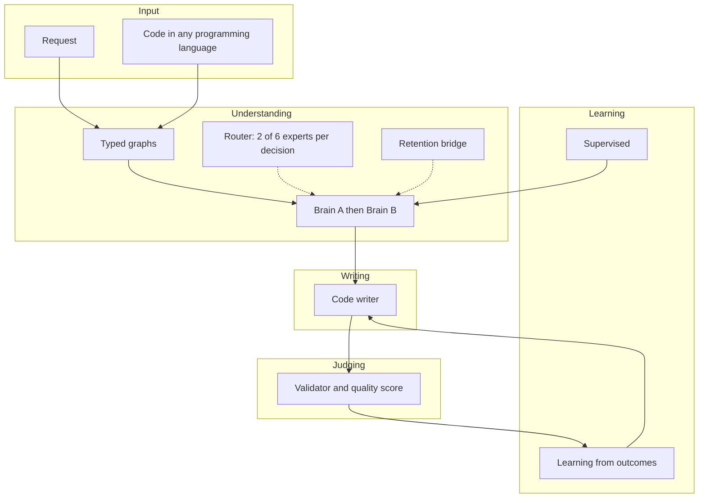
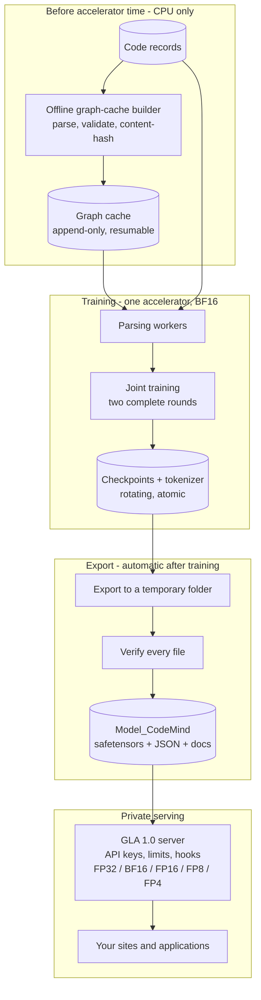
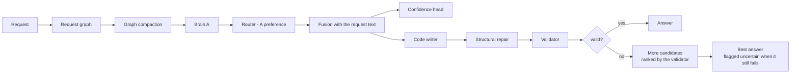
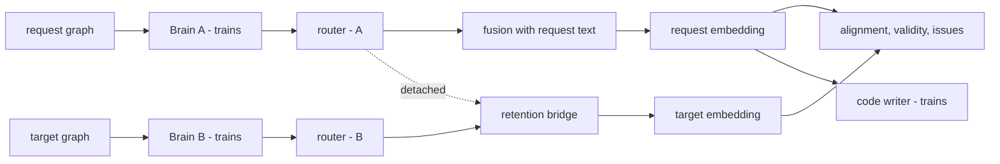

# GLA 1.0 — Technical Overview

**Model generation 1.0 · ≈ 3.3 billion parameters · architecture, training, release format, private serving and extension guide**

GLA 1.0 is the first production generation of GLA — **Graph-Language Assistant**, by **ATEC** (Advancement Through Engineering & Creation) — a code-intelligence model built on the Graph-Language Assistant architecture. It reads code in any programming language, writes, completes and fixes code, and checks what it writes. Instead of treating code as a flat string of tokens, it turns code into a **typed graph** — a map of what calls what, what feeds what and what runs before what — and understands it with **two specialised graph networks ("brains")**. It writes through a **structural code writer**, checks every answer with a **layered validator**, and learns from those verdicts.

> **Availability — please read.** GLA 1.0 is **not released**. The model files are **not available for download and are not distributed** in any form; they stay with their owner, ATEC, which runs GLA 1.0 only on its own GLA 1.0 server. The public `gla-api` library **cannot load or run** GLA 1.0. The only way to use it is through access granted by ATEC (for example an API key to its server).
>
> This document is published **for information only**: it explains how GLA 1.0 works. It does not make the model available, and it grants no right to build, train or reproduce it. Terms of use: [GLA 1.0 License](../licenses/LICENSE-GLA-1.0.md).

---

## About this document

| | |
|---|---|
| **What it covers** | What every part of GLA 1.0 does, how the parts connect, why they were designed that way, how the model is trained, how it is packaged and served, what was found and fixed for this release, and where it can be extended. |
| **Who it is for** | The owner's engineers who operate GLA 1.0; developers whose applications use it through granted API access; technical readers who want the full picture; non-specialists, through the plain-language summary that opens every section. |
| **How to read it** | Part 0 is the whole system in a few pages. Every later section opens with **In plain words** (the idea) and **Why it matters** (the consequence and how to build on it), followed by the technical description. |
| **Name** | **GLA** — Graph-Language Assistant, by **ATEC** (Advancement Through Engineering & Creation). Graph-Language Assistant is also the name of the architecture. Earlier documents and files call the model *CodeMind*; it is the same model. |
| **Model generation** | 1.0 (≈ 3.3 B parameters). |
| **Status** | Release build. Every part has been run end to end in reduced-scale training, export, reload and serving tests (Part VII). Full-scale training runs on the target accelerator. Public benchmark results are not part of this document. |

> **Confidentiality.** This document explains *what* each part does and *why*. It intentionally contains **no source code, no loss or reward coefficients, no tuned thresholds, no learning rates or schedules, no sampling ratios, no pattern lists, no training data and no weights**. Architecture-scale figures (depths, widths, expert counts, context lengths, vocabulary sizes) are included because the design cannot be understood without them.

> **Repository.** [GitHub repository](https://github.com/ATECTechnologies/Graph-Language-Assistant/tree/main) · [GLA 1.0 License](https://github.com/ATECTechnologies/Graph-Language-Assistant/tree/main/licenses/LICENSE-GLA-1.0.md) · [README](https://github.com/ATECTechnologies/Graph-Language-Assistant/tree/main/README.md). The GLA 1.0 License is the source of truth for license terms.

---

## Contents

**Part 0 — The whole picture**
- [0. GLA 1.0 on two pages](#0-gla-10-on-two-pages)

**Part I — The system as a whole**
- [1. Executive summary](#1-executive-summary)
- [2. Design principles](#2-design-principles)
- [3. The system at a glance](#3-the-system-at-a-glance)
- [4. Scale, memory and sizing](#4-scale-memory-and-sizing)

**Part II — Understanding**
- [5. Language support](#5-language-support)
- [6. The graph vocabulary](#6-the-graph-vocabulary)
- [7. From graphs to numbers](#7-from-graphs-to-numbers)
- [8. The typed graph-attention layer and the brain](#8-the-typed-graph-attention-layer-and-the-brain)
- [9. The two-brain chain and joint training](#9-the-two-brain-chain-and-joint-training)
- [10. Expert routing](#10-expert-routing)
- [11. The retention bridge](#11-the-retention-bridge)
- [12. Graph compaction](#12-graph-compaction)

**Part III — Writing, judging and learning**
- [13. The code writer](#13-the-code-writer)
- [14. Validation and quality scoring](#14-validation-and-quality-scoring)
- [15. Supervised learning](#15-supervised-learning)
- [16. Learning from outcomes](#16-learning-from-outcomes)

**Part IV — Safety**
- [17. Content screening and secret protection](#17-content-screening-and-secret-protection)

**Part V — Training, packaging and serving**
- [18. Data pipeline and offline graph cache](#18-data-pipeline-and-offline-graph-cache)
- [19. Training runtime and reliability](#19-training-runtime-and-reliability)
- [20. The model folder](#20-the-model-folder)
- [21. Serving GLA 1.0 privately](#21-serving-gla-10-privately)

**Part VI — Building on GLA 1.0**
- [22. Extension points](#22-extension-points)
- [23. Recipes](#23-recipes)
- [24. Compatibility rules](#24-compatibility-rules)

**Part VII — What changed, evidence and reference**
- [25. What was found and fixed for 1.0](#25-what-was-found-and-fixed-for-10)
- [26. Verification](#26-verification)
- [27. Limits and open questions](#27-limits-and-open-questions)
- [28. Key figures](#28-key-figures)
- [29. Glossary](#29-glossary)

---

# Part 0 — The whole picture

## 0. GLA 1.0 on two pages

### 0.1 The idea in five sentences

1. Code is made of **relationships** — calls, data flow, control flow, dependencies — so GLA reads code as a **graph**, not as a flat string.
2. Understanding is done by **two specialised brains in a chain** — one that understands the request and the existing code, one that builds the edit — refined by a **router** that calls in expert sub-networks and joined by a **bridge** that keeps earlier knowledge from being overwritten.
3. Writing is done by a **structural code writer** that produces lines from a closed vocabulary of code actions, so its output always has the shape of code.
4. Every answer is **judged** by a layered validator; the verdict decides whether the answer is given as is or flagged as uncertain — and the same verdicts are used as a **teacher** during training.
5. The finished model is a **data-only folder** in the standard format, served privately through an OpenAI-compatible API with keys, limits and hooks.

### 0.2 An analogy

| Role in a small engineering firm | Part of GLA 1.0 |
|---|---|
| An **analyst** reads the client's request and the existing code | **Brain A** — the understanding brain |
| A **planner** works out the change to make | **Brain B** — the editing brain |
| A **dispatcher** decides which specialists to call in | The **router** and its **experts** |
| A **records clerk** makes sure earlier lessons are not lost | The **retention bridge** |
| A **writer** drafts the code | The **code writer** |
| A strict **inspector** approves or flags every piece of work | The **validator** and quality engine |
| A **front desk** that only lets registered clients in | The **private server** with API keys and limits |

### 0.3 The concept map



### 0.4 Key figures at a glance

| | |
|---|---|
| Parameters | ≈ 3.30 B |
| Brains | 2 (A: 8 layers · B: 7 layers), width 1,664, 64 attention heads, a shared feed-forward block in every layer |
| Experts | 6 graph-level experts (2 active per decision) and 4 node-level experts per brain (2 active per node) |
| Code writer | 9 layers, width 1,664, up to 32,768 positions, ≈ 14,100-entry action vocabulary |
| Graph size | up to 4,096 nodes per graph after compaction |
| Graph vocabulary | 14 node types · 29 relation types |
| Programming languages | 68 named; any other through a language-independent reader |
| Training | ≈ 135 GB of code, two complete rounds, both brains trained jointly, BF16, one 80 GB-class accelerator |
| Release | sharded `safetensors` weights + JSON configuration and tokenizer, checksums, generated documents — no code |
| Serving | private OpenAI-compatible server; FP32, BF16, FP16, FP8 or FP4; any number of GPUs |

### 0.5 Where to find what

| If you want to know… | Read |
|---|---|
| What GLA 1.0 is and is not | 1, 3.4 |
| How one request flows through the system | 3.2 |
| How code becomes a graph, and the graph becomes numbers | 5–7 |
| Why two brains, and why they are trained together | 9 |
| How it writes and how it checks itself | 13, 14 |
| How it learns from its own answers | 16 |
| How it is trained reliably at scale | 18, 19 |
| What the model folder contains | 20 |
| How to serve it privately | 21 |
| How to extend it | 22–24 |
| What was fixed for this release | 25 |
| What has been verified | 26 |

---

# Part I — The system as a whole

## 1. Executive summary

> **In plain words.** GLA 1.0 reads and writes software in any programming language. It turns code into maps of relationships (graphs), understands them with two specialised networks, writes with a structural writer, checks its own answers, and learns from those checks. Its owner serves it privately through an API.
>
> **Why it matters.** Understanding, writing, judging and learning meet at clear hand-off points, so each can be studied, improved or replaced on its own.

**Representation.** Source code becomes a **typed, heterogeneous graph**: functions, blocks, statements, expressions, variables, control flow, data flow, program dependence, calls and inter-procedural links, each with its own node or relation type. A request is turned into a graph of the same vocabulary, so one model reads both.

**Understanding.** Two brains — instances of the same typed graph-attention design that differ only in depth — form a chain:

- **Brain A** (8 layers) understands the request and the source code.
- **Brain B** (7 layers) builds the edit-oriented representation of the target, informed by what Brain A understood.

Every layer of both brains has a **shared feed-forward block**; inside each brain a **node-level expert layer** (4 experts, 2 active per node) refines individual nodes before the graph is summarised. A **graph-level router** (6 experts, 2 active per decision) refines each brain's summary, with a separate preference for each brain, and a **retention bridge** joins the two brains and penalises drift from what was learned earlier.

**Writing.** The **code writer** (9 layers, up to **32,768 positions**) produces a sequence of **structural actions** — the kind of line, whole common lines, or learned pieces of a line — which a renderer turns back into formatted source.

**Judging.** A layered **validator** checks syntax and static correctness, integrity (no hollow stubs, no echoes of the prompt, no prose disguised as code), purity and safety, and — with a reference — behaviour and structure. A **quality engine** turns this into a 0–100 score.

**Learning** runs as **joint training** — both brains, the router, the bridge and the writer learn together, over **two complete rounds of all data**:

1. **Supervised objectives** align requests with code, predict validity and issue types, and teach the writer.
2. **Learning from outcomes**: the writer drafts several answers to the same task, the validator scores them, each is compared with its siblings, and the writer moves toward the answers that validate. A small head learns **calibrated confidence**, so the model can say when it is not sure.

**Packaging and serving.** About **3.3 billion parameters**, trained on **one 80 GB-class accelerator** in BF16. When training finishes the model is exported automatically to a **standard, code-free model folder** and served by the **GLA 1.0 server** — OpenAI-compatible, with API keys, per-key limits (any of them unlimited), hooks, several GPUs and five precisions.

---

## 2. Design principles

> **In plain words.** The rules the design follows. When two ideas conflict, the principle decides.
>
> **Why it matters.** They tell you where it is safe to change things.

| Principle | What it means in practice |
|---|---|
| **Nothing is locked to a language** | Every programming language gets a real structural graph — an exact parser where one exists, a grammar where one is available, a language-independent reader otherwise. |
| **One vocabulary, one set of weights** | A single node and relation vocabulary and a single model serve every language. |
| **Structure over text** | The model reasons over graphs and writes structural actions. |
| **Correctness is measured, not assumed** | An automated validator judges every output, and its judgement is a training signal. |
| **Honest uncertainty** | When the model is not confident, the answer says so, with the reason. |
| **The same representation in training and in use** | The embedding the writer learns from is computed exactly as it is when answering. |
| **Policy belongs to the operator** | Content policy and service limits live outside the weights; every limit can be unlimited. |
| **The model is data, not code** | The model folder contains weights and JSON only; loading it cannot execute anything. |
| **Private by design** | 1.0 is served by its owner through the API; it is not downloadable, not distributed, and not run by the public `gla-api` library. |
| **Prove it before paying for it** | Parsing, caching, validation and a reduced-scale end-to-end run come first. |
| **Never change a result to gain speed** | Performance changes are checked for identical output before they are accepted. |

---

## 3. The system at a glance

> **In plain words.** The life of the project (prepare → train → export → serve), the journey of one request, and the four core files.
>
> **Why it matters.** Use this section as a map.

### 3.1 Lifecycle



### 3.2 One request, end to end



The embedding the writer is conditioned on is the **same function** in training and in use: the request graph through Brain A and the router, fused with the encoder's view of the request text (Section 9.2).

### 3.3 The four core files

| File | Responsibility |
|---|---|
| `CodeMind.py` | The core: language registry and parsers, graph vocabulary, encoding, graph-attention brains, the code writer and its action vocabulary, validator and quality engine, outcome learning and reward, training objectives, data streaming, training runtime, sizing, model export and generated documentation, and the interface the private server calls |
| `codemind_brain_dual.py` | Multi-brain machinery: the graph-level and node-level routers and their experts, the retention bridge, graph compaction, the orchestrator that runs the brains in order, persistence |
| `linguistic_safety.py` | Policy-driven content screening, personal-data and secret detection, redaction |
| `build_graph_cache.py` | The offline, CPU-only builder that parses and validates the training data ahead of time |

None of these files is part of the model folder (Section 20).

### 3.4 What GLA 1.0 is — and is not

| GLA 1.0 is… | GLA 1.0 is not… |
|---|---|
| A graph-based code model | A language model whose basic unit is a flat token sequence |
| Two brains of **one** design joined by a learned bridge | One stack doing everything |
| A code writer restricted to a **closed vocabulary of structural actions** | A free-form prose writer (1.0 answers with code) |
| Trained by supervised objectives **and** by learning from validated outcomes | Trained only by next-token prediction |
| Honest about uncertainty: answers carry an `uncertain` flag and a reason | A system that presents every answer as certain |
| A **private** model, served through its owner's API | A downloadable model or a library package |

---

## 4. Scale, memory and sizing

> **In plain words.** How big the model is, how much memory training needs, and how size is checked against data.
>
> **Why it matters.** Memory, not arithmetic, usually decides whether a run fits on its hardware.

### 4.1 Parameter budget (≈ 3.30 B)

| Component | Structure | ≈ Parameters |
|---|---|---|
| Brain A | 8 graph-attention layers + shared feed-forward blocks + node-level experts | 1.47 B |
| Brain B | 7 graph-attention layers + shared feed-forward blocks + node-level experts | 1.30 B |
| Code writer | 9 layers, 16 heads, ≈ 14 K action vocabulary, 8 memory tokens, learned positions | 0.40 B |
| Router | 6 experts | 0.07 B |
| Token encoder | hashed token encoder with open language slots | 0.03 B |
| Retention bridge | gated fusion | 0.02 B |
| Fusion and confidence head | | 0.02 B |
| **Total** | | **≈ 3.30 B** |

The 1.0 release keeps the size of the original design (≈ 3.31 B). About 0.25 B parameters that sat in two bridges to an external language model — never trained, because that model was not part of GLA — were removed, and the same budget now goes into the brains' shared feed-forward blocks, where every node of every graph trains it (Section 25).

### 4.2 Training memory

Weights, gradients and optimiser state cost **≈ 16 bytes per parameter** — about **53 GB** at 3.3 B. On an 80 GB-class accelerator that leaves roughly 27 GB for activations, which the design stays inside through:

- **Activation recomputation** in the brains and the writer.
- **A chunked, recomputed output loss**: the writer's full table of output scores is never built.
- **Length-sorted writer chunks under a position budget**: samples of similar length are trained together, so one long file never pads a whole batch.
- **A node budget per batch** for the graph side.
- **A memory governor** that shrinks the micro-batch before an out-of-memory error.
- **A preflight check** of the static memory against the accelerator and of free disk against what checkpoints and the export will need.

### 4.3 Sizing from the data

A compute-efficient model wants roughly 20 training tokens per parameter. With ≈ 135 GB of code (about 3.5 bytes per token) counted over two rounds, the data supplies ≈ 77 B effective tokens — about **23 tokens per parameter** for the 3.3 B model, in the appropriate band. The sizing advisor reports this every time data is connected; it never changes the model, because changing depth after training would make checkpoints unloadable.

### 4.4 The training plan

- **Two complete rounds**, each one full pass over all connected data, with **both brains training in both rounds**.
- **A tiny, stable hold-out** (≤ 0.2 %, chosen by a stable hash) from which a small validation set is read.
- **The learning-rate schedule is measured in samples of the current run**, so a fresh run decays properly and a resumed run continues where it stopped.
- **Resumable at sample granularity**: a finished round is skipped on resume and the interrupted round is shortened by what it already trained.

---

# Part II — Understanding

## 5. Language support

> **In plain words.** How GLA 1.0 handles every programming language without a fixed list, and how a request becomes a graph.
>
> **Why it matters.** This is what makes "any language" concrete. Start here to support something unusual.

### 5.1 Three layers of support

1. **Exact analysis (Python)** — a native walk of the language's own syntax tree builds every layer — syntax, control flow, data flow, program dependence, calls and system dependence — with real definition–use chains and control dependence.
2. **Grammar-based analysis** — for languages with an available grammar, a grammar-driven builder produces the same layered graph. Grammars are downloaded once and cached; training downloads them all in the main process before its parse workers start, and a failed download is retried later instead of disabling the language for the whole run.
3. **The language-independent reader** — for everything else. It recovers the skeleton most languages share — comments, strings, brackets, blocks opened by braces or indentation, block headers, calls and assignments — **from the source itself**: comment and string contents are masked so structure is never read from inside them, the comment marker is learned from the file's own evidence, keywords are inferred from the file's statistics, scopes follow braces or indentation, and comments stay attached to the code they describe.

A **registry of 68 named languages** supplies hints such as family and comment syntax. It is not a gate: a language outside the table is registered on first sight and processed like any other.

### 5.2 From a request to a graph

A request is split into sentences and lines, each becoming a node joined to the next, under a language node for the request. A line that is actually code — a snippet pasted into the request — is parsed by the real code parser and joined into the same graph, so a request that mixes explanation and code is one connected graph. This works the same for any human language, because it relies on line and sentence boundaries, not on the grammar of a particular language.

### 5.3 Polyglot projects

The graphs of several languages can be merged into one graph with cross-language links — HTTP routes matched to the clients that call them, imports, shared configuration — and large repositories are processed in memory-bounded batches.

---

## 6. The graph vocabulary

> **In plain words.** 14 kinds of node and 29 kinds of relation.
>
> **Why it matters.** One vocabulary for all languages is why one set of weights serves them all.

| Group | Node types | Meaning |
|---|---|---|
| Program layers | `ast`, `cfg`, `dfg`, `pdg`, `call`, `sdg` | Syntax, control flow, data flow, program dependence, call graph, system dependence |
| Code structure | `func`, `block`, `expr`, `stmt`, `token` | Functions, blocks, expressions, statements, lexical tokens |
| Polyglot markers | `lang`, `api`, `config` | Language hosts, API bindings, configuration wiring |

The **29 relation types** fall into families: structure (child, next sibling, contains, belongs to), control flow (flow, branch), data and dependence (data flow, control and data dependence), calls (invokes, returns, inter-procedural, call-site wrapping), cross-layer mapping, and polyglot links (cross-language functions, hosting, API binding, configuration wiring, language family and co-existence). Every relation has its own learned transformation in every layer.

---

## 7. From graphs to numbers

> **In plain words.** The text on each node is hashed into embeddings — no vocabulary to fit — and mixed with language, family and node-type information. Many graphs are packed into one batch.
>
> **Why it matters.** A hashed encoder works for any script and any identifier, including ones never seen in training.

The **token encoder** turns a node's text into a vector without a fitted vocabulary: each token contributes a hashed identity embedding and a bucket embedding, combined and mixed with **language**, **language-family** and **node-type** embeddings. The **graph tensorizer** converts graphs into per-type feature tensors and per-relation edge lists and packs many graphs into one block-diagonal batch with per-graph indices, so pooling stays per graph.

---

## 8. The typed graph-attention layer and the brain

> **In plain words.** Every kind of node has its own way of asking, answering and passing on information, and every kind of relation has its own transformation. Each node gathers messages from its neighbours — and from itself — weighted by attention, then passes through a feed-forward block.
>
> **Why it matters.** This is the mechanism behind "typed" reasoning, and in 1.0 every part of it learns.

### 8.1 The layer

- **Per node type:** query, key, value and output projections, and normalisation.
- **Per relation, per attention head:** a learned transformation applied to a neighbour's key before scoring.
- **Joint attention.** Each destination node attends over **all of its incoming edges of every relation plus a self-loop** in one normalisation. There are always at least two candidates, so the attention scores genuinely learn which neighbours — and which relations — matter. Scores and normalisation run in full precision.
- **Output projection** mixes the heads back together, followed by a skip connection and per-type normalisation.
- **Shared feed-forward block.** One block (width × 3) is shared by every node type in the layer, so it is trained by every node of every graph.
- **Computed once:** key and value projections depend only on the source type and are reused by every relation that starts there.

### 8.2 The brain

A brain is a per-type input projection, a stack of graph-attention layers (recomputed during training to save memory), a **node-level expert layer** (4 experts, 2 active per node, applied as a residual so the graph structure is kept), **learnable weighted pooling** across node types, and a semantic head. Each brain carries a *validity* head and a **multi-label issue head** over six categories — syntax, security, safety, undefined name, unused import, other — trained from what the validator actually found.

Both brains share width 1,664 and 64 heads of 26 dimensions; they differ only in depth.

---

## 9. The two-brain chain and joint training

> **In plain words.** Brain A understands the request and the source; Brain B builds the edit of the target, informed by Brain A. In 1.0 they learn together in every round.
>
> **Why it matters.** There is no later phase that can overwrite earlier skills, and no data is wasted on a brain that is not learning.

### 9.1 Roles

| Brain | Depth | Reads | Router preference |
|---|---|---|---|
| **A** | 8 layers | The request graph (and any code it contains) | A |
| **B** | 7 layers | The target code graph | B |

### 9.2 One joint training step



- **Both brains, the router, the bridge, the fusion module and the writer learn from the same batch** in both rounds.
- **The request embedding is one function.** The request graph through Brain A and the router, fused with the encoder's view of the request text, is exactly what the writer is conditioned on when it answers — so what the writer learns from is what it sees in use.
- **The writer trains before the main backward pass,** from the request embedding already computed, and only a small fixed share of its learning signal reaches the brains.
- **Learning from outcomes runs after the backward pass** (Section 16).
- **Retention across rounds:** at the end of round 1 the bridge's reference point is refreshed, so round 2 is penalised for drifting from what round 1 learned.
- **A checkpoint at the end of every round** in addition to the periodic ones.

### 9.3 Training mode and answering mode

Every brain, the router and the bridge set their mode from **whether gradients are enabled**. With gradients: dropout, router exploration, expert statistics updating. Without: deterministic, no exploration and **no change to any saved state** — answering a question never alters what a resumed training run will see.

---

## 10. Expert routing

> **In plain words.** Two kinds of expert. Inside each brain, a node-level layer sends every node to 2 of 4 experts. After a brain summarises a graph, a graph-level router picks 2 of 6 experts to refine the summary, with a separate preference for each brain.
>
> **Why it matters.** Experts add specialised processing at small cost; balancing keeps all of them in use.

- **Per-brain preferences.** The graph-level router adds a learned preference row for the calling brain, so A and B can prefer different experts.
- **Exploration in training only.** Small random noise during training; deterministic choice when answering.
- **Experts with memory.** Each expert keeps a slowly moving average of its own outputs, which damps abrupt swings; the averages are saved with the model and only change during training.
- **Balancing over the whole step.** Every routing decision of a step is recorded, and one balancing term penalises the step's **average** routing for being uneven — rather than pushing each decision toward uniform, which would fight specialisation — plus a small penalty on extreme gate scores so the probabilities cannot saturate.

---

## 11. The retention bridge

> **In plain words.** A learned gate that carries Brain A's knowledge into Brain B, with a gentle penalty for drifting from what was learned before.
>
> **Why it matters.** It is the memory-preserving link of the chain.

The bridge fuses the two brains' vectors through a learned per-sample gate, penalises the upstream representation for moving away from a stored reference point (weighted by how much each dimension mattered, scaled and capped relative to the main loss), and reports a retention signal — how much upstream knowledge survives fusion — that feeds the reward. The reference point is refreshed between rounds from recent examples.

---

## 12. Graph compaction

> **In plain words.** Large graphs are shrunk to 4,096 nodes by merging exact duplicates and bypassing unimportant chains, never touching functions, calls or data flow.
>
> **Why it matters.** It keeps memory bounded without losing the structure that matters.

Stages: exact-duplicate merge (except structurally load-bearing types), edge remapping and de-duplication, bypass of low-importance single-in/single-out chains (never anchors such as functions, calls, data flow and entry points), and importance trimming only if the graph is still over budget.

---

# Part III — Writing, judging and learning

## 13. The code writer

> **In plain words.** Code is written as a sequence of actions from a closed vocabulary — the kind of line, a whole common line, or learned pieces of a line — by a transformer that sees the request embedding as eight memory tokens.
>
> **Why it matters.** The output always has the shape of code; whether it is correct is the validator's job.

### 13.1 The action vocabulary

- **Line kinds:** function and statement lines, **comment** lines (in whatever syntax the file uses), **blank** lines, and **indent / dedent** markers that carry block structure.
- **Whole-line vocabulary:** about 8,000 of the most frequent complete lines are single entries.
- **Line pieces:** any other line is spelled from about 6,000 learned pieces plus single characters — about four characters per action.
- **No duplicates:** calls are not written separately from the statement that contains them.
- **One granularity for all languages:** the target code is always read at the same generic granularity, so one writer learns from every language.

A **renderer** turns actions back into formatted source per language family. On real Python files the representation reproduces 57 of 60 files line for line and all 60 still compile (Section 26).

### 13.2 The writer network

A decoder-only transformer — **9 layers, 16 heads, width 1,664** — with the request embedding injected as **eight memory tokens** that every position can attend to; input and output embeddings share weights. Positions are learned up to a **32,768-position ceiling**; training uses up to 20,480 positions, with occasional position offsets so the upper part of the position table is trained too. Decoding is incremental with cached keys and values. Standard transformer initialisation gives a starting loss near the uniform value.

### 13.3 How an answer is chosen

1. **Deterministic first answer**, with a repetition guard that only stops genuine runaway loops.
2. **Structural repair:** unbalanced brackets and unterminated block comments are closed deterministically.
3. **Validation.** If the validator accepts the answer, it is the answer.
4. **Escalation only on rejection:** a few sampled candidates are ranked by the same validator; the first answer is always one of them, so the result can tie or improve but never get worse.
5. **Honest flags.** The answer carries `uncertain` and a reason when the confidence head is not confident or the best answer still fails the check.
6. **Integrity block:** an answer that looks like cheating (hollow code, an echo of the prompt) is withheld unless the caller forces it.

### 13.4 Large code

Files of tens to hundreds of thousands of lines are handled by splitting at function and class boundaries, carrying a meaning summary from chunk to chunk and stitching the results with indentation preserved.

---

## 14. Validation and quality scoring

> **In plain words.** The inspector: independent checks combined so one failure cannot be hidden by strength elsewhere, plus a 0–100 quality score.
>
> **Why it matters.** It is both the filter when answering and the teacher in training.

1. **Static analysis** — syntax (exact parser or grammar), undefined names, unused imports, and a safety check for dangerous constructs.
2. **Integrity** — hollow stubs, prompt echoes, prose mixed into code.
3. **Purity** — how much of the output is actually code.
4. **Optional execution** in an isolated subprocess (skipped for dangerous patterns), with behaviour comparison against a reference.
5. **Structural similarity** to a reference graph, without execution.

The **quality engine** scores syntax, static checks, graph coverage, semantic similarity, execution and mastery, so a low loss with hollow outputs never looks like quality.

---

## 15. Supervised learning

> **In plain words.** What the model is taught directly.
>
> **Why it matters.** Each objective gives the brains a reason to learn a different aspect of code.

| Objective | What it teaches |
|---|---|
| **Contrastive alignment** | A request should be close to its target and far from recent unrelated targets (a bank of recent targets supplies real negatives) |
| **Semantic consistency** | Request and target representations should agree |
| **Validity prediction** | Predict the validator's verdict |
| **Issue types** | Predict the six issue categories the validator actually found, with weighting so rare categories are not drowned out |
| **Graph regulariser** | Keep node activations bounded |
| **Retention** | Do not drift from the bridge's reference point |
| **Expert balance** | Keep all experts in use |
| **Writer** | Teacher-forced prediction of the target's actions |

The writer's loss is computed in recomputed chunks over length-sorted groups of samples, each group's loss weighted by its share of the real tokens, so the result equals one large batch without its memory.

---

## 16. Learning from outcomes

> **In plain words.** The writer learns from the inspector's verdicts on its own answers. A separate small head learns how confident to be.
>
> **Why it matters.** Imitating examples cannot teach "the code I wrote by myself works". This can.

### 16.1 The writer — groups of answers

Periodically, after a batch's backward pass, one group runs:

1. **Write several answers to one task**, sampled with incremental decoding and no gradient. The structural rules and the repetition guard act as a mask over allowed actions, and **the exact allowed set at every step is recorded**.
2. **Score each answer** with the validator, plus a bonus for removing problems the source had. An answer that never ends properly gets a negative reward.
3. **Compare within the group.** Each answer's advantage is its reward relative to its siblings; a group in which every answer scored the same is skipped.
4. **Recompute probabilities in one parallel pass** under exactly the recorded masks, so the update's probability ratios are valid (they equal 1.0 at the first pass, as they should).
5. **Bounded update, per action.** Ratios are taken action by action and averaged over the whole group — never as one product over a whole answer, which overflows — with a limited step, a skip of any non-finite update, and an early stop if the behaviour has moved too far.

Dropout is off for the whole group, because the behaviour that sampled must be the behaviour that is updated.

### 16.2 The confidence head

A small head on the request embedding, with a value estimate and a **confidence** output trained to match the validator's verdicts rather than to be optimistic. It decides when an answer is flagged `uncertain`.

### 16.3 The reward

Correctness (the validator's score) dominates; curiosity (novelty, scaled by integrity), calibration, honesty, integrity, safety, behaviour evidence and retention are separate, visible terms; the total is clamped to a bounded range. Reward weights are never learned by gradient.

---

# Part IV — Safety

## 17. Content screening and secret protection

> **In plain words.** A policy-driven screen for requests and answers, plus detection and masking of personal data and secrets.
>
> **Why it matters.** The operator decides what is acceptable; secrets never leave in answers or logs.

There is no built-in definition of right and wrong in the code: categories, weights, thresholds and actions come from the operator's policy. Matching is engineered for real text in many scripts (word-boundary or substring matching by script, multi-pattern matching per language, obfuscation handling that does not damage normal text). **23 detector kinds** find keys, tokens, private keys, connection strings, contact data and account or card numbers with **checksum validation**, and reports keep only masked values. The private server screens requests and answers with it and redacts secrets in answers.

---

# Part V — Training, packaging and serving

## 18. Data pipeline and offline graph cache

> **In plain words.** How code data is read, turned into training pairs, parsed ahead of time and streamed.
>
> **Why it matters.** Most of what a model learns is decided by what its data pairs actually say.

### 18.1 From records to training pairs

- **A provenance tag is never a request.** Many records carry only a source tag (a collection name or repository path) next to the code. Such a tag is recognised and ignored.
- **Code-only records get a real request** synthesised from the code itself — its docstring or leading comment, otherwise the names it defines, otherwise a completion task — deterministically, so reloading gives the same pairs.
- **Long files are kept**, cut only at a line boundary.
- **Instruction pairs** (instruction / input / output) are used as they are.

### 18.2 Streaming

Large files are streamed with a bounded shuffle buffer; their line counts are cached next to them, so a restart does not re-read the whole corpus. The offline graph cache inside the data folder is never mistaken for training data.

### 18.3 Offline pre-building

The **offline graph-cache builder** parses and validates the data once, on CPU machines, before accelerator time is rented. It uses the same parsers and validator as training, so a cached graph is identical to one training would compute; it is resumable, append-only, crash-tolerant and duplicate-free, and training imports it automatically.

---

## 19. Training runtime and reliability

> **In plain words.** What keeps a long run alive and correct.
>
> **Why it matters.** A run that lasts days must survive interruptions and bad batches without losing work.

- **Precision:** BF16 (FP16 with loss scaling where BF16 is missing; full precision on CPU). Lower serving precisions are applied only by the server.
- **Optimisers:** one for the brain side, one for the writer; warm-up and cosine decay **measured in samples of the current run**.
- **Recomputation that recomputes the right layer:** every recomputed layer is bound to itself.
- **Memory governor**, out-of-memory recovery, guards against non-finite values, non-finite updates skipped.
- **Checkpoints:** `safetensors` plus JSON, never pickle; three rotating slots, atomic writes, a round-end checkpoint; **the code tokenizer is saved next to every checkpoint** and restored with it.
- **Resume:** an interrupted run continues at the sample where it stopped, with its original schedule; finished rounds are skipped.
- **Graceful shutdown:** a stop signal saves a checkpoint.
- **Preflight:** configuration compatibility with an existing checkpoint, free disk for rotating checkpoints plus the resume point plus the export, and static GPU memory against the accelerator.
- **Bounded validation:** a small held-out set, with output bounded relative to each reference.

---

## 20. The model folder

> **In plain words.** When training finishes, the model is exported automatically to `Model_CodeMind` in the standard layout: weight files, JSON configuration and tokenizer, a checksum manifest and English documentation. No program code.
>
> **Why it matters.** The folder is all the server needs, it can be inspected with standard tools, and loading it cannot execute anything.

```
Model_CodeMind/
  config.json                        model configuration (architecture only, marked private)
  model-00001-of-0000N.safetensors   weights, in shards (5 GB each by default)
  model.safetensors.index.json       which tensor lives in which shard
  model.meta.json                    model metadata read with the weights
  gen_codec.json                     the code tokenizer
  tokenizer_config.json              tokenizer settings
  generation_config.json             default generation settings
  manifest.json                      SHA-256 and size of every file
  README.md                          how to run and call it
  API_REFERENCE.md                   every endpoint, field and error
  MODEL_CARD.md                      what the model is, how it was trained, its limits
```

The export writes to a temporary folder, verifies every file against the manifest, and only then swaps it into place — a failed or interrupted export never leaves a half-written model where the server would load it. Weights are exported in BF16 by default (FP32 or FP16 on request).

---

## 21. Serving GLA 1.0 privately

> **In plain words.** The GLA 1.0 server runs on the owner's machine, loads `Model_CodeMind`, and answers through an OpenAI-compatible API — with API keys, limits, hooks, any number of GPUs and five precisions. It is not a public library and the model is not offered for download.
>
> **Why it matters.** Applications and websites use GLA 1.0 through the API exactly like any hosted model, while the weights stay with their owner. The steps in 21.1 are run **by the owner only**, on the owner's machine; everyone else uses the API (21.2) with a key the owner issues.

### 21.1 Starting it (owner only)

```bash
pip install torch --index-url https://download.pytorch.org/whl/cu128   # PyTorch with CUDA for your system
pip install -r codemind1/requirements.txt

python -m codemind1 init                              # .env with an admin token, Model_CodeMind/
python -m codemind1 serve --supervise --host 0.0.0.0  # every GPU, restart after a crash, port 8000
python -m codemind1 create-key --owner my-app         # an API key for an application (shown once)
```

The server listens only on the local machine unless `--host 0.0.0.0` is given. Put HTTPS in front before exposing it.

### 21.2 Calling it

| Endpoint | Purpose |
|---|---|
| `POST /v1/chat/completions` | Answer a conversation with code; streaming supported |
| `POST /v1/completions` | Answer a single prompt with code |
| `POST /v1/code/validate` | Run the validator: valid, score, issues |
| `GET /v1/models`, `/health`, `/ready` | Model list, liveness, readiness |
| `GET /v1/me`, `/v1/usage` | The calling key's limits and usage |
| `/admin/...` | Keys, audit log, workers, statistics, model reload |
| `GET /metrics` | Monitoring |

Any OpenAI client works by changing its base URL. Every answer also carries a `codemind` object with `mode`, `uncertain`, `reason`, `confidence` and `score`.

### 21.3 Precision and GPUs

| Precision | Approx. memory for one copy | Agreement with FP32 output (measured on a test build) |
|---|---|---|
| `fp32` | ≈ 15 GB | 1.000 |
| `bf16` | ≈ 8 GB | 1.000 |
| `fp16` | ≈ 8 GB | 1.000 |
| `fp8` | ≈ 4.5 GB | ≈ 0.9995 |
| `fp4` | ≈ 3 GB | ≈ 0.997 |

`--precision auto` picks FP8 when the GPU passes a numeric self-test, otherwise BF16; every precision falls back safely. `--gpus auto` uses every GPU, and the server fits several copies per GPU when memory allows.

### 21.4 Limits, keys and hooks

- **Every limit is the operator's choice, and `0` means unlimited**: request queue, open connections, output tokens per answer, requests per minute and parallel requests per key.
- **Per-key settings:** rate, daily tokens, concurrency, maximum answer length, IP and website allow-lists.
- **Keys** are stored only as keyed hashes; admin actions need the admin token and are logged.
- **Hooks:** `--hooks my_hooks.py` with `before_request(ctx)` and `after_response(ctx, answer)` adds your own rules, retrieval, logging or post-processing without touching the model.

---

# Part VI — Building on GLA 1.0

## 22. Extension points

| Level | What you change | Retraining? |
|---|---|---|
| **1. Request** | System text, conversation, temperature, answer length, language | No |
| **2. Hooks** | Your code before and after every answer (`--hooks`) | No |
| **3. Policy and limits** | Content policy, per-key limits, allow-lists, server limits (any unlimited) | No |
| **4. Orchestration** | Validate-then-retry loops, batch jobs, multi-GPU deployment | No |
| **5. Integration** | OpenAI-compatible clients, IDE plug-ins, CI checks with `/v1/code/validate` | No |
| **6. Continued training** | More data in the same record formats; a new run on the trained model | Yes — a new run |
| **7. Architecture** | New checks, objectives, heads, relation kinds or languages | Yes |

| Area | Natural extensions | What to keep fixed |
|---|---|---|
| Languages (5) | Hints in the registry, or nothing — the language-independent reader handles it | The node and relation vocabulary |
| Validator (14) | A new check layer — linter, security rule, test runner | One failure cannot be hidden by strength elsewhere |
| Reward (16.3) | A small, bounded auxiliary term | Correctness dominates; weights are never learned by gradient |
| Safety (17) | Categories, languages, word lists, deflections — in the policy | No judgement inside the code |
| Generation (13.3) | Outer loops around the writer | The first answer is always a candidate |

## 23. Recipes

### 23.1 A house style on every answer (server hook)

```python
# my_hooks.py  ->  python -m codemind1 serve --hooks my_hooks.py
STYLE = "Follow PEP 8. Use type hints."

def before_request(ctx):
    ctx["system"] = (STYLE + " " + ctx.get("system", "")).strip()
    return ctx
```

### 23.2 Refuse requests outside your product's scope

```python
def before_request(ctx):
    if "malware" in ctx["prompt"].lower():
        raise ValueError("This service does not help with that request.")
    return ctx
```

### 23.3 Accept code only if it validates

```python
from openai import OpenAI
import requests

client = OpenAI(base_url="https://your-server.example/v1", api_key="YOUR_KEY")

def code_until_valid(prompt, tries=3):
    for _ in range(tries):
        code = client.chat.completions.create(
            model="codemind-1.0", messages=[{"role": "user", "content": prompt}]).choices[0].message.content
        rep = requests.post("https://your-server.example/v1/code/validate",
                            headers={"Authorization": "Bearer YOUR_KEY"},
                            json={"code": code, "language": "python"}).json()
        if rep["valid"]:
            return code
        prompt += "\n\nFix these problems: " + "; ".join(i["message"] for i in rep["issues"][:5])
    return code
```

### 23.4 Validate code in continuous integration

Call `POST /v1/code/validate` for every changed file and fail the build when `valid` is false; each issue comes with its line, rule and severity.

## 24. Compatibility rules

| Change | Effect on the trained model |
|---|---|
| Prompts, hooks, policy, limits, precision, GPUs | None — runtime only |
| Re-exporting with another shard size or weight precision | None |
| New data in the existing record formats | Compatible — continued training |
| A new validator check or reward term | Compatible — affects future training and answers |
| A new auxiliary head | Compatible — it starts fresh, the rest loads unchanged |
| A new relation kind | Loads; the new relation's transformations start untrained |
| Width, heads, brain or writer depths, expert counts, feed-forward width | **Incompatible** — train from scratch |
| The code tokenizer | **Incompatible with the writer** — it must be retrained |

---

# Part VII — What changed, evidence and reference

## 25. What was found and fixed for 1.0

> **In plain words.** The original prototype was run end to end, defect by defect. These are the problems that would have stopped it from training, or made it learn the wrong thing, and what was done.
>
> **Why it matters.** Several of these were invisible: the prototype ran without errors while parts of it learned nothing.

### 25.1 Problems that stopped learning

| Problem | Effect | Fix |
|---|---|---|
| The writer's training step ran after the batch's backward pass | It failed on **every step**: the code writer never trained at all | It now runs before the backward pass |
| Learning from outcomes used one probability ratio for a whole answer | The ratio overflowed and turned the writer into invalid numbers after one update | Ratios per action, group comparison, non-finite updates skipped |
| Recomputed layers looked up their layer only when recomputed | Every layer was recomputed as the **last** one — silent wrong gradients | Each recomputation is bound to its own layer |
| Attention normalised separately per relation | In tree-shaped graphs almost every normalisation had one input, so the attention scores could not learn | Joint attention over all incoming edges plus a self-loop; output projection used |
| The code tokenizer could not represent real code | Only 3 of 60 real Python files survived encoding (5 compiled): the writer was trained on broken targets | New action vocabulary with comments, blank lines, indentation and learned line pieces: 57 of 60 identical, 60 of 60 compile |
| Brain B did not learn in round 1 | Half the data was wasted for brain B, and the sequential schedule invites forgetting | Joint training in both rounds |
| A fusion module ran only when answering | An untrained layer sat in front of the writer at inference | Trained in every step, as part of the shared request embedding |
| The writer was trained on one embedding and conditioned on another when answering | Mismatch between training and use | One request-embedding function for both |

### 25.2 Problems in the data

| Problem | Effect | Fix |
|---|---|---|
| A record's provenance tag was read as its instruction | Most of the corpus taught "collection name → code" | Tags recognised and ignored; real requests synthesised from the code |
| Pairs longer than 8,192 characters were dropped | Most real source files were thrown away | Kept, cut at a line boundary |
| 10 % of the data was held out and never validated | Data lost for nothing | 0.2 % hold-out, read as a real validation set |
| The offline graph cache inside the data folder was read as training data | At full scale a multi-gigabyte file loaded into memory | Excluded |

### 25.3 Problems in the run

| Problem | Effect | Fix |
|---|---|---|
| The end-of-pass cache clean-up deleted the code tokenizer | After any restart a new tokenizer no longer matched the trained writer | Only cached embeddings are removed; the tokenizer travels with every checkpoint |
| The learning-rate schedule mixed units | The decay barely happened on a fresh run; after a restart the rate sat at its floor | Measured in samples of the current run |
| A restart repeated both rounds from the beginning | Wasted accelerator time | Resume at the sample where the run stopped |
| Validation generated without a limit | Training could stall in validation | Bounded output and a small validation set |
| The writer's batch was padded to its longest sample and its full output table was built | Tens of gigabytes beyond the accelerator at full scale | Length-sorted chunks under a position budget; chunked loss |
| Answering ran in training mode | Dropout, noise and changes to saved expert state when answering | Mode follows whether gradients are enabled |
| The router's balance term was overwritten per call and fought specialisation | Balancing counted one graph per batch | One balancing term over the whole step's routing |
| The writer started with a loss in the tens | Noisy, unstable early training | Standard initialisation: the starting loss is near the uniform value |
| About 0.25 B parameters bridged to an external model that is not part of GLA | Never trained | Removed; the budget moved into the brains' feed-forward blocks — the model stays ≈ 3.3 B |
| Projection heads that no objective trained were returned as the model's embedding | A random projection in the public output | Removed; the trained summary is the embedding |
| The disk check ignored the resume checkpoint and the export | A run could finish and fail to save | Counted, together with a GPU memory check |
| Grammars were downloaded by each worker, and one failure disabled a language for the run | Coarser graphs for whole languages | Downloaded once before the workers start; failures retried |

### 25.4 What was added

- **Automatic export** of a standard, code-free, verified model folder after training (Section 20).
- **The private GLA 1.0 server** with an OpenAI-compatible API, keys, limits, hooks, five precisions and multi-GPU support (Section 21).
- **Content screening and secret redaction** for the server (Section 17).
- **Structural repair and escalation** at generation time (Section 13.3).
- **Honest uncertainty** on every answer.

## 26. Verification

All figures below were measured on this release with reduced-size configurations, real source files and test builds of the model folder.

| Check | Result |
|---|---|
| Two-round joint training, end to end | Completes with no failed steps and stable memory; the writer's loss starts near the uniform value and falls |
| Writer training step | Runs on every batch (it failed on every batch before) |
| Learning from outcomes | Updates run; the replayed probability ratio is 1.0 at the first pass, as it must be; no invalid numbers |
| Interrupt and resume | Stopped at sample 273 of 382, resumed and finished at exactly 382, with the original schedule, even with the cache folder deleted |
| Export → verify → reload | Every file matches its manifest; an FP32 export reloads bit-identical (maximum difference 0.0); BF16 within rounding |
| Code tokenizer round trip on 60 real Python files | 57 identical line for line, 60 of 60 compile, ≈ 4 characters per action (before: 3, 5 and ≈ 1.9) |
| Offline graph cache | Built, imported by training automatically |
| Private server | Chat, streaming, validation, model list, keys — all answer correctly |
| Serving precisions vs FP32 (test build) | BF16 1.000 · FP16 1.000 · FP8 ≈ 0.9995 · FP4 ≈ 0.997 |
| Full-size parameter count | 3,302,943,894 (original design 3,307,729,430) |

## 27. Limits and open questions

- **Code only.** GLA 1.0 answers with code; explanations appear as code comments.
- **Quality follows the data.** Languages that are rare in the training data are written less reliably.
- **Generated code is checked, not proven.** The validator catches syntax, integrity and safety problems; behaviour still needs tests, and generated code must run in a sandbox.
- **The language-independent reader is heuristic** for languages without a grammar.
- **Learning from outcomes trains the writer and the confidence head**, not the brains, by design.
- **Validator scores are an internal measure**; how they predict quality on unfamiliar codebases is a question for external evaluation.
- **Reward shortcuts are a bounded, real risk** in any loop that learns from a judge.

## 28. Key figures

*(Architecture scale only. Training hyper-parameters, loss weights, learning rates, sampling ratios and reward coefficients are not published.)*

| Item | Value |
|---|---|
| **Parameters** | **≈ 3.30 B** |
| Training hardware | One 80 GB-class accelerator, BF16 |
| Static training memory | ≈ 16 bytes per parameter (≈ 53 GB) |
| Hidden width / heads | 1,664 / 64 (26 dimensions each) |
| Brain depths | A 8 · B 7 layers, shared feed-forward block (× 3) in every layer |
| Experts | Graph-level 6 (2 active); node-level 4 per brain (2 active) |
| Node / relation types | 14 / 29 |
| Programming languages | 68 named; any other through the language-independent reader |
| Code writer | 9 layers, 16 heads, width 1,664; ≈ 14,100 actions (≈ 8,000 lines, ≈ 6,000 pieces, characters and markers); 8 memory tokens |
| Writer context | 32,768 positions ceiling; up to 20,480 in training |
| Graph budget | 4,096 nodes after compaction |
| Training data | ≈ 135 GB of code; ≈ 23 effective tokens per parameter |
| Training plan | Joint training, two complete rounds, hold-out ≤ 0.2 % |
| Escalation | Up to 3 extra validator-ranked candidates, only when the first answer is rejected |
| Safety | 23 personal-data and secret detectors; policy-driven screening |
| Release | Sharded `safetensors` + JSON + SHA-256 manifest + generated docs; no code; private |
| Serving | FP32 · BF16 · FP16 · FP8 · FP4; one or many GPUs; OpenAI-compatible API |

## 29. Glossary

| Term | Meaning |
|---|---|
| **Graph** | Nodes joined by typed edges; code becomes a graph. |
| **Typed graph-attention layer** | The building block of the brains: separate projections per node type and a transformation per relation type. |
| **Brain A / B** | The understanding brain (request and source) and the editing brain (target). |
| **Router, expert** | A gate that chooses which specialist sub-networks refine a vector or a node. |
| **Retention bridge** | The learned link between the brains that penalises drift from what was learned. |
| **Request embedding** | The vector the writer is conditioned on — the same in training and in use. |
| **Structural action** | One step of writing code: the kind of line, a whole line, or a piece of a line. |
| **Validator** | The layered checker that judges an answer. |
| **Learning from outcomes** | Learning from the validator's score on the model's own answers. |
| **Joint training** | Training both brains, the router, the bridge and the writer together, in both rounds. |
| **Model folder** | The exported model: weights, JSON configuration and tokenizer, manifest and documents — no code. |
| **Hook** | Your own function run before or after every answer on the server. |

---

*GLA 1.0 — Technical Overview. Private model; source code, training hyper-parameters, data and weights are proprietary.*
