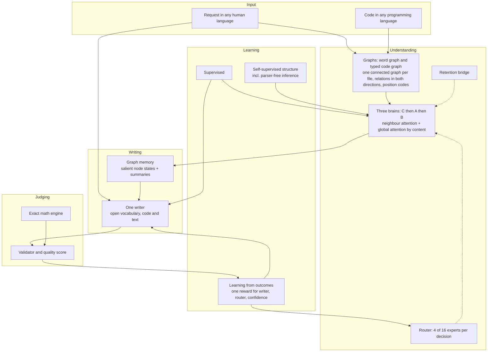
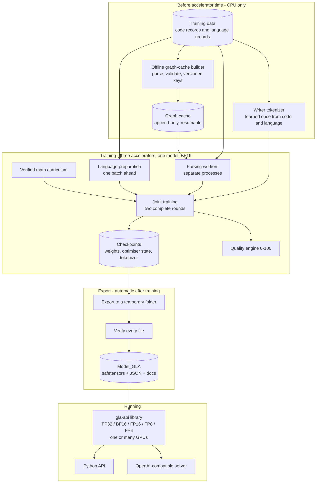
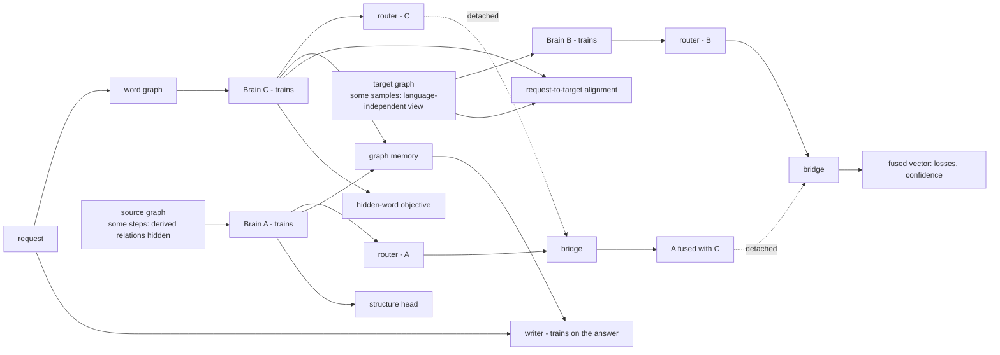
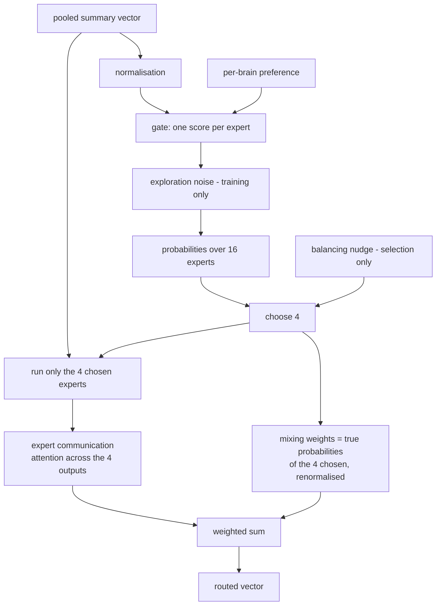
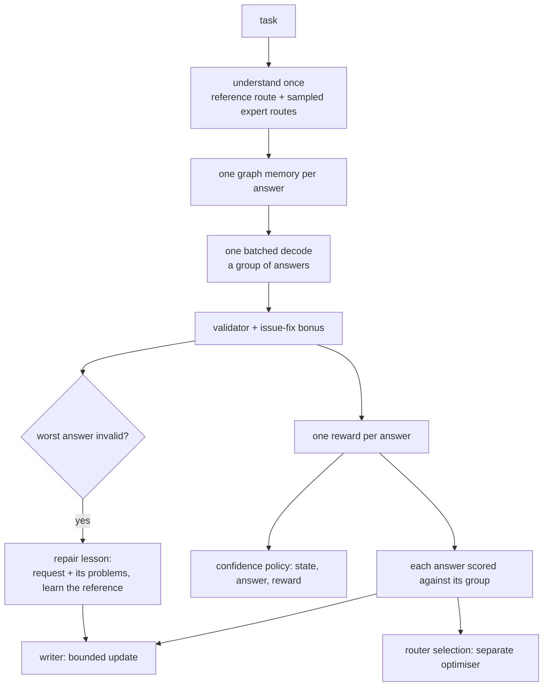

# GLA 3.0 — Technical Overview

**Model generation 3.0 · ≈ 21.19 billion parameters · architecture, training, release format and extension guide**

GLA — **Graph-Language Assistant**, by **ATEC** (Advancement Through Engineering & Creation) — is a self-hosted code-intelligence model built on the Graph-Language Assistant architecture. It reads and writes software in any programming language and communicates in any human language. Instead of treating code as a flat string of tokens, it turns code and text into **typed graphs** — maps of what calls what, what feeds what and what runs before what — and understands them with a chain of **three specialised graph networks ("brains")**. Every answer, code or prose, is written by **one writer** that reads the request token by token and, while it writes, keeps looking into a **memory of what the brains understood**. Every answer is checked by a **layered validator**, the verdicts become the model's teacher, and numbers and physical quantities are computed by a **built-in exact math engine** instead of being guessed.

---

## About this document

| | |
|---|---|
| **What it covers** | What every part of GLA 3.0 does, how the parts connect, why they were designed that way, how the model is trained on three accelerators, how it is packaged and run, and where developers can extend it. |
| **Who it is for** | Engineers evaluating, operating or building on GLA; technical readers who want the full picture; non-specialists, through the plain-language summary that opens every section. |
| **How to read it** | Part 0 is the whole system in a few pages. Every later section opens with **In plain words** (the idea) and **Why it matters** (the consequence and how to build on it), followed by the technical description. Read the boxes only for an overview; read everything for depth. |
| **Name** | **GLA** — Graph-Language Assistant, by **ATEC** (Advancement Through Engineering & Creation). Graph-Language Assistant is also the name of the architecture. Earlier documents and files call the model *CodeMind*; it is the same model. |
| **Model generation** | 3.0 (≈ 21.19 B parameters). |
| **Status** | Architecture complete and verified end to end at reduced scale (training, interruption and resume, export, reload in a fresh process, serving through the library). The full-scale run — two complete rounds over the ≈ 742 GB corpus on three ≈ 180 GB accelerators — is the next step. Public benchmark results are not part of this document. |

> **Confidentiality.** This document explains *what* each part does and *why*. It intentionally contains **no source code, no loss or reward coefficients, no tuned thresholds, no learning rates or schedules, no sampling ratios or probabilities, no pattern lists, no training data and no weights**. Architecture-scale figures (depths, widths, expert counts, context lengths, vocabulary sizes, memory sizes) are included because the design cannot be understood without them. Training hyper-parameters are proprietary and are not published.

> **Repository.** [GitHub repository](https://github.com/ATECTechnologies/Graph-Language-Assistant/tree/main) · [GLA 3.0 License](https://github.com/ATECTechnologies/Graph-Language-Assistant/tree/main/licenses/LICENSE-GLA-3.0.md) · [README](https://github.com/ATECTechnologies/Graph-Language-Assistant/tree/main/README.md). The GLA 3.0 License is the source of truth for license terms.

---

## Contents

**Part 0 — The whole picture**
- [0. GLA on two pages](#0-gla-on-two-pages)

**Part I — The system as a whole**
- [1. Executive summary](#1-executive-summary)
- [2. Design principles](#2-design-principles)
- [3. The system at a glance](#3-the-system-at-a-glance)
- [4. Scale, memory and sizing](#4-scale-memory-and-sizing)

**Part II — Understanding**
- [5. Universal language support](#5-universal-language-support)
- [6. The graph vocabulary](#6-the-graph-vocabulary)
- [7. From graphs to numbers](#7-from-graphs-to-numbers)
- [8. The typed graph-attention layer and the brain](#8-the-typed-graph-attention-layer-and-the-brain)
- [9. The three-brain chain and joint training](#9-the-three-brain-chain-and-joint-training)
- [10. Expert routing](#10-expert-routing)
- [11. The retention bridge](#11-the-retention-bridge)
- [12. Graph compaction](#12-graph-compaction)

**Part III — Writing, judging and learning**
- [13. The writer](#13-the-writer)
- [14. Validation and quality scoring](#14-validation-and-quality-scoring)
- [15. Supervised and self-supervised learning](#15-supervised-and-self-supervised-learning)
- [16. Learning from outcomes](#16-learning-from-outcomes)

**Part IV — Built-in services**
- [17. Math, physics and engineering core](#17-math-physics-and-engineering-core)
- [18. Linguistic safety and secret protection](#18-linguistic-safety-and-secret-protection)
- [19. Grounding](#19-grounding)

**Part V — Training and operating the model**
- [20. Data pipeline and offline graph cache](#20-data-pipeline-and-offline-graph-cache)
- [21. Training runtime and reliability](#21-training-runtime-and-reliability)
- [22. The release format](#22-the-release-format)
- [23. Running the model with `gla-api`](#23-running-the-model-with-gla-api)

**Part VI — Building on GLA**
- [24. Extension points](#24-extension-points)
- [25. Recipes](#25-recipes)
- [26. Compatibility rules](#26-compatibility-rules)

**Part VII — Evidence, limits and reference**
- [27. Verification](#27-verification)
- [28. Limits and open questions](#28-limits-and-open-questions)
- [29. Key figures](#29-key-figures)
- [30. Glossary](#30-glossary)

---

# Part 0 — The whole picture

## 0. GLA on two pages

### 0.1 The idea in seven sentences

1. Code is made of **relationships** — calls, data flow, control flow, dependencies — so GLA reads code as a **graph**, not as a flat string.
2. Human language goes through the **same machinery**: a sentence becomes a graph of words, so one system understands instructions and code in any language.
3. Understanding is done by **three specialised brains in a chain** — one for the request, one for the code, one for the edit — steered by a **router** that calls in expert sub-networks, and joined by a **bridge** that keeps earlier knowledge from being overwritten.
4. Every file becomes **one connected graph** in every language; relationships flow **both ways** through it, every node knows **where it sits**, and every node can **look up any other node of its graph by content**, so distant parts of a file or a text meet from the first layer on — not only through a chain of neighbours.
5. Writing is done by **one writer** with **one open vocabulary** for code and prose alike: it reads the request token by token, looks into a **graph memory** of what the brains understood, and decides for itself whether the answer is code or text.
6. Every answer is **judged** by a layered validator; the verdict decides whether the answer is given, retried, repaired or marked as uncertain — and **the same verdict is the single reward** from which the writer, the router and the model's sense of confidence all learn.
7. Anything exact — arithmetic, units, physical formulas — is **computed** by a deterministic engine rather than predicted.

### 0.2 An analogy

Picture an engineering firm.

| Role in the firm | Part of GLA |
|---|---|
| A **translator** turns the client's request into a precise brief | **Brain C** — the language brain |
| An **analyst** studies the existing code, guided by the brief | **Brain A** — the code-understanding brain |
| A **planner** works out the change to make | **Brain B** — the edit brain |
| A **dispatcher** decides which specialists to call in for each job | The **router** and its 16 **experts** |
| A **records clerk** makes sure last year's lessons are not lost | The **retention bridge** |
| One **author** who drafts every document — code or prose — while keeping the analyst's and translator's notes open on the desk | The **writer** and its **graph memory** |
| A strict **inspector** approves or rejects every piece of work, and sends rejected work back with the list of problems | The **validator**, the quality engine and the **repair loop** |
| A **calculator** that never lets a wrong number through | The **math and physics core** |

The firm improves because the inspector's rulings are fed back as training — to the author, to the dispatcher and to the firm's own sense of when it is sure.

### 0.3 The concept map



### 0.4 Key figures at a glance

| | |
|---|---|
| Parameters | ≈ 21.19 B |
| Brains | 3 (C: 34 layers · A: 24 layers · B: 18 layers), width 2,048, 32 attention heads |
| Graph global attention | every node can attend to any node of its graph by content — after every layer of Brain A, every 2nd layer of B and C |
| Experts | 16, of which 4 are active per decision |
| Writer | 40 layers, width 4,096, 32 query heads sharing 8 key/value heads; graph memory read in every 2nd layer |
| Writer vocabulary | 65,536 byte-level tokens shared by code and every human language |
| Context | up to 180,000 tokens (prompt + answer) |
| Graph size | up to 32,768 nodes per graph after compaction |
| Graph vocabulary | 15 node types · 41 relation types, each also running in reverse |
| Programming languages | 70 named, more than 1,000 open slots, any other language through a universal reader |
| Human languages | unbounded detection; 30 languages trained |
| Training | ≈ 742 GB, two complete rounds, all parts trained jointly, BF16, three ≈ 180 GB accelerators acting as one model |
| Release | `safetensors` weights + JSON configuration and tokenizer, no program code |
| Runs with | the `gla-api` library — FP32, BF16, FP16, FP8 or FP4, any number of GPUs |

### 0.5 Where to find what

| If you want to know… | Read |
|---|---|
| What GLA is and is not | 1, 3.4 |
| How one request flows through the system | 3.2 |
| How "any language" is actually achieved — including languages without a parser | 5, 15.2 |
| What the graph is, why every file is one connected graph, and how it becomes numbers | 6, 7 |
| Why three brains, and why they are trained together | 9 |
| What the router does | 10 |
| How the writer works, what it remembers and how it chooses code or text | 13 |
| How answers are checked, repaired and marked as uncertain | 13.7, 13.9, 14 |
| How it learns — including from its own answers | 15, 16 |
| How exact numbers are guaranteed | 17 |
| How it is trained reliably at scale, on three accelerators | 4.5, 20, 21 |
| What the released model folder contains | 22 |
| How to run it, on how many GPUs, at which precision | 23 |
| How to extend it | 24, 25, 26 |
| What has been verified, and what remains open | 27, 28 |

---

# Part I — The system as a whole

## 1. Executive summary

> **In plain words.** GLA reads and writes software in any programming language and talks in any human language. It turns code and text into maps of relationships (graphs), understands them with three specialised networks, writes with one writer that keeps those networks' understanding in view, checks its own answers, and learns from those checks.
>
> **Why it matters.** Each of the four stages — understand, write, judge, learn — meets the next at a clear hand-off point, so each can be studied, improved or replaced on its own. If you read only one section, read this one and Section 3.4.

**Representation.** Source code becomes a **typed, heterogeneous graph**: functions, blocks, statements, expressions, variables, control flow, data flow, program dependence, calls and inter-procedural links, each with its own node or relation type. Human language becomes a graph of word nodes joined by order and proximity. One graph vocabulary carries both, so one set of weights serves every language. Every relation is also available **in reverse** — from a use back to its definition, from a callee back to its callers, from a child back to its parent — and every node carries learned codes for **where it sits** in its graph. Every builder — exact parser, grammar or universal reader — produces **one connected graph per file**: data-flow definitions and uses are tied to the code they belong to, so a definition at the top of a file and its use at the bottom are joined by a short path rather than left unreachable.

**Understanding.** Three brains — instances of the same typed graph-attention design that differ only in depth and in the node types they receive — form a chain:

- **Brain C** (34 layers) reads the request in any human language.
- **Brain A** (24 layers) reads the code or instruction graph, informed by what Brain C understood.
- **Brain B** (18 layers) builds the edit-oriented representation of the target, informed by what Brain A understood.

In every layer, each node attends **jointly over all of its incoming edges of every relation**, carried on a pre-normalised residual stream, so information keeps its strength over many hops. On top of that, **graph global attention** lets every node look up **any node of its own graph by content** — after every layer of Brain A and every second layer of Brains B and C — so a value 40 edges away is one step away, and the model can find *which* distant node holds what it needs instead of receiving an average. A single **router** with **16 experts** (4 active per decision) refines each brain's summary and keeps a separate preference for each brain. A single learned **retention bridge** joins the two hand-offs and penalises drift away from what was learned earlier.

**Writing.** One **writer** — a 40-layer decoder of width 4,096 with grouped key/value attention, rotary positions and a context of up to **180,000 tokens** — writes every answer, code or prose, token by token over **one open, byte-level vocabulary of 65,536 tokens** learned from code and language together. Nothing is ever "unknown": a new identifier, a number, a rare script or an emoji is always writable. The writer reads the **request itself**, token by token, and in every second layer looks into a **graph memory**: the most salient node states of Brain A and Brain C — chosen and weighted by a learned score — together with each brain's pooled understanding. The first token it writes is its own decision about the form of the answer: **code in a named language, or text**. The same function builds this memory in training and when answering, so what the writer learns is exactly what it uses.

**Judging.** A layered **validator** checks syntax and static correctness, integrity (no hollow stubs, no prompt echoes, no prose disguised as code), purity, safety and — when a reference exists — behaviour and structure. A **quality engine** turns this into a 0–100 score across six dimensions. Cheap structural slips are repaired deterministically; a rejected answer escalates to several candidates ranked by the validator; a still-uncertain answer is returned **honestly marked as uncertain**, with the reason, the questions that would resolve it and the best attempt.

**Learning** runs as **joint training** — every brain, the router, the bridge and the writer learn together, over **two complete rounds of all data** — in three layers:

1. **Supervised and self-supervised objectives** align requests with code, teach the writer, and make the model **discover structure on its own**: it predicts relations hidden from it, including — in a share of steps — *every* data-flow, dependency, call and control-flow relation at once, which it must infer from bare syntax. A share of code is also read **without any language-specific parser**, so the brains learn to reach the same understanding from the language-independent view a never-seen language would get.
2. **Learning from outcomes.** The writer produces a group of answers to one task in a single batched pass, the validator scores them, each is compared with its siblings, and the writer — and the router's choice of experts — is moved toward the answers that actually validate. The same scores teach the **confidence policy** what the model can really do, and a failing answer becomes a **repair lesson** in exactly the form the repair loop uses when answering. One reward, three learners, no conflicting targets.
3. **A math and physics core inside the learning loop**: an exact engine (rational arithmetic, SI units with dimensional analysis, 121 verified formulas) feeds the model's representations, supplies labels, contributes a verified problem curriculum, scores numeric claims and corrects wrong arithmetic at generation time.

**Around the core** sit a policy-driven linguistic-safety and secret-protection module, a grounding service that sends questions to the math engine or to an optional web-search service, a check-and-repair generation loop, a repository-level project overview, and an offline graph-cache builder that keeps parsing off accelerator time.

**Scale and packaging.** About **21.19 billion parameters**, trained in BF16 on **three ≈ 180 GB accelerators that act as one model**: the encoder, Brain A and the router on the first, Brains B and C on the second, the writer on the third, and every training step uses all three. After training, the model is exported automatically in a **standard, code-free release format** — sharded `safetensors` weights, JSON configuration and one tokenizer, a checksum manifest and generated English documentation — and is run with the **`gla-api`** library on Windows or Linux, at FP32, BF16, FP16, FP8 or FP4, on one GPU or many.

---

## 2. Design principles

> **In plain words.** These are the rules the design follows. When two ideas conflict, the principle decides.
>
> **Why it matters.** They tell you where it is safe to change things. For example, "nothing is locked to a language" means a feature that only works for one language is a defect to fix, not an acceptable shortcut.

| Principle | What it means in practice |
|---|---|
| **Nothing is locked to a language** | Every programming language gets a real structural graph — through an exact parser where one exists, a grammar where one is available, and a language-independent structural reader otherwise — and the model is *trained* to understand code from the language-independent view too. Every human language is detected; languages never seen before are discovered and grouped, not rejected. |
| **One vocabulary, one set of weights** | A single node and relation vocabulary, a single writing vocabulary and a single model serve every language. There are no per-language models. |
| **Structure first, words always** | The brains reason over graphs; the writer reads the request's words *and* the brains' structural understanding. Neither is squeezed through the other. |
| **Learn what is used, use what is learned** | The writer's memory is built by the same function in training and when answering. Every parameter is reachable by a learning signal; a component that cannot learn is a defect. |
| **Correctness is measured, not assumed** | An automated validator judges every output, and its judgement is a training signal, not only a filter. |
| **One judge, one reward** | The writer, the router and the confidence policy all learn from the same verdict on the model's own answers, so their objectives cannot pull against each other. |
| **Honest uncertainty** | When the model is not sure, it still answers — and says that it is not sure, why, what information would help, and which part is unverified. It can also decline. |
| **Exact where exactness is possible** | Arithmetic, units and physical formulas are computed deterministically, never predicted. |
| **Policy belongs to the operator** | Safety categories, weights and actions come from a policy the operator supplies. Service limits live in runtime configuration, never in the weights, and every limit can be set to unlimited. |
| **Several cards, one model** | Training spans three accelerators with gradients flowing across them in every step — one model, not three part-models synchronised. Serving is the opposite: any precision, any number of GPUs, chosen by the operator. |
| **The model is data, not code** | The released model contains weights and JSON only. Loading it cannot execute anything. |
| **Prove it before paying for it** | Parsing, caching, validation and a reduced-scale end-to-end run come first, so expensive accelerator time is not spent finding bugs. |
| **Never change a result to gain speed** | Every performance change is checked for identical output on identical inputs and weights before it is accepted. |
| **Reach is measured, not assumed** | Graph connectivity, how far a value can travel through the layers, and whether representations blur with depth are measured on real graphs and with trained probes (Section 27.3) — not inferred from the layer count. |

---

## 3. The system at a glance

> **In plain words.** Three views: the life of the project (prepare → train → export → run), the journey of one request, and the four core files.
>
> **Why it matters.** Use this section as a map. When a later section feels abstract, come back here and find where it sits.

### 3.1 Lifecycle

> **In plain words.** Before any accelerator time is rented, the data is parsed on ordinary machines and saved. Training then streams that data. When training finishes, the model is exported automatically as a standard, code-free folder, which the `gla-api` library loads and serves.
>
> **Why it matters.** Cheap work is done first and elsewhere: parsing never needs an accelerator, so it never steals accelerator time; and the exported folder is all anyone needs to run the model.



### 3.2 One request, end to end

> **In plain words.** The request goes to the language brain and, as an instruction graph, to the code brain. Their understanding becomes the writer's memory. The writer reads the request, decides whether to answer with code or text, and writes. Code is checked; small slips are repaired; a rejected answer is retried with several candidates; anything still uncertain is returned with an honest note.
>
> **Why it matters.** This is the whole runtime behaviour in one picture. Every feature plugs into one of these boxes.

```mermaid
flowchart LR
    T[Request text] --> NLD[Language detection] --> LG[Word graph] --> BC[Brain C]
    T --> IG[Instruction / code graph<br/>exact, grammar or universal parser] --> COL[Graph compaction<br/>up to 32,768 nodes] --> BA[Brain A]
    BC --> R1[Router - C preference] --> BR1[Retention bridge]
    BR1 --> BA
    BA --> R2[Router - A preference]
    R2 --> MA[Quantity adapter<br/>only when numbers are present]
    BC --> GM[Graph memory<br/>salient C and A node states<br/>+ both summaries]
    MA --> GM
    T --> W[Writer reads the request tokens]
    GM --> W
    W --> H{answer header<br/>written by the model}
    H -- text --> TXT[Prose] --> DG{repetitive or empty?}
    DG -- no --> OUT[Answer]
    DG -- yes --> UNS[Uncertain answer<br/>reason, questions, best attempt]
    H -- code --> CODE[Code] --> MG[Arithmetic guard] --> REP[Structural repair] --> V[Validator]
    V --> AB{valid and honest?}
    AB -- yes --> OUT
    AB -- no --> ESC[Several candidates in one batched pass<br/>ranked by the validator] --> AB2{valid?}
    AB2 -- yes --> OUT
    AB2 -- no --> UNS
```



When the caller gives the mode explicitly (`code` or `text`), the writer is told the header instead of choosing it. When the request carries code to edit, the same path applies with Brain B building the edit-oriented view during training (Section 9).

### 3.3 The four core files

> **In plain words.** The AI itself is four files: the core model, the multi-brain machinery, the safety module and the offline graph builder.
>
> **Why it matters.** The split follows responsibility. Things that change together live together; safety is separate so its policy can evolve without touching the model.

| File | Responsibility |
|---|---|
| `GLA.py` | The core: language registry and parsers, connectivity repair, graph vocabulary, encoding and structural position codes, graph-attention brains with global attention, the writer with its tokenizer and graph memory, validator and quality engine, the unified reward and learning-from-outcomes, all training objectives, data streaming, the multi-accelerator training runtime, math engine, sizing, release export and generated documentation |
| `gla_brain_dual.py` | Multi-brain machinery: the router and its experts, the retention bridge, connectivity-preserving graph compaction, the orchestrator that runs the brains in order, and persistence |
| `linguistic_safety.py` | Policy-driven linguistic safety, personal-data and secret detection, redaction |
| `build_graph_cache.py` | The offline, CPU-only builder that parses and validates the training data ahead of time, under the same versioned cache keys as training |

Earlier builds named the first two files `CodeMind.py` and `codemind_brain_dual.py`; the roles are the same.

None of these files is part of the released model. The release folder (Section 22) contains weights and JSON only, and is run by the `gla-api` library (Section 23).

### 3.4 What GLA is — and is not

> **In plain words.** A table of common misunderstandings.
>
> **Why it matters.** Correct expectations prevent wrong comparisons. For example, the expert mixture works on one summary vector per graph, so it is not comparable with models that route individual tokens.

| GLA is… | GLA is not… |
|---|---|
| A graph-based understanding system: code becomes a typed graph, text becomes a word graph | A language model whose understanding is only a flat token sequence |
| Three brains of **one** design (language, understanding, edit) joined by a learned bridge | One stack doing everything, or three unrelated models |
| A writer that reads the request's tokens **and** a memory of the brains' graph understanding | A text generator conditioned only on its own prompt, or a decoder fed one summary vector |
| An **open-vocabulary** writer: any identifier, literal, script or emoji is writable | A closed vocabulary of memorised lines |
| A system whose expert mixture acts on **one summary vector per graph** | A token-level sparse expert layer inside every block |
| Trained by supervised and self-supervised objectives **and** by learning from validated outcomes | Trained only by next-token prediction |
| Language-independent: one vocabulary and one set of weights for all languages, and trained to understand code without a language-specific parser | A family of per-language models, or a model that needs a parser for every language |
| Numerically grounded: an exact engine is **inside** the learning loop | A model that predicts numbers and hopes |
| **Honest** when unsure: it answers, says it is unsure, says why and what would help | A system that always sounds confident |
| Released as **data only** (weights + JSON) | A bundle of code that must be trusted to run |

---

## 4. Scale, memory and sizing

> **In plain words.** How big the model is, how its training state fits on three accelerators, how the size is checked against the amount of data, and how the training plan is derived from the real data.
>
> **Why it matters.** Bigger is not automatically better: a model too large for its data memorises, and one too small wastes data. This section is the check that keeps the two in proportion.

### 4.1 Parameter budget (≈ 21.19 B)

> **In plain words.** A bill of materials: which component costs how many parameters. The brains and the writer each take roughly half.
>
> **Why it matters.** The size is set deliberately: about 20 effective tokens of data per parameter. To change the size, change brain depths or the writer's depth or width — never the vocabularies, which would invalidate the tokenizer.

Hidden width is **2,048** in the brains and **4,096** in the writer. At start-up the system logs the **real** parameter count — every module counted once, shared weights counted once — next to an analytic estimate computed by the same formulas the configuration uses; on the reference configuration the two agree exactly.

| Component | Structure | ≈ Parameters |
|---|---|---|
| Brain A | 24 graph-attention layers over 12 code node types, every relation in both directions, graph global attention after every layer | 6.14 B |
| Brain B | 18 layers of the same design, global attention after every 2nd layer | 4.54 B |
| Brain C | 34 layers over word nodes, global attention after every 2nd layer | 1.89 B |
| Writer | 40 layers, width 4,096, 32 query / 8 key-value heads, feed-forward width ≈ 11 K, 65,536-token vocabulary (input and output tied), graph-memory cross-attention in 20 layers, memory builder | 8.21 B |
| Router | 16 experts + expert-communication block | 0.30 B |
| Retention bridge | gated fusion | 0.03 B |
| Encoder, fusion and small heads | hashed token encoder with open language slots and structural position codes, semantic fusion, confidence policy, auxiliary heads, quantity adapter and head, structure head | ≈ 0.08 B |
| **Total** | | **≈ 21.19 B** |

A code-brain layer costs ≈ 245 M parameters, most of it in per-node-type projections and the shared feed-forward block; a language-brain layer, which carries only one node type, costs ≈ 51 M. The reverse relations add only per-relation, per-head transformations — a few million parameters per layer — because a relation's transformation is small compared with a node type's projections. A global-attention block costs ≈ 8.4 M parameters (it runs at half the brain's width, 16 heads of 64), ≈ 0.42 B for all of them together.

**Where the growth from earlier 3.0 builds went.** Earlier 3.0 builds had ≈ 17.87 B parameters (A 18 · B 16 layers, 12 experts, a 36-layer writer). The release spreads the increase across the whole model rather than one part: deeper code brains (A +6, B +2 layers), four more experts at the same per-request cost, four more writer layers, and the global-attention blocks.

### 4.2 Training memory

> **In plain words.** Training needs about 12 bytes per parameter for the weights, their gradients and the optimiser's state — less than the usual 16, because the optimiser keeps its two running averages in half precision. Spread over three accelerators, that leaves room for everything that depends on the input.
>
> **Why it matters.** Memory, not arithmetic, is usually what stops large training runs. Any new feature should be judged by how much of the margin it uses.

- **Static state ≈ 12 bytes per parameter.** Full-precision weights and gradients plus an optimiser whose first and second moments are kept in BF16 with stochastic rounding (so small updates are not lost to rounding). At ≈ 21.19 B parameters that is ≈ 254 GB in total, split across the three cards (Section 4.5).
- **Graph activations** stay in BF16 between graph layers and are recomputed during the backward pass; the node budget of each micro-batch is derived from the accelerator's real size.
- **Writer activations** are recomputed per block; the output loss is computed **only at answer positions and in chunks**, so the full table of output scores (tokens × 65,536) never exists in memory.
- **Token budgets instead of padding.** Writer sequences are sorted by length and packed into chunks under a token budget computed from the accelerator's memory, instead of padding every sequence to the longest in the batch.
- **A proactive memory governor** shrinks the micro-batch *before* an out-of-memory error and grows it back slowly after a calm period.
- **Lazy checkpoint loading and split saving.** Checkpoints are memory-mapped when loaded, and saved as two halves (weights, then optimiser state), so the host-memory peak is one half, not both.
- **A preflight report** estimates weights, optimiser state, graph activations and writer activations at the training length, flags real out-of-memory risk and names the first setting to reduce.

### 4.3 Sizing from the data

> **In plain words.** A rule of thumb — about 20 training tokens per parameter — compared with the measured amount of data, giving a verdict: too little data, appropriate, or a model smaller than the data could support.
>
> **Why it matters.** The advisor reports but never rebuilds the model, because changing depth after training would make saved checkpoints unloadable. Treat it as an anchor, not a law, because the brains learn from graphs rather than token sequences.

Two functions tie model size to data size: an analytic parameter counter and a sizing advisor. The advisor uses explicit, adjustable planning assumptions — average bytes per token, two effective passes, and a compute-efficient ratio of about 20 tokens per parameter.

The training corpus is **≈ 742 GB**: ≈ 465 GB of code records across **63 programming languages plus 10 focus categories** and ≈ 277 GB of human-language records in **30 languages**. With two complete passes that is roughly **20 effective tokens per parameter** at ≈ 21.19 B — the centre of the advisor's "appropriate" band. The parameter budget is kept inside a fixed window around this target (20–22 B); the advisor runs every time data is connected and reports its verdict and a recommended language-brain depth.

### 4.4 The training plan

> **In plain words.** Two complete passes over all the data, with every part of the model learning together in each pass. Almost nothing is held out, and the plan adapts to however much data is connected.
>
> **Why it matters.** Two complete passes mean every brain and the writer see everything twice — the simplest defence against forgetting. Resuming works at the level of individual samples, so an interruption loses very little.

- **Two complete rounds.** Each round is one full pass over all connected code and language data, and in every round all brains and the writer train together. The learning-rate schedule — one warm-up-then-cosine shape shared by every optimiser — is computed against the real total number of samples of the run.
- **Rounds end when the data ends,** not when a counter is reached.
- **A tiny, stable hold-out.** A very small fraction of the data is held out for validation, chosen by a stable hash so it can never leak into training.
- **Resumable at sample granularity.** Finished rounds are skipped on resume; the interrupted round continues after the samples already trained; a new run on an existing model gets a fresh schedule of its own.
- **A time budget, if wanted.** Training can be given a number of hours: throughput is measured, the remaining time is split so that every round finishes, and the model is saved at the deadline. Running again continues.
- **Any data size gives a correct plan** — from thousands of records to hundreds of millions.

### 4.5 Three accelerators, one model

> **In plain words.** The model's training state is too large for one 180 GB card, so it is spread over three — but it remains one model. The code-understanding side runs on the first card, the edit and language brains on the second, the writer on the third, and every step sends activations forward and gradients back across them.
>
> **Why it matters.** Splitting by component keeps each card's work large and simple — no layer is cut in half — and the split is invisible to everything else: the losses, the optimiser and the checkpoint see one model.

| Card | Holds | ≈ Parameters | Weights + gradients + optimiser | Left for activations (180 GB card) |
|---|---|---|---|---|
| First | Encoder, Brain A, router, bridge, fusion, heads | ≈ 6.6 B | ≈ 79 GB | ≈ 99 GB |
| Second | Brain B, Brain C | ≈ 6.4 B | ≈ 77 GB | ≈ 101 GB |
| Third | The writer and its graph memory | ≈ 8.2 B | ≈ 99 GB | ≈ 79 GB |

The split was chosen so that no card is the bottleneck: the card that runs the largest graphs (the first) carries the fewest parameters, and the writer, whose working memory is controlled by a token budget, has a card to itself.

- **Transparent bridging.** A component placed on another card is wrapped so that calls from the first card move their inputs there and their outputs back — only at the outermost call, so the component's internal work never bounces between cards, and gradient recomputation during the backward pass stays on the card where it belongs.
- **Caches stay where they are used.** During answering the writer's attention cache stays on its own card; only the final scores travel.
- **One step uses every card.** Brain C on the second card feeds Brain A on the first, Brain B on the second builds the edit view, and the writer's loss on the third sends a small, controlled share of gradient back into the brains.
- **Any number of cards.** With three or more cards the three-way split is chosen automatically; with two, the earlier split is used (code side on the first, Brain C and the writer on the second); with one, everything runs on one device. The split can also be pinned or disabled. The memory governor watches every card in use. The serving library runs each model copy on one card by default, and on two or three cards with `split` (Section 23.4).
- **The cards take turns within a step.** The split is by component, so in one step the cards work largely one after another (Brain C, then A and B, then the writer). Keeping all three busy at every moment would need pipelining or sharded data parallelism — a possible later step, not part of this release.

---

# Part II — Understanding

> Part II explains how GLA *reads*: languages, graphs, encoding, the three brains, the router, the bridge and graph compaction.

## 5. Universal language support

> **In plain words.** How the system handles every programming language and every human language without a fixed list — and how it is trained to understand languages for which nobody wrote a parser.
>
> **Why it matters.** This is what makes the "any language" promise concrete. Start here if you want to support something unusual.

### 5.1 Programming languages: three layers of support

> **In plain words.** Python gets an exact syntax tree with full semantic analysis. Languages with an available grammar use that grammar. Everything else goes through a universal structural reader that finds blocks, calls, definitions and assignments by itself. A registry of 70 named languages supplies hints, and more than a thousand open slots give any other language a place.
>
> **Why it matters.** Instead of writing one parser per language, the system recovers the skeleton that almost all languages share — and Section 5.2 explains how the model is trained not to depend even on that.

Support is layered so that **no language is ever "unsupported"**:

1. **Exact analysis (Python).** A native walk of the language's own syntax tree builds every layer — syntax, control flow, data flow, program dependence, calls and system dependence — with real semantic analysis: definition–use chains and control dependence.
2. **Grammar-based analysis.** For languages with an available grammar, a grammar-driven builder produces the same layered graph. Grammars are looked up by name, not from a fixed list; each is downloaded once and cached, and can be pre-fetched for machines without internet access (Section 23.7). Real grammars cover hardware-description languages (Verilog, SystemVerilog, VHDL), markup used as code (SVG, XAML), QML, CUDA, shader languages, electronics design formats and documentation formats, alongside the mainstream languages.
3. **The universal structural reader** handles everything else — dialects, configuration languages and domain-specific languages the system has never seen — and still produces the full layered graph.

**Definition–use in grammar-based languages.** The grammar-driven builder links every use of a name to the definition that reaches it, in scope. It understands the binding forms that differ most between languages:

- **Multi-target assignments** — `a, b := f()` in Go, tuple and list patterns, `let (a, b) = …` in Rust, multi-name declarations — bind every name on the left.
- **Patterns** — a binding introduced through a pattern rather than a plain name (Rust's `let`, destructuring in JavaScript and Python) registers each name it introduces.
- **Loop variables** — `for x in xs`, `for _, v := range m`, `for (T x : xs)`: the iterable is read first, then the loop variables become definitions visible to the loop body. Without this, a loop variable would be read as a use with no definition, and loops would carry almost no data flow.
- **Compound assignment** — `x += 1` is a use of the old value and a new definition.

The effect is large where it matters: these forms carry most of the data flow of Go and Rust code (Section 27.3).

A **registry of 70 named languages** (general-purpose, data and query, web and UI, infrastructure and build, systems, hardware) supplies hints such as language family and comment syntax. It is **not a gate**: the registry reserves open slots, so a language that is not in the table is registered on first sight, receives its own embedding slot and is processed like any other. Code that an exact parser rejects is not discarded; it falls through to the universal reader.

#### The universal structural reader

Most programming languages share a skeleton: comments, strings, nested brackets, blocks opened by braces or indentation, block headers (function, condition, loop), calls of the form `name(...)`, and assignments. The reader recovers this skeleton **from the source itself**, without a per-language grammar:

- **Lexical masking.** Comments and string contents are masked, with positions preserved, so structure is never inferred from text inside a comment or a string. The line-comment marker is *learned from the file's own evidence*, with the registry's hint used only when the evidence does not contradict it. Block-comment forms are detected from what the file actually contains; multi-line strings are tracked; languages in which an apostrophe is not a string delimiter are handled.
- **Learned keywords.** Which words introduce control flow and which introduce definitions is inferred from the statistics of the file, not looked up in a keyword table.
- **Scoped definition–use.** Scopes follow brace depth or indentation, whichever the file uses. Variables are linked to their definitions within scope; calls are linked to functions defined later in the file as well as earlier.
- **Documentation retained.** Comments are attached to the construct they describe instead of being thrown away.
- **Universal syntax checking.** Unclosed, unmatched and mismatched brackets and unterminated block comments are detected for any language, outside comments and strings.

#### Deterministic self-repair

When generated code fails the universal structure check, a deterministic repair step closes unbalanced brackets and unterminated block comments **before** the validator judges it, so cheap structural slips cost nothing. If the repaired answer is still rejected, generation escalates (Section 13.7).

### 5.2 Understanding code without a hand-written parser

> **In plain words.** A parser is somebody's hand-written knowledge of one language. GLA uses parsers where they exist — but it is also trained, deliberately and continuously, on views of code from which that hand-written knowledge has been removed, so that it learns to infer structure itself.
>
> **Why it matters.** This is what lets the model generalise to a language it has never been given a parser for: it has practised, at scale, exactly the situation that language puts it in.

Two training mechanisms work together (details in Section 15.2):

1. **The language-independent view.** A fixed share of code samples is read through the universal structural reader **only** — no exact analysis, no grammar — even when a better parser exists. Which samples get this view is decided by a stable hash of the sample, so the graph cache and a resumed run see the same choice. The training objectives then ask the brains to reach the same understanding of the code — the same alignment with the request, the same validity and issue predictions — from the poorer view. The brains learn that structure is something to *recover*, not something that is always handed over.
2. **Inferring the derived relations.** Syntax (what contains what, what follows what) is visible in any language. Data flow, dependencies, calls and control flow are *derived* from syntax by analysis — the part a missing parser takes away. In a share of structure-learning steps, **every** derived relation is removed from the graph the brain reads, and the brain must predict them back from the remaining syntax. The only way to do that is to have learned how definitions, uses, calls and branches relate to the shape of the code.

Together with random edge hiding, these make the structure head (Section 15.2) a learned analyser that works on any graph the pipeline can build — and its suggestions can be surfaced to the user as relations the parser missed (Section 13.9).

### 5.3 Polyglot projects

> **In plain words.** Real projects mix languages. Their graphs are merged into one, with cross-language links: an API route matched to the client that calls it, imports and requires, shared configuration.
>
> **Why it matters.** The model can reason about a whole repository rather than one file at a time, and very large repositories are processed in memory-bounded batches.

The graphs of several languages are merged into **one** graph and cross-language edges are added: HTTP routes matched to the clients that call them, `import` / `require` / `fetch` links, shared configuration wiring, same-family hints. Large repositories are indexed, grouped into memory-budgeted batches, parsed batch by batch, merged and compacted before the brains see them, so projects of thousands of files never need to be resident at once. Web code is treated like any other code.

### 5.4 Human languages

> **In plain words.** Text in any human language becomes a graph of words for understanding, and is written by the writer's open vocabulary. A detector identifies the language and script without a fixed list, and groups unknown languages consistently.
>
> **Why it matters.** Understanding needs no fitted vocabulary at all, and writing has one vocabulary in which every script is representable, so a language never seen before is still read — and still writable.

The language brain has **no tokenizer of its own**. Text in any human language becomes a graph of `word` nodes joined by sequence and proximity edges, read with exactly the same encoder and graph-attention design as the code brains. Scripts written without spaces (Thai, Lao, Khmer, Myanmar, Chinese, Japanese) are cut into syllable-like units without a dictionary, never splitting a combining vowel or tone mark from its consonant.

The **language detector** identifies language and script **without a fixed language list**. It combines script analysis, function-word evidence and learned character-trigram profiles, and returns a language code, a script and a confidence; when the script is known but the language is not, it reports an "undetermined, this script" code. Unrecognised languages are **grouped online** into a bounded number of discovered clusters, so the same unfamiliar language is recognised consistently and can be balanced in training like any other. The detector is thread-safe, learns only from labels present in real data and is bounded in size. It also selects the right safety rules for each message and reports which human languages the training data actually contains.

**Trained languages and the reply language.** The model knows which human languages it was trained on — from the counts saved in its own checkpoint, with a built-in list of 30 as the starting point. When a request arrives in another language, the answer is given in English with a short apology, and the answer object says so (Section 23.3).

The 30 trained languages are English, Chinese, Thai, Japanese, Korean, Spanish, Hindi, Russian, French, German, Portuguese, Arabic, Indonesian, Vietnamese, Filipino, Italian, Turkish, Bengali, Urdu, Persian, Malay, Polish, Dutch, Swahili, Ukrainian, Czech, Swedish, Greek, Hebrew and Tamil.

### 5.5 Project overview

> **In plain words.** A fast, deterministic summary of a whole repository — languages, core files, entry points, dependency cycles, isolated files and the files in worst shape with their issues — computed without the neural network.
>
> **Why it matters.** It is the cheap "big picture" tool, inspectable and easy to extend. It matches names; it does not resolve imports.

The overview answers *"what is in this repository and how does it hang together"* at the cost of parsing and validation only, for any size of project and any mix of languages. It returns:

- **Languages** with their line counts.
- **Per-file rows**: language, node count, lines, defined symbols, files it uses, how many files use it.
- **A dependency map.** A file *uses* another when it mentions a symbol the other defines. A locally defined symbol shadows other files; when a name is defined in several files, owners in the same language win; a name defined in several files of *different* languages and used from none of them is left unlinked rather than guessed.
- **Core files** (most depended upon), **likely entry points**, **dependency cycles** (found with an iterative strongly-connected-component search, so deep projects cannot overflow the stack) and **isolated files**.
- **Health.** Optionally, every file is validated in its own language and the worst files are listed first with their top issues.

---

## 6. The graph vocabulary

> **In plain words.** The vocabulary of the maps: 15 kinds of node and 41 kinds of relation — and every relation also has a reverse.
>
> **Why it matters.** One vocabulary for all languages is why one set of weights can serve them all. Every relation kind, in each direction, has its own learned transformation, so "is called by" is read differently from "calls".

**15 node types**

| Group | Node types | Meaning |
|---|---|---|
| Program layers | `ast`, `cfg`, `dfg`, `pdg`, `call`, `sdg` | Syntax, control flow, data flow, program dependence, call graph, system dependence |
| Code structure | `func`, `block`, `expr`, `stmt`, `token` | Functions, blocks, expressions, statements, lexical tokens |
| Polyglot markers | `lang`, `api`, `config` | Language hosts, API bindings, configuration wiring |
| Human language | `word` | A word in a natural-language graph |

Each brain carries weights only for the node types it actually receives: the code brains for the **12** code types that the graph builders produce, the language brain for `word`. A node type a brain never receives would otherwise carry a full set of per-type weights in every layer that could never learn.

**41 relation types** (21 relation names between different type pairs), in families:

| Family | Examples of what they connect |
|---|---|
| Structure | syntax child, next sibling, contains, belongs to |
| Control flow | flow and branch edges between statements |
| Data and dependence | data flow, control dependence, data dependence |
| Calls | invokes, returns, inter-procedural links, call-site wrapping |
| Cross-layer mapping | links that let information move between layers (syntax ↔ flow ↔ dependence ↔ data flow) |
| Connectivity | `same_line` links that tie any node a builder left unreachable to the code node on its line (see below) |
| Polyglot | cross-language function links, hosting, API binding, configuration wiring, same-family and co-existence |
| Containment refinements | finer-grained containment between structural nodes |
| Language | `next` and `near` between words |

**Reverse relations.** Every relation also exists in the opposite direction, as its own relation with its own weights: a code brain reads **74** relations (37 forward, 37 reverse), the language brain 4. Without them, information moved only along the edge — a definition never heard about its uses, a function never saw who calls it, a block never saw what its children contain except through each node's own state. The reverse edges are built inside the brain from whatever edges it is given, so edges hidden for structure learning stay hidden in both directions.

**One connected graph per file.** A graph is only as useful as what can be reached in it. Measured on real code, every builder left parts of the graph unreachable from the code itself: the data-flow and dependence layers (definitions and their uses) formed islands of their own in every language, and some languages also left stray syntax, flow or call pieces. In the exact Python builder the syntax tree was moreover a single chain in visiting order, without parent–child links, so a node and its parent could be hundreds of steps apart. Two rules fix this for every language:

- The exact Python builder links every syntax node to its parent, and ties each definition and use to the syntax node where it occurs.
- After **every** build — exact, grammar or universal, single file or merged project, and again after any cut to the node budget — a **connectivity repair** ties each node outside the main graph to the code node on the same (or the nearest) line.

The effect is large: on a 1,500-line Python file the average distance from a node to the farthest node it can reach fell from **587 steps to 18**, the share of the file within reach of the brain's depth rose from **0.4 % to ≈ 100 %**, and every tested language (Python, JavaScript, Go, Java, Rust, C — native and language-independent builders alike) now yields **one** connected graph. Definitions and their uses, often far apart in a file, become short paths through the graph — exactly the long-range links code reasoning needs.

The vocabulary is the same whichever builder produced the graph — exact, grammar-based or universal — which is what allows one model to serve every language.

---

## 7. From graphs to numbers

> **In plain words.** Text on each node is hashed into embeddings — no vocabulary needs fitting — and mixed with language, family, node-type and **position-in-the-graph** information. Many graphs are then packed into one batch.
>
> **Why it matters.** The work is split in two: a CPU-only preparation step that runs ahead on another thread, and one device step that must stay in training because the encoder learns. That split keeps the accelerator busy.

**The token-efficient encoder** turns the text of a node into a vector **without a fitted vocabulary**. Each token contributes a hashed identity embedding and a bucket embedding; a projection combines them; **language** and **language-family** embeddings (sized by the open slot space, so newly registered languages have a place) and a **node-type** embedding are mixed in through small learned gates. Position embeddings over the tokens and an attention pooling with a learnable query add sensitivity to word order through a gate that starts almost closed. Because it is hash-based it works for every script — which is why the language brain needs no tokenizer.

**Structural position codes.** Without them, two identical labels — two `x`, two `return`, two "the" — would be indistinguishable to the first layer. Every node therefore also receives five learned codes describing **where it sits**:

| Code | What it captures |
|---|---|
| Depth | How deep the node is in the containment tree |
| Sibling position | Its order among its parent's children |
| In-degree | How many edges arrive at it (log-bucketed) |
| Out-degree | How many edges leave it (log-bucketed) |
| Place in the file | Where its line lies between the first and the last line of the graph |

They are computed in one pass over the edges during CPU preparation and added to the node vector through a learned scale, so they are available at layer zero at almost no cost.

**The graph tensorizer** converts graphs into per-type feature tensors and per-relation edge lists, and packs many graphs into one **block-diagonal batch** with per-graph indices so that pooling and whole-graph context stay per graph. It works in two stages:

1. **Preparation (CPU only).** Subsampling to the node budget (connectivity-preserving, below), per-type node positions, language and family slots, relation edge lists, structural position codes, and the **tokenisation of every node label**. It touches no accelerator and no gradient, so it is a pure function of the graph and runs ahead of time on a worker.
2. **Assembly (device).** Because the encoder is learnable, this stage stays inside training — but it is a **single pass**: every node of every graph in the batch is encoded together in token-count-bucketed chunks (padding stays small, and masked pooling makes the result independent of it), edge offsets are computed on the CPU, and each tensor crosses to the accelerator once.

Doing the tokenisation in the preparation stage keeps it off the training thread (Section 27.3).

**Subsampling that keeps the graph whole.** When a graph exceeds the node budget, nodes are kept by a **breadth-first search from many seeds** — functions first, then points spread evenly over the file — so every kept node is joined to a seed through other kept nodes and the whole file stays covered; the connectivity repair then joins the pieces. Selecting nodes by type and line alone, as earlier builds did, kept nodes but not their edges: on a 4,000-line file, 59–75 % of the kept nodes had no edge at all. With the connected selection none is isolated.

A **semantic fusion** module then combines the encoder's view of each node with the brain's output.

---

## 8. The typed graph-attention layer and the brain

> **In plain words.** The core building block. Every kind of node has its own way of asking, answering and passing on information, and every kind of relation — in each direction — has its own transformation. Each node gathers messages from its neighbours, weighted by attention, and can also look up any node of its graph directly, by what that node contains.
>
> **Why it matters.** This is the mechanism behind "typed" reasoning: a function call and a data dependency are read through different learned transformations, and nothing in a graph is out of reach.

### 8.1 The layer

- Every **node type** has its own query, key, value and output projections, and its own normalisation.
- Every **relation** — a (source type, relation, destination type) triple, forward or reverse — has its own learned transformation **per attention head**; a neighbour's key passes through that transformation before scoring.
- **Joint attention over every incoming edge.** For each destination node, the scores of all its incoming edges of *every* relation are normalised **together**. Code graphs are mostly trees, so a node usually has exactly one incoming edge of a given relation; normalised per relation, that edge's weight would always be 1 and the query, key and relation transformations would receive no learning signal. Normalising jointly — with forward and reverse relations guaranteeing several candidates — makes the layer learn **which neighbour, through which relation, matters**. The output projection then mixes the heads.
- **A pre-normalised residual stream, neighbours only.** Queries, keys and values read a normalised copy of each node's state; the node's own state is carried forward unchanged on the residual path, and the attention adds what the neighbours contribute. Earlier builds counted the node twice — as a self-loop candidate *and* as the residual — and normalised the sum after every layer, which diluted the neighbours' contribution at every hop: in a trained probe a value could travel about three hops and no further. With the pre-normalised stream and neighbour-only attention the same probe carries a value five hops at 100 % accuracy, also through 18 layers (Section 27.3).
- **Scores in full precision, messages in BF16.** Attention scores and the per-destination normalisation are computed in FP32 for stability at any graph size; the messages and the node states between layers stay in BF16 to halve memory.
- **A shared feed-forward block.** After attention, every node of every type passes through one feed-forward block shared by all node types (pre-normalised, residual). One shared block is trained by every node of every graph, so all its weights learn.
- **Computed once, fully vectorised.** Key and value projections depend only on the source type, so each is computed once per pass and reused by every relation; for relations with many edges the relation transformation is applied once per source node and gathered. Normalisation and aggregation are scatter operations over all edges at once.

### 8.2 The brain

A brain is a per-type input projection, a stack of graph-attention layers, **graph global attention** after every layer (Brain A) or every second layer (Brains B and C), a **centred whole-graph summary** after every layer, a final normalisation, **learnable weighted pooling** across node types and a semantic head. Each layer together with its global attention and summary is recomputed as one block during training to save memory.

**Graph global attention.** Message passing moves information one edge per layer and squeezes everything a node has heard into one vector. Measured on real code graphs, a node's sensitivity to inputs more than about eight steps away falls exponentially with distance, whatever the depth; and when a node must find *one particular* distant node — "which of these 32 leaves carries the key I am asking about?" — passing everything through the tree's narrow junctions fails (a trained probe stayed near chance from 8 leaves on). A graph-wide average cannot help either, because an average cannot say which node carried what. Graph global attention lets every node **query every node of its own graph by content**:

- **One step to anywhere, by content.** Each node forms a query; every node of the same graph offers a key and a value; attention picks the relevant ones. In the probes, a value crosses 39 hops through 18 layers and a root finds the right one of 32 leaves — both at 100 %.
- **Graphs never see each other.** In a batch, each graph attends only within itself; a graph alone and the same graph inside a batch give identical results.
- **Learned landmarks for very large graphs.** Up to 4,096 nodes, every node is a candidate. Above that, a graph's keys are its **4,096 most relevant nodes, chosen by a learned score** — every node's contribution is weighted by that score in every graph, so the score is trained by the task. Choosing candidates by position instead capped a lookup probe at 0.71; learned candidates reached 1.00. The cost stays proportional to *nodes × 4,096* rather than *nodes²*.
- **Half width.** The attention runs with 16 of the brain's 32 heads (same head size). Finding a node needs far fewer dimensions than describing it: at half width the probes reach the same 100 %, at half the cost and parameters.
- **Opens only when useful.** The block's output starts at exactly zero, so the first steps are the local brain alone; it opens as soon as reaching far helps.
- **Cost.** Per graph layer, global attention adds about one third to one half of the local layer's work at any graph size. All-pairs attention at full width would add about three times the local work at 32,768 nodes.

**Centred whole-graph summary.** After every layer, each graph's node states are averaged, passed through one projection shared by all layers, and added back to every node of that graph through a **gate per layer that starts closed**. Only the part of the summary that is *not* already the direction all nodes share is added: adding the same mean vector to every node after every layer was measured to drive the share of the representation common to all nodes from 0.28 to 0.75 within 18 layers — that broadcast, not the depth, was the source of over-smoothing. Centred, the share stays near its starting value at any depth (also at 36 layers with every gate open), and the representations become richer rather than poorer with depth (Section 27.3). Per-graph indices keep the summaries of different graphs in a batch apart.

**Final normalisation.** Because the residual stream is no longer normalised inside each layer, one normalisation at the end of the brain gives the node states and the pooled vector a stable scale.

Pooling starts from a prior that favours functions, calls and data flow over raw syntax, and is then learned. Each brain carries small task heads on its pooled vector: a *validity* score and a **multi-label issue head** over six categories — syntax, security, safety, undefined name, unused import, other — trained from what the validator actually found. This gives a quick learned self-check that complements the slower rule-based analysis.

All three brains share the same width (2,048) and head layout (32 heads of 64 dimensions); they differ in depth, in how often global attention runs, and in the node types they carry.

---

## 9. The three-brain chain and joint training

> **In plain words.** Three brains of the same design: C reads the request, A reads the code, B reads the target of the edit. They are trained together with the writer, not one after another.
>
> **Why it matters.** Joint training is the answer to forgetting: there is no "later phase" that can overwrite earlier skills.

### 9.1 Roles

| Brain | Depth | Reads | Job | Router preference |
|---|---|---|---|---|
| **C** | 34 layers | The request as a word graph | Understand what is asked, in any human language | C |
| **A** | 24 layers | The source / instruction graph | Understand code structure, informed by C | A |
| **B** | 18 layers | The target code graph | Build the edit-oriented representation, informed by A | B |

Brain C is the deepest because its job is the broadest — every human language rather than one code vocabulary — and, carrying a single node type, each of its layers is the cheapest. Brain B is shallower than A by design: close enough that the retention machinery stays balanced, lighter because editing builds on understanding.

### 9.2 One joint training step



What happens in a joint step, and why:

- **All three brains and the writer learn from the same sample**, with the same router and bridge, in every step of every round.
- **Brain C gets its own signal.** In the chain, Brain C reaches Brain A through a detached fusion, so the main loss alone would not train it. Joint steps add an explicit **alignment objective** — the request's representation is pulled toward its target's and pushed away from a bank of recent unrelated targets — together with a hidden-word objective, and Brain C's node states are part of the writer's memory, so the writer's loss reaches it too. The alignment is emphasised in the first round and relaxed in the second.
- **Hidden words only in some steps,** because hiding words would also change what Brain A is conditioned on.
- **Retention across rounds.** At the end of each round the bridge's reference point is refreshed and blended with its history (Section 11).
- **Structure learning rides on Brain A.** In a share of steps, edges of the source graph are hidden and must be recovered — sometimes random edges, sometimes every derived relation at once (Section 15.2).
- **The writer trains before the main backward pass,** from the brains' states already in hand, so the shared computation is still intact for the brain-side loss (Section 13.6).
- **Learning from outcomes starts gently and runs after the backward pass** (Section 16).
- **Language data trains Brain C and the writer directly.** Language-only records are trained in separate **language micro-batches**: hidden-word prediction, an **in-batch alignment** between text and response (the other pairs of the batch serve as negatives — for translation pairs this aligns two languages), and a writer step on the responses. A plain text is split at a sentence boundary into prompt and continuation — at a point fixed by the text itself, so the preparation thread and the training step always agree on the split. A language micro-batch is a full accumulation slot, so the optimiser treats both kinds of data uniformly. Its CPU preparation for the *next* micro-batch runs on a worker thread while the current one trains.
- **A round-end checkpoint** is written after every round in addition to the periodic ones.

### 9.3 Sequential schedule (optional)

The sequential C → A → B schedule, in which each brain trains in its own phase and Brain C is frozen afterwards (releasing its gradient and optimiser memory), remains available as a baseline for measuring what joint training adds.

### 9.4 Training mode and answering mode

Each brain and the shared router set their mode from **whether gradients are enabled**. With gradients: training behaviour — dropout, router exploration, expert statistics updating, recomputation. Without: evaluation behaviour — deterministic, no dropout, no exploration and **no change to any persistent state**. This matters because the experts' running statistics are saved in checkpoints: answering a question must never alter what a resumed training run will see.

### 9.5 Extra lessons for the language brain

- **Hidden-word objective.** Some words of a request are hidden and Brain C must recover their *input features* from context. It needs no per-language vocabulary and reuses the main forward pass.
- **Loss balancing.** The language term is kept at a target share of the total by adapting its weight to measured loss sizes (smoothed, bounded, with warm-up), so neither code nor language dominates.
- **Register and severity head (optional).** A classifier on Brain C's representation predicts how severe and how casual a message is, trained only when the operator supplies a labelled file. It is off by default.

---

## 10. Expert routing

> **In plain words.** After a brain summarises a graph into one vector, a router picks 4 of 16 expert sub-networks to refine it. Each brain can prefer different experts.
>
> **Why it matters.** The router adds task-specific processing at small cost. It works on one vector per graph, so it is a representation mixer, not a token-level sparse layer.

### 10.1 What kind of expert mixture this is

The mixture is applied **once per graph, after a brain has pooled its output**. It does not route individual nodes or tokens. A brain produces one summary vector; the router chooses **4 of 16** experts; the chosen experts transform it; the mixed result **replaces** the brain's vector on its way to the bridge, the losses and the writer's memory. **One router serves all three brains** (≈ 0.30 B of ≈ 21.19 B parameters), and it runs **once per batch**, not once per sample.



### 10.2 Routing step by step

1. **Normalise** the pooled vector.
2. **Score with a per-brain preference.** A gate scores the 16 experts, and a learned **preference row for the calling brain** is added, so Brains C, A and B can learn different expert preferences. The preferences start equal and diverge only as training separates them.
3. **Explore** with small random noise during training only.
4. **Select** 4 experts. During training the ranking includes a small balancing nudge; when answering, it follows the gate alone.
5. **Mix** with the **true gate probabilities** of the chosen experts, renormalised — the balancing nudge never enters the output.
6. **Run only the chosen experts,** let them exchange information, and combine.

### 10.3 Experts and expert communication

Each expert is a small two-layer network (≈ 17 M parameters) carrying a **slowly moving average of its own recent outputs**, which damps abrupt changes from batch to batch; the averages are saved with the model. The **expert-communication block** treats the four selected outputs as a tiny sequence and lets them attend to each other, behind a gated connection that **starts almost closed** — early behaviour is a plain weighted sum, and the exchange opens only if training finds it useful.

### 10.4 Four guards against expert collapse

"Collapse" means a few experts end up doing all the work. Four complementary guards prevent it:

1. **A load-balance objective** built from *measured* expert load over many calls, which moves probability away from over-used experts without fighting specialisation.
2. **A penalty on extreme gate scores,** so the probabilities cannot saturate.
3. **An importance objective,** because an expert chosen rarely but always with a large weight is invisible to load alone.
4. **A gradient-free balancing nudge** that slightly favours under-used experts at *selection* time only, with no extra loss competing with the main objective.

The balancing terms from **every** router call in a step are averaged and applied once. Each call reports its routing entropy, maximum expert load and chosen experts to the training log, so collapse is visible early.

### 10.5 Exploring expert choices when learning from outcomes

Ordinary routing is a deterministic choice of the top experts — and a deterministic choice cannot learn from outcomes, because there is nothing to explore. For outcome-based learning the router therefore has a **sampling mode**: the four experts are drawn without replacement in proportion to the gate's probabilities, each decision is recorded, and after the answers are scored the gate is moved toward the choices that produced better answers.

- **The sampled choice reaches the writer.** Each answer of a group is written from a graph memory built with *its own* sampled expert choices, so the expert choice and the answer it led to are scored together.
- **Only the selection learns.** This update changes the gate, the per-brain preferences and the normalisation, through a **separate optimiser**; the experts themselves are not touched.
- **No interference with the main objective.** The update is computed separately, and any gradients pending from the main objective are restored afterwards.
- **Off everywhere else.** Sampling is switched on only around the forward passes that produce the answers being compared, and is always switched off afterwards, even if something fails.

---

## 11. The retention bridge

> **In plain words.** A learned gate that carries one brain's knowledge into the next, with a gentle penalty for drifting from what was learned before.
>
> **Why it matters.** It is the memory-preserving link of the chain. Its reference point is blended with its history, so even early rounds leave a trace.

One bridge joins **both** hand-offs (C → A and A → B) and does three jobs:

1. **Gated fusion.** Upstream and downstream vectors are projected, and a learned gate decides per sample how much the result leans on the upstream brain versus a joint view of both.
2. **A drift penalty.** The upstream representation is penalised for moving away from a stored reference point, weighted per dimension by how much each dimension mattered. The penalty is scaled and capped relative to the main loss, so it can regularise but never dominate.
3. **A retention signal.** The similarity between the upstream representation and the fused output, smoothed over time, shows whether upstream knowledge survives fusion; it feeds the reward.

Reference points are updated from recent examples and **blended with their history** rather than overwritten. The bridge runs once per batch for all samples.

---

## 12. Graph compaction

> **In plain words.** Large graphs are shrunk to a node budget by merging exact duplicates and bypassing unimportant chains, never touching functions, calls or data flow — and the result is still one connected graph.
>
> **Why it matters.** A larger budget loses less structure at roughly linear extra memory, which is why the budget is generous.

Before a brain sees a graph, the compactor brings it within **32,768 nodes**, in training and when answering; graphs already within budget pass untouched. The stages:

1. **Exact-duplicate merge** in linear time, except for structurally load-bearing node types.
2. **Edge remapping and de-duplication.**
3. **Chain bypass** of low-importance nodes that have one predecessor and one successor — never functions, calls, data flow, system dependence or entry-point-like names — with dangling edges cleaned up.
4. **Connected trimming,** only if the graph is still over budget: the same breadth-first selection from functions and evenly spread seeds as subsampling (Section 7), followed by the connectivity repair. Earlier builds kept the highest-scoring nodes regardless of how they were linked, which at budgets of 2,048 or 512 nodes left hundreds of pieces and 11–49 % of the nodes without any edge; the connected trimming leaves one piece and no isolated node at every budget tested.

Every stage reports what it did, so compaction is inspectable. The writer complements compaction: whatever detail a very large graph loses, the request's own tokens are still read in full (up to the prompt budget).

---

# Part III — Writing, judging and learning

> Part III explains how GLA *writes*, how it *judges* what it wrote, and how it *learns*.

## 13. The writer

> **In plain words.** One writer produces every answer. It has one vocabulary for code and every human language, reads the whole request word by word, keeps the brains' understanding open in a memory it consults while writing, decides for itself whether the answer is code or text, and has no fixed frame on what the answer looks like.
>
> **Why it matters.** The quality ceiling of a model is set by how it writes. The writer has no closed vocabulary, always sees the request's own words, reads the graph understanding as many addressable facts rather than one vector, and is trained exactly as it is used — while the graph understanding stays at the centre.

### 13.1 Why one writer with an open vocabulary

Four design decisions define the writer, each answering a concrete failure mode of generators:

- **An open vocabulary, not a closed one.** A writer whose vocabulary is a list of known lines or fragments can only re-emit what it has seen: a new identifier, a new literal or an unusual line shape becomes improbable or impossible, and a common line wins over the right one. A byte-level vocabulary makes every string writable, and learned merges keep frequent things cheap.
- **The request's own words, not a summary.** A pooled vector carries the gist of a request, not "call the function `f6_pulse` and use the threshold 3". The writer therefore reads the request token by token.
- **Many addressable facts, not one vector.** The brains' understanding reaches the writer as a memory of up to 387 slots, consulted at every second layer for every token, not as a single conditioning vector at the start.
- **Trained exactly as used.** The memory is built by the same function in training and when answering, so nothing the writer learns depends on a path that answering does not take.

**One writer for code and prose.** Code and prose are both sequences of bytes; one vocabulary covers both; one network learns both; mixed answers (an explanation with a code block, code with comments in Thai) need no switching; and the form of the answer — code or text — is part of what the writer writes (Section 13.5).

### 13.2 The vocabulary

> **In plain words.** A byte-level vocabulary of 65,536 entries, learned from code and human-language data together, in which every possible string is representable and frequent words, identifiers, keywords and indentation runs cost one token each.
>
> **Why it matters.** Nothing is ever "unknown" — any language, any script, any emoji, any identifier — and the same vocabulary serves code and prose, so mixed answers (an explanation with a code block, code with comments in Thai) need no switching.

- **Base alphabet: the 256 byte values.** Every string has an encoding; decoding is exact: `decode(encode(x)) == x` for every input, which is verified on code, unspaced scripts, emoji, control characters and long unbroken runs.
- **Learned merges.** Frequent byte sequences are merged into single tokens, learned from a spread sample of **both** code and language records, so `return`, `self.`, `    ` (four spaces), `def`, common words of every trained language and frequent identifiers are single tokens. The vocabulary size is reserved up front, so the writer's output layer never depends on how many merges happened to be learned.
- **Code-aware pre-tokenisation.** Before merging, text is cut into pre-tokens that respect code: identifiers keep their underscores (`snake_case` and `__init__` are one pre-token each), digits group in threes, operator runs stay together, indentation is its own pre-token, and the space before a word stays with the word. Letters include combining vowel signs, tone marks and viramas, so Thai, Hindi, Bengali or Arabic words are not cut apart at every mark; very long unspaced runs are cut at character boundaries, preferring syllable starts.
- **Control tokens.** Sixteen reserved ids mark the structure of a conversation: start and end, a separator, system / user / assistant turns, the **code** and **text** answer headers, end of turn, a file marker, and reserved slots for future use. They can never appear inside an answer — the sampler excludes them.
- **Learned once, travels with the model.** The vocabulary is learned at the start of the first training run (or ahead of time with one command), cached, saved **next to every checkpoint** and exported as `tokenizer.json` in the release folder, so a model can never be separated from its vocabulary.

In a test fit on Python source, the learned vocabulary averaged about **5.8 characters per token**; the full-scale figure depends on the training mix.

### 13.3 The architecture

> **In plain words.** A 40-layer writer, 4,096 wide. Every layer reads what has been written so far; every second layer also reads the graph memory. It is designed to be efficient at very long context.
>
> **Why it matters.** These are the choices that let one network write a 50,000-line file or a short sentence with the same weights.

| Part | Design |
|---|---|
| Depth and width | 36 blocks, width 4,096 |
| Self-attention | 32 query heads of 128 dimensions sharing **8 key/value heads** (grouped-query attention): a quarter of the key/value memory, which is what makes a long-context cache affordable |
| Stability | Normalisation before every sub-layer (root-mean-square), and **normalised queries and keys** inside attention, which keeps attention scores well-conditioned at depth and length |
| Positions | Rotary positions with a high base, up to **180,000 tokens**; beyond that, positions are scaled smoothly instead of failing |
| Feed-forward | A gated feed-forward block (≈ 11 K hidden) in every layer |
| Graph memory | **Cross-attention into the graph memory in every second layer** (20 of 40), with normalised queries and keys, and a learned **opening gate** per layer (Section 13.4) |
| Output | The output layer shares its weights with the input embedding |
| Memory use | Per-block recomputation in training; answer-position-only, chunked output loss; key/value cache with grouped heads when answering |

### 13.4 The graph memory

> **In plain words.** While it writes, the writer can look at up to 387 "notes": the most important node states from the code brain and the language brain, each brain's overall summary, and an always-present empty note. A learned score decides which nodes become notes, and how loudly each one speaks.
>
> **Why it matters.** This is how the graph understanding actually reaches the words being written: not as one vector at the start, but as a set of addressable facts consulted at every second layer, for every token.

**What the memory holds, per request:**

| Slots | Content |
|---|---|
| Up to **256** | Node states from **Brain A** — the code / instruction graph |
| Up to **128** | Node states from **Brain C** — the word graph of the request |
| 1 | Brain A's pooled, routed understanding |
| 1 | Brain C's pooled, routed understanding |
| 1 | A learned null slot, so every row always has something to attend to |

**How nodes are chosen.** Each brain's node states are scored by a small learned scorer; the best-scoring nodes of *each graph* are kept (selection is vectorised across the whole batch). The kept states are **multiplied by their own score** before they enter the memory, so the scorer receives a learning signal from the writer's loss: the choice of what to remember is itself trained. Each note also carries its node-type embedding and an embedding saying which brain and which kind of slot it came from. A mask hides empty slots.

**How it is read.** The memory is projected to the writer's width and normalised. In every second layer, the text being written attends into the memory through its own cross-attention, whose output is scaled by a learned gate per layer that **starts slightly open**: a fresh writer begins close to a plain language model and opens its memory as it learns to use it. When answering, the memory's keys and values are computed once per request and reused for every token.

**Gradient into the brains.** The brains see the writer's learning signal through a **controlled bridge**: the memory is built from the brains' states at full value, but only a small, fixed share of the writer's gradient flows back into them (Section 15.1). Writing quality informs understanding without letting the writer's loss — on a very different scale — pull the representations apart.

**One function for training and answering.** When answering, the request is turned into the same two graphs, run through the same brains, router and bridge, with the same quantity adapter, and the memory is built by **the same function** used in training. A language micro-batch in training also builds Brain A's view of the text (without gradient), so the memory has the **same layout** whether the request was code or language. What the writer learned to read is what it reads.

### 13.5 The conversation layout and the choice of answer form

> **In plain words.** Every training example and every request is laid out the same way: optional system text, the user's request, then the assistant's answer — which starts with a header the model writes itself: "code in language X" or "text".
>
> **Why it matters.** "Should this be code or prose?" is a judgement about meaning, so the model learns to make it instead of a keyword rule.

```
<start> [<system> system text] <user> request <assistant>  <code> python <sep>  answer <end>
                                                       or  <text>              answer <end>
```

- **The request is read from its end** when it is longer than the prompt budget (8,192 tokens by default), because the question usually comes last.
- **The header is part of the answer.** Training supervises the header and the answer — never the request — with extra weight on the header token, so the code-or-text decision is learned firmly.
- **Automatic mode.** When the caller does not fix the mode, the model's probabilities for the two headers decide. Until the writer has trained long enough for that decision to be meaningful, a lightweight keyword router decides instead; the switch-over is automatic and saved with the model.
- **The language of the code** is written in the header in plain text (`python`, `rust`, `verilog`…), so no list of languages is built into the vocabulary.
- **One understanding, shared.** In automatic mode the request is understood once; the mode decision and the answer reuse the same memory.

### 13.6 How the writer learns

> **In plain words.** It learns from every code record and every language record, in the same training step as the brains, on the answer only, with its own optimiser. A failing answer of its own also becomes a lesson (Section 16).
>
> **Why it matters.** The writer and the brains improve together, from the same data, without a separate writing stage that could drift away from the understanding.

- **Code records** (request → code) are written with a *code* header; **language records** (instruction → response, translation pairs, a text and its continuation) with a *text* header.
- **Inside the brains' step.** The writer trains from the brains' node states already computed for the step — no second forward pass — **before** the brains' backward pass, keeping the shared computation intact.
- **Length curriculum.** Training sequences start short and grow to the full training length (32,768 tokens by default) over the first part of the run, with a share of full-length sequences throughout; an answer cut short gets no end token, so the model never learns to stop where the data did not.
- **Packing by budget.** Sequences are sorted by length and packed into chunks under a token budget computed from the accelerator's memory; each chunk back-propagates on its own and contributes in proportion to its answer tokens.
- **Tokenisation off the critical path.** Requests and answers are tokenised on a background thread while the brains run, and memoised, so the training thread does not spend seconds per micro-batch on tokenisation.
- **Its own optimiser and schedule** with the same warm-up-then-cosine shape as the rest of the model; its state is saved in every checkpoint and restored on resume.

### 13.7 How answers are produced and chosen

> **In plain words.** The writer samples its answer token by token. Code is checked; if it fails, several more candidates are written in one batched pass and the best is kept. Prose that comes out as a loop is re-tried. Anything still uncertain is returned honestly.
>
> **Why it matters.** Extra compute is spent only when it is needed, the result can only tie or improve, and the caller always knows how sure the model is.

- **Sampling.** Nucleus sampling with temperature, optional top-k, repetition penalty and no-repeat n-gram blocking; control tokens are excluded; the answer ends when the model writes the end token. A deadline can bound wall-clock time.
- **Batched candidates.** Several answers to one request are produced in **one batched decode**: one shared reading of the request, one shared memory, each row with its own temperature. Best-of-several, text retries and outcome-learning groups all use this path.
- **Abstention and confidence.** Before writing code, the confidence policy (Section 16.4) estimates how likely the model is to succeed; if it is too low and the caller did not force an answer, the model says so instead of guessing.
- **Arithmetic guard.** Wrong "expression = value" statements in the output are corrected by the exact engine (Section 17.2).
- **Structural repair.** Unbalanced brackets and unterminated block comments are closed deterministically (Section 5.1).
- **Escalation.** The first answer stays the answer whenever the validator accepts it. If it is rejected, more candidates are sampled at spread temperatures — one of them deliberately cool, close to the most likely answer — and ranked by the validator: honest first, then valid, then by score. The first answer is always among them, so the result can tie or improve but **never get worse**.
- **Text quality control.** Prose is scored for degeneration (repeated n-grams, tiny character sets, runaway repeats); the least degenerate of the batched attempts is returned with its score.
- **Honest uncertainty instead of a bare refusal.** When code still fails validation, comes out incomplete, or prose is still degenerate, the answer says **that it is not sure, how sure, and why**; lists the **questions** whose answers would resolve the doubt (which language and version, the full error message, inputs and expected outputs, constraints); adds what a **search** found, when a search service is configured; and attaches the **best attempt, marked as unverified**. In Thai for Thai requests, in English otherwise.

### 13.8 Very large code

Files from 10,000 to more than 500,000 lines are edited or generated by splitting at function and class boundaries, carrying a **meaning summary** from chunk to chunk — blended into the summary slot of the writer's memory that the writer was trained to read — in addition to the text just before the chunk in the request, and stitching the results with indentation preserved. The work streams, so the whole file is never in memory at once.

### 13.9 Review, check-and-repair and relation suggestions

> **In plain words.** One tool reviews any code with the validator; another loops "write → check → rewrite with the problems listed", keeping the best result. The repair request has exactly the form the model is trained on.
>
> **Why it matters.** Because the best answer is always kept, the loop can only tie or improve on its first attempt — and because the model has practised repairing its own failures in that exact form, the loop is a skill, not a hope.

- **Review** judges any code — written by the model or by a person — in any language, with the same validator the training loop uses, and returns validity, score, a cheating flag and each issue with its severity, line, rule and message. It needs no trained weights.
- **Check-and-repair** generates a best-of-several answer, reviews it, and, if it is invalid (and not a cheating pattern), writes a **repair request** — the original request followed by the concrete problems — for a bounded number of rounds. A new answer replaces the previous one only if it is valid or strictly better. The repair request is built by **one function** that training also uses for its repair lessons (Section 16.3).
- **Relation suggestions.** The structure head (Section 15.2) can be run over pairs of nodes that are *not* connected, returning the most plausible missing relations with their scores and source lines — a way to surface structure a parser missed, and the clearest window into what the model infers on its own.

---

## 14. Validation and quality scoring

> **In plain words.** The inspector: independent checks combined so that one failure cannot be hidden by strength elsewhere, plus a 0–100 quality score.
>
> **Why it matters.** The validator is the filter when answering, the teacher during training, and the source of the single reward.

The **validator** layers independent checks:

1. **Static analysis** — syntax, undefined names and unused imports where an exact parser exists; the universal structure check for every other language; and a non-blocking **safety** check for dangerous constructs.
2. **Integrity** — catches *cheating*: hollow stubs, echoes of the prompt, prose mixed into code.
3. **Purity** — how much of the output is actually code.
4. **Optional execution** — in an isolated subprocess, skipped when a dangerous pattern was found. With a reference, a behaviour comparison checks that the code does the right thing, not merely that it runs.
5. **Structural similarity** — a data-flow and control-flow comparison against a reference graph that works **without execution**, for any language.
6. **Project validation** — a multi-language project is scored file by file, each against its own language's rules.

The result carries validity, a score from −1 to 1, the issues, feedback, execution status, integrity, safety, purity, a cheating flag, advice on whether to abstain and, when evidence exists, a logic score and a behaviour match.

The **quality engine** turns these results into a 0–100 score across six dimensions — syntax, static checks, graph coverage, semantic similarity, execution and *mastery* — deliberately multi-dimensional so that a low loss with hollow outputs never looks like quality. During training, the validation pass scores what the model **actually writes** from held-out requests, not the reference answers.

---

## 15. Supervised and self-supervised learning

> **In plain words.** What the model is taught directly: match requests with code, write the answers, predict validity and issues — and predict structure that has been hidden from it, up to and including every derived relation of a graph.
>
> **Why it matters.** The self-supervised part needs no outside labels at all, which is what keeps unusual languages from depending on a perfect parser.

### 15.1 Supervised objectives

The brains' main objective combines six parts:

| Objective | What it teaches |
|---|---|
| **Contrastive alignment** | The representation of a source should be close to that of its target and far from unrelated targets; the whole batch in both directions, plus a ring bank of recent targets on the accelerator, supplies genuine negatives |
| **Semantic consistency** | The fused understanding should be coherent with the target |
| **Validity prediction** | Predict the validator's verdict |
| **Graph structure** | Representations should respect the graph's structure |
| **Confidence** | Track the confidence policy's own objective |
| **Issue types** | Predict the six issue categories the validator actually found |

On top of these come the router's averaged balancing terms, the bridge's drift penalty, the quantity head's objective for rows with engine-computed labels and — in joint training — Brain C's alignment, hidden-word and language micro-batch objectives. The whole unified loss is computed **once per batch**.

**The writer's objective** is next-token prediction on the answer header and the answer (Section 13.6), with its own optimiser.

**A controlled gradient bridge.** The writer sees the brains' node states and summaries at full value, but only a **small, fixed share** of its learning signal flows back into the brains. Cutting it entirely would mean writing quality never informs understanding; letting all of it through would let the writer's loss pull the representations apart. Measured on a reduced build, the writer's signal reaches Brain A, Brain C, the router and the encoder on code steps, and Brain C, the router and the encoder on language steps — and every one of the writer's own parameters receives gradient.

### 15.2 Learning structure without ready-made relations

> **In plain words.** Hide edges, then predict that they exist and which relation they were. Sometimes *all* the derived relations are hidden at once, and sometimes the parser itself is taken away.
>
> **Why it matters.** It answers "what if my language has no good grammar?": the model has practised recovering flow and dependence from syntax, and understanding code from the parser-free view, across 63 languages.

Every other structural signal is *given*: a parser or the universal reader decides what the edges are. The **structure head** removes that dependence, at three levels of difficulty:

1. **Random hiding.** In a share of joint steps, a random part of the source graph's edges is withheld from message passing. From Brain A's node states, each hidden edge must score above an equal number of random node pairs of the same types, and its relation must be classified.
2. **Derived-relation hiding.** In a share of those steps, **every** edge of the derived relations — data flow, data and control dependence, calls, returns, inter-procedural links, control flow, cross-layer and polyglot links — is removed from the graph the brain reads, while syntax relations keep only the usual random hiding. A sample of the removed edges becomes the target. Because reverse relations are built from the edges the brain is given, the hidden relations are gone in both directions. The brain has to infer, from the shape of the code alone, which use reads which definition, which call reaches which function and which statement controls which.
3. **The parser-free view.** A share of code samples is read by the language-independent reader only (Section 5.2), so the whole objective — alignment, validity, issues, structure — is learned from the view an unparsed language would give.

Relation names are **hashed into a fixed number of buckets** (64), so new relation kinds, new languages or new graph builders need no change to the model. The head adds about 11 M parameters, is switched off for the run if it ever fails, and is saved with the rest of the model.

---

## 16. Learning from outcomes

> **In plain words.** The model learns from the inspector's verdicts on its *own* answers. One verdict — one reward — teaches three things: the writer learns what works, the router learns which experts lead to it, and the confidence policy learns how often the model really succeeds. Failures become repair lessons.
>
> **Why it matters.** Imitating examples can never teach "the program I wrote by myself actually works". And when several learners share one judge, they cannot learn conflicting goals.

### 16.1 One reward, three learners



| Learner | What it learns from the reward | Optimiser |
|---|---|---|
| **Writer** | Raise the probability of answers that validate better than their siblings | The writer's own, with a bounded step |
| **Router selection** | Prefer the expert choices that produced better answers | A separate optimiser touching only gate, preferences and normalisation |
| **Confidence policy** | Predict, from the understanding of a request and the answer written, how good the answer really is | Its own buffered optimiser |

The confidence policy learns from the same group answers and the same reward as the writer — not from the reference answers of the data, which are correct by definition and would never test its notion of "I am sure" against the model's own work. Confidence and ability are measured on the same thing.

None of the three sends learning signal into the brains' graph-attention weights. The brains are shaped by the supervised and self-supervised objectives plus the small controlled share of the writer's signal. Understanding stays anchored by direct supervision, while outcome-based learning tunes behaviour where a non-differentiable result — "does it validate?" — is what matters.

### 16.2 Learning from a group of answers

Periodically the training loop runs one **group**:

1. **Understand once, explore the routes.** The task is understood with the reference route and, for the other answers, with sampled expert choices (Section 10.5); each answer gets the graph memory its own route produced.
2. **Write the group in one batched decode** — one shared reading of the request, each row at its own temperature, control tokens excluded, with a bounded length.
3. **Score each answer** with the full validator — optionally compared with the reference's real behaviour and structure — plus an **issue-fix bonus** for removing problems the static analysis found in the source. An empty or unfinished answer receives a negative reward: a bad answer teaches as much as a good one.
4. **Compare within the group.** Each answer's advantage is its reward relative to its siblings, normalised by the group's spread. There is no value network and no drifting baseline. **A group in which every answer scored the same carries no information and is skipped.**
5. **Replay once.** The probabilities of the written tokens under the current weights are recomputed for the **whole group in one teacher-forced pass**, at each row's sampling temperature, against the same memory the row was written from — which is what makes the update's probability ratios valid.
6. **Bounded update.** The writer moves toward better answers by a limited step — with more room to raise a good token's probability than to lower a bad one's, which keeps exploration alive — averaged over all tokens of the group, plus a small exploration bonus. A few passes are made, and the update **stops early if behaviour has moved too far** from the one that produced the answers.
7. **Router and confidence.** The same advantages train the router's selection; the same rewards, with each answer and the understanding of the task, train the confidence policy.

The group runs after the batch's backward pass; any failure is logged once and never interrupts training; the router's sampling state and the writer's mode are always restored. Group rewards are logged as a trend over a window, because one group is a noisy estimate. Outcome learning runs less often while the writer is young — when nearly all its answers are equally poor, groups carry no signal — and at full cadence later.

### 16.3 Repair lessons

When the worst answer of a group fails validation, in a share of groups the model gets a **repair lesson**: the request is rewritten exactly as the check-and-repair loop would rewrite it when answering — the original request followed by that answer's concrete problems, by line — and the writer is trained to produce the reference answer from it, with a graph memory built for the repair request by the same function used when answering. The model thereby practises, on its own real mistakes, the exact skill the repair loop asks of it at run time.

### 16.4 The confidence policy

A small policy takes the pooled understanding of a request as its state and a reduced representation of an answer as its action, and has three outputs: a **choice**, a **value** estimate and a **confidence** trained to match reality rather than to be optimistic. It uses buffered, mini-batched, bounded updates with an anchor to a frozen reference, early stopping when it moves too far, gradient clipping, skipping of non-finite steps and full diagnostics. Grounded in the model's own answers, it is what makes *"not confident — say so, ask, or decline"* an actual mechanism.

### 16.5 The reward

The reward is assembled from separate, visible dimensions and clamped to a bounded range; the primary terms dominate by design.

| Dimension | Rewards or penalises |
|---|---|
| **Correctness** | The validator's score — the largest primary term |
| **Curiosity** | Novelty of the input, scaled by integrity so that novel garbage earns nothing |
| **Calibration** | Confidence that matches reality; over-confidence is penalised |
| **Honesty** | Abstaining when the answer is invalid is rewarded; cheating is penalised heavily |
| **Integrity** | Real code — no hollow stubs, no prose |
| **Safety** | How safe the code is |
| **Logic** | Behavioural or structural evidence of correctness, when a reference exists |
| **Retention** | Upstream knowledge surviving the bridge |
| **Issue fixing** | Problems found in the source that the answer removed |
| **Linguistic safety, register, arithmetic correctness** | Small, bounded auxiliary terms |

A separate **trust score** moves with outcomes over time.

### 16.6 Keeping the reward honest

Any loop that learns from a judge invites shortcuts, so:

- Only the **auxiliary** terms adapt, each within a hard range, and only from **independent measurements** that do not pass through the reward — the validator pass rate, the measured rate of wrong arithmetic, the measured severity of text.
- A **shortcut detector** pulls the multipliers back toward neutral and raises a flag if the average reward climbs while the real pass rate does not.
- Reward weights are **never learned by gradient**: a model allowed to learn its own reward would learn to game it.
- Novelty is backed by a bounded, persisted memory of patterns already seen; a **mastery record** tracks how well each kind of code is already learned.

---

# Part IV — Built-in services

> Part IV covers the services around the core: exact mathematics, safety and grounding.

## 17. Math, physics and engineering core

> **In plain words.** A deterministic calculator wired into the learning system: exact arithmetic, units with dimension checks, 121 verified formulas and numerical tools.
>
> **Why it matters.** Numbers are where language models fail quietly. Here they are computed, not predicted.

Language models do arithmetic unreliably, and a model that sees numbers only as text cannot learn what a quantity *is*. GLA carries an exact engine that needs no model and wires it into four places in the learning system.

### 17.1 The engine

- **Exact arithmetic.** Integers and fractions stay exact; only genuinely irrational results become floating point. Division by zero, enormous powers and unknown functions are rejected, not approximated.
- **Units and dimensions.** Every value is stored in SI with a seven-component dimension vector, with **69 units** and **32 physical and mathematical constants**. Mismatched dimensions are *errors* — `1 m + 1 s` is rejected — and results can be converted to any compatible unit.
- **Safe evaluation.** A restricted expression language: no imports, no attribute access, no calls outside an allow-list.
- **121 formulas** across mechanics and orbits, fluids and thermodynamics, gravitation, relativity and cosmology, quantum and atomic physics, optics, electromagnetism and circuits. **Every formula carries a dimensional self-check**, and the formulas of the latest expansion also carry a **reference value computed independently** of their expression.
- **Numerical tools.** Exact rational linear-system solving, bracketed root finding, adaptive integration, extrapolated numerical derivatives and an adaptive higher-order differential-equation integrator.
- **Engineering helpers.** Standard component series (E6 to E192), nearest and round-up standard values, PCB trace width, decibel conversion, best standard-value resistor dividers, LED series resistors.
- **Claim checking.** Scans text for "expression = value" statements and recomputes them.

### 17.2 Four roles in the learning system

All uses go through one thread-safe service with length caps, time budgets and bounded caches, so pathological input cannot stall it.

1. **Seeing quantities.** A small bounded feature vector — presence of math, claim counts and correctness, quantity counts, sign and magnitude, average SI dimension, exactness — is turned by a small learned **adapter** into a correction to the request's representation. The adapter is harmless by construction: its last layer starts at zero and its output is gated by the "has math" feature, so text without numbers is changed by *exactly zero*. The same adapter runs when the writer's memory is built for answering.
2. **Learning from computed labels.** A small head predicts the **SI dimension** of the answer, its **order of magnitude** and whether a stated claim is **correct**, with labels the engine computes itself.
3. **A verified curriculum in the same stream.** Problems generated from deterministic templates — energy, escape velocity, pendulum, Ohm's law, quadratics, linear systems, the Lorentz factor, photon energy — in more than one human language are mixed into the same training stream.
4. **Reward and guard.** Claim checking contributes a small reward term wherever the model writes its own output, and at generation time a conservative **arithmetic guard** corrects wrong "expression = value" statements (plain `=` with dimensionless arithmetic only — never comparisons, approximations or assertions).

The adapter and head together are under a million parameters.

---

## 18. Linguistic safety and secret protection

> **In plain words.** A policy-driven mechanism for flagging or blocking content, plus detection and masking of personal data and secrets. The operator supplies the policy.
>
> **Why it matters.** The code provides the mechanism, not the judgement — the operator decides what is acceptable for their service.

The module's founding principle: **there is no fixed, built-in definition of right and wrong in the code.** Category names, weights, thresholds and actions (block, flag, ignore) come from the operator's policy; shipped word lists are only mild examples.

- **Policy model.** Named categories with weights, actions and optional per-category thresholds; optional neutral "deflection" replies (available in 16 languages, never quoting the flagged content); which categories count as casual register; whether a sarcasm marker may lift a block (off by default).
- **Matching built against real failures.** Word-boundary matching for scripts written with spaces; substring matching plus an editable safe-word list for scripts written without spaces; a compiled multi-pattern matcher per language; word-list infrastructure for **44 languages**.
- **Obfuscation handling that does not damage normal text.** Digit-for-letter substitution undone only inside mixed tokens; stretched letters; separator tricks; invisible characters; look-alike letters inside Latin words; stacked combining marks.
- **Sarcasm** can lower a severity score but **cannot unblock** a message unless the policy allows it.
- **Personal data and secrets: 23 detector kinds** — cloud and API key formats, tokens, private-key headers, connection strings, e-mail addresses, phone numbers, IP addresses, bank account numbers, payment cards, national identifiers, passports, licence markers and a high-entropy check — with **real checksum validation** rather than naive digit counting. **Reports store only masked values.**
- **Robustness.** Each message is scanned once; redaction is linear-time; patterns are length-bounded against adversarial input; very long messages are scanned at head and tail and marked as clipped.
- **Where it is used.** As small auxiliary reward terms in training, and as the request and answer screen when serving (Section 23.6). With no policy configured, it blocks nothing; if it fails, requests pass through rather than failing. It never decides whether code is valid.

---

## 19. Grounding

> **In plain words.** For any question, decide whether it needs the calculator, a web search, or nothing — and report wrong numeric claims in the question itself.
>
> **Why it matters.** One entry point gives exact numbers and sourced facts in one consistent format, for GLA or for any other model.

Grounding routes a question to one of three paths:

- **Pure arithmetic or physics → the exact engine** — exact, instant, never touches the network.
- **External facts → web search**, when the operator has configured a web-search service. The standard release answers without internet access.
- **Nothing to ground.**

It also scans the question for wrong numeric claims and reports them as computed, not guessed. The result is a ready-to-insert context block in one format. The uncertain-answer path (Section 13.7) uses the same service to attach what a search found.

When web search is configured, fetched content is treated as **untrusted data, never as instructions**: queries containing secrets are never sent, private network addresses are refused, fetched text is screened for instruction-injection phrasing and masked for secrets, and it is wrapped in an envelope that the fetched content cannot close or forge.

---

# Part V — Training and operating the model

> Part V covers how the model is fed, trained, packaged and run.

## 20. Data pipeline and offline graph cache

> **In plain words.** How the data is read, mixed, parsed ahead of time and cached.
>
> **Why it matters.** A steady, well-mixed stream matters as much as the model. The accelerators should never wait for data.

### 20.1 Two kinds of record, streamed

The corpus is two families of JSON-lines files — code and human language — about 742 GB together (≈ 465 GB code, ≈ 277 GB language) and on the order of a hundred million records. Nothing is tied to file names or counts; every record is classified by the same parsers that training uses.

- **Code records** — a request and a code target, across 63 programming languages and 10 focus categories. They feed the three-brain chain and the writer (code header). A record that carries **code only** is not dropped and not fed with an empty request: a request is synthesised from the code itself — its docstring or leading comment, otherwise the names it defines, otherwise a completion or rewrite request — so the model always sees a request-shaped input. Provenance tags that some datasets keep in the prompt field (licences, repository names) are recognised and ignored.
- **Language records** — instruction and response, prompt and response, translations, plain text (with its language label and kind when the file provides them), chat messages and multi-turn conversations, in 30 languages, including law, psychology and philosophy material. They train **Brain C** and the writer (text header).

**Long records are kept.** Very long code is cut, if at all, only at a **line boundary**, never mid-line. Human-language codes are kept apart from the programming-language registry, so a language label can never claim a programming-language slot.

**What is never training data.** The offline graph cache, the tokenizer files and the bookkeeping sidecar files live inside the data folder; they are recognised and skipped.

**Measuring the mix.** At the start of a run the stream samples each file at several offsets, classifies the samples with the same parsers and logs the measured mix. Line counts of large files are cached next to them, keyed by size and modification time, so a restart does not recount hundreds of gigabytes from a network volume.

**Streaming far beyond memory** relies on four mechanisms:

1. **Size-weighted interleaving** of many units, with each very large file cut into byte ranges, so a single huge file is never read as one long, possibly ordered run, and the code/language mix stays steady from the first sample to the last.
2. **A shuffle buffer bounded by measured bytes,** not by an assumed sample size.
3. **A priority buffer with random tie-breaking,** so the feeder is never the bottleneck and the stream is genuinely shuffled from the very start.
4. **Language records ride the same stream** through a queue.

### 20.2 Parallel parsing and the disk budget

Upcoming samples are parsed ahead of the accelerators by **separate worker processes** (threads would be serialised by the interpreter), and the validator runs in the same workers. The choice of the language-independent view (Section 5.2) is made there, from a stable hash of the sample. Language micro-batches have their own lighter pipeline on a worker thread, which also builds Brain A's view of each text and pre-tokenises responses for the writer. The number of workers is derived from the machine's **real** CPU and memory limits, including container limits, leaving CPUs for the trainer.

Three caches share **one disk budget** on the fast container disk: a **pinned shard cache** (a pass visits every file once, so least-recently-used eviction would drop a unit just before it is needed again — pinning keeps the first units for later rounds), an **adaptive graph cache** that measures its record size and stops writing when it could cover too small a share of the samples, and a spill cache in its own folder that only ever touches its own entries. Sizes are tracked rather than re-scanned.

### 20.3 Offline pre-building

Parsing needs no accelerator, so the **offline graph-cache builder** does it once, on ordinary CPU machines, **before any accelerator time is rented**. It uses the *same* parsers, worker logic and validator as training, so a pre-built graph is byte-identical to one training would compute. It is **resumable and append-only**, **crash-tolerant** (a torn last line is detected and repaired), **duplicate-free**, capped to what training can use, and it leaves enough free disk for training's checkpoints — when that reserve leaves no room it stops with a clear message and the numbers, instead of finishing with nothing written.

- **Versioned keys.** Every cache key — in the offline builder and in training's own disk cache — carries the **graph schema version**. When the parsers change what they emit, old entries simply stop matching, so graphs built by an older parser can never be fed into training. Both sides build keys with the same function.
- **The same view as training.** The choice of the language-independent view (Section 5.2) is made per sample from a stable hash, by the same function in the builder and in training, so a pre-built graph is always the view training would have used.

---

## 21. Training runtime and reliability

> **In plain words.** What happens in each step, and what keeps a long run on three accelerators alive.
>
> **Why it matters.** A run that lasts days must survive interruptions, memory pressure and bad batches without losing work or corrupting results.

### 21.1 One training step, end to end

1. **Stream** the next samples; occasionally a verified math problem is inserted.
2. **Parse and compact** source and target in worker processes, or take them from the graph cache; tokenise node labels and compute structural position codes.
3. **Start the writer's tokenisation** of the batch's requests and answers on a background thread.
4. **Forward** Brain C on the word graphs, Brain A on the sources with C fused (in some steps with edges hidden for the structure head — sometimes every derived relation), and Brain B on the targets with A fused — all with gradients, across all three cards, each through the router with its own preference.
5. **Quantity adapter** adds its correction (exactly zero for text without numbers).
6. **Validate and label.** The validator scores the targets; its findings become issue labels.
7. **Writer step.** The graph memory is built from the brains' states; the writer trains on the batch's answers and takes its optimiser step, before the main backward pass.
8. **Confidence buffer** collects state, action and reward.
9. **Assemble the unified loss and run backward** once for the batch. Gradients accumulate to the configured boundary, where a clipped update is applied; non-finite steps are skipped and the whole accumulation window is discarded.
10. **Language micro-batches** run between code micro-batches whenever one is ready; the next one is already being prepared.
11. **After the backward pass, periodically:** one outcome-learning group (with its repair lesson and confidence update), a checkpoint, a validation and quality pass on what the model writes, and a memory-governor check.

### 21.2 Optimisation and precision

All brain-side modules share one adaptive optimiser with decoupled weight decay; the writer and the confidence policy have their own; every schedule uses one warm-up-then-cosine shape computed against the real number of samples of the run. Schedules count samples, and are stepped in samples, so the warm-up and the decay land where they are planned whatever the batch size. Biases, normalisation parameters and embeddings are excluded from weight decay; optimiser state is restored on resume.

**Training precision is BF16.** Numerically sensitive parts — router scores, attention normalisation in the graph layers, expert communication, the writer's output loss — run in full precision internally. Lower serving precisions (FP8, FP4) are applied only at load time by the library (Section 23.2); they are never used for training.

### 21.3 Reliability

- **Memory governor.** Reads the real peak memory of the previous micro-batch on **every card in use** and shrinks the next one **before** an out-of-memory error, growing it back slowly after a calm period. An out-of-memory recovery path that halves the batch remains as a second line.
- **Allocator tuning,** because apparent memory growth in long runs was fragmentation, not a leak.
- **Per-layer guards against non-finite values,** and skipping of non-finite steps.
- **Checkpoints.** Weights in `safetensors`, optimiser state in a second `safetensors` file, JSON metadata and the writer's tokenizer next to them — never pickle. Saved by wall-clock interval, keeping only as many copies as the disk can hold, with atomic writes and retry, plus a round-end checkpoint after every round.
- **Graceful shutdown.** A stop signal saves a checkpoint and ends the run cleanly; running again resumes at the next untrained sample, with every optimiser's momentum restored.
- **Preflight.** Before training starts, the configuration is checked against any checkpoint it is meant to resume (a change to any shape-defining setting is reported as an error before hours are spent), free disk space is checked, the writer tokenizer's state is reported and memory is estimated.
- **Compatible growth.** Components missing from an older checkpoint start from their initial values with a warning, so a model extended with a new head still loads its trained parts.

### 21.4 Throughput: never let the accelerators wait, never change a result

Every throughput change was checked for **identical output** on identical inputs and weights before it was accepted:

| Stage | Design |
|---|---|
| Code parsing and validation | Separate worker processes sized from real machine limits |
| Language preparation | CPU stage on a worker thread, one micro-batch ahead |
| Node-label tokenisation | In the preparation stage, not on the training thread |
| Writer tokenisation | Background thread during the brains' forward pass, memoised |
| Node encoding | One pass per batch, bucketed by token count |
| Host-to-device transfer | One transfer per tensor, from pinned memory |
| Router, experts, bridge, loss, confidence values | Once per batch instead of once per sample |
| Contrastive negatives | A ring bank kept on the accelerator |
| Writer batches | Packed under a token budget instead of padded |
| Answer candidates and outcome groups | One batched decode per group |
| Outcome-learning step | After the batch's backward pass |

---

## 22. The release format

> **In plain words.** When training finishes, the model is exported automatically to a folder named `Model_GLA` in the standard format used across the industry: weight files, JSON configuration, one tokenizer, a checksum manifest and English documentation. There is no program code in it.
>
> **Why it matters.** The folder is all anyone needs to run the model, it can be inspected with standard tools, and loading it cannot execute anything.

### 22.1 Contents

```
Model_GLA/
  config.json                        model configuration (architecture only, incl. the writer's)
  model-00001-of-0000N.safetensors   weights, in shards
  model.safetensors.index.json       which tensor lives in which shard
  model.meta.json                    model metadata read with the weights
  tokenizer.json                     the writer's tokenizer (code + text, one vocabulary)
  tokenizer_config.json              tokenizer settings: vocabulary size, special tokens, layout
  generation_config.json             default generation settings
  manifest.json                      SHA-256 and size of every file
  README.md                          install and use
  API_REFERENCE.md                   every function, option, endpoint and error
  MODEL_CARD.md                      what the model is, how it was trained, its limits
```

- **Weights** are `safetensors`, split into shards (5 GB each by default; a single file when the model is small enough), with the standard index file, exported in BF16 by default. The tied input/output embedding of the writer is stored once.
- **One tokenizer.** The writer's single vocabulary is `tokenizer.json`; `tokenizer_config.json` records its vocabulary size, the special tokens and the conversation layout.
- **Configuration and tokenizer** are plain JSON.
- **Documentation is generated from the real model at export time** — parameter count per component, context, languages, precisions and their memory — so it cannot go stale.
- **No program code, no pickle.** The folder is data only.

### 22.2 How the export protects itself

1. The model is written to a **temporary folder** next to the destination.
2. **Every file is verified** — presence, size and SHA-256 against the manifest.
3. Only then is the temporary folder **swapped into place**. An interrupted or failed export never leaves a half-written model where a working one used to be.

Export runs automatically at the end of training; it can be skipped with a flag and run later on its own. Anyone holding the folder can re-check it at any time (`gla-api verify`).

---

## 23. Running the model with `gla-api`

> **In plain words.** `gla-api` is the Python library that runs GLA — installed with `pip`, on Windows or Linux — the same way other models are run by their libraries. It loads the model folder, runs it at the precision you choose on as many GPUs as you have, and can serve it as an OpenAI-compatible API.
>
> **Why it matters.** Users and developers never need the training code. Everything they build, they build on the library and the model folder.

### 23.1 Requirements and installation

| | |
|---|---|
| Operating system | Windows 10 / 11 (64-bit) or Linux (x86-64) |
| Python | 3.11, 3.12 or 3.13 |
| PyTorch | 2.4 or newer, with CUDA for GPU use |
| GPU | NVIDIA; memory depends on the precision (below). CPU works for testing, slowly |

```bash
pip install gla-api                       # the runtime and the API server, in one command
gla-api --version
gla-api info --model ./Model_GLA          # model, runtime, PyTorch, GPUs
```

Library page: **https://pypi.org/project/gla-api/**. For an NVIDIA GPU on Windows, install the CUDA build of PyTorch first
(`pip install torch --index-url https://download.pytorch.org/whl/cu128`), then the library. When `pip` is not found on
Windows, `py -m pip install gla-api` and `py -m gla_api <command>` work the same way.

**Runtime.** The library ships the compiled runtime for this model and selects it automatically from the model folder (or from a training checkpoint's metadata). **`gla-api` 1.2.1** or newer is required for this release of GLA 3.0 (connected graphs, global attention, the 24 / 18 / 34-layer brains and the 40-layer writer); earlier 1.0.x libraries run earlier 3.0 builds only.

### 23.2 Precision

| Precision | Approximate memory for one copy of the ≈ 21.2 B model | Typical use |
|---|---|---|
| `fp32` | ≈ 89 GB | Most exact; reference |
| `bf16` | ≈ 45 GB | Ampere and newer; the recommended default for quality |
| `fp16` | ≈ 45 GB | GPUs without BF16 |
| `fp8` | ≈ 24 GB | FP8-capable GPUs compute in FP8; others store FP8 and compute in BF16 |
| `fp4` | ≈ 14 GB | Smallest memory; slightly less exact |

Memory figures are approximate (weights plus working memory for moderate context; long contexts add key/value cache) and are recomputed from the real model in the model folder's README.

- **`precision="auto"`** (default) chooses FP8 when the GPU passes a numeric self-test, otherwise BF16 (FP16 where BF16 is missing), and FP32 on CPU.
- **Every precision has a self-test and a safe fallback.** If a GPU cannot run FP8 or FP4 correctly, the library falls back to BF16 instead of producing wrong numbers.
- **What is converted.** Large linear layers of the brains (including their global-attention projections) and the writer are converted; the router, the writer's output layer and small layers — such as the global attention's learned landmark score — stay at the compute precision, because they are sensitive and cheap.
- **FP4** stores weights in 4 bits with one scale per small block; **FP8** offers several kernels (`rowwise`, `tensor`, `dequant`) chosen automatically.

### 23.3 The Python API

```python
import gla_api

model = gla_api.load("./Model_GLA")              # first GPU (or CPU), precision="auto"

print(model.chat("Explain what a race condition is, with a short example."))

answer = model.code("Write a function that merges two sorted lists", language="python")
print(answer.text)
if answer.uncertain:                                       # the model says when it is not sure
    print(answer.reason, answer.questions)

report = model.validate("def f(x):\n    return x +", language="python")
print(report["valid"], report["issues"])
```

| Call | Purpose |
|---|---|
| `gla_api.load(path, precision=…, device=…, devices=…, split=…, safety=…, before=…, after=…)` | Load the model folder (or a training checkpoint); `gla_api.load("echo")` is a tiny test model for trying out code |
| `model.chat(prompt or messages=[…], system=…, mode=…, temperature=…, top_p=…, max_tokens=…)` | Answer; `mode="auto"` lets the model choose code or text |
| `model.code(prompt, language=…)` | Answer with code |
| `model.stream(...)` | The answer in pieces, in order |
| `model.achat(...)` / `model.acode(...)` | The same for asyncio programs |
| `model.chat_many([...])` | Many requests at once, spread over all loaded copies |
| `model.validate(code, language=…)` | Run the validator: `valid`, `score`, `feedback`, and `issues` (severity, line, rule, message) |
| `model.ground(query)` | Exact math and physics with units, from the built-in engine |
| `model.count_tokens(text)` | Token count in the writer's vocabulary, for budgeting |
| `model.info` | Version, parameters, precision, devices, runtime |
| `model.close()` | Free GPU memory |

Every answer is an object whose text is `str(answer)`, with additional fields: `mode` (text or code), `uncertain`, `confidence`, `reason`, `questions`, `sources` (when a search found something), the detected human `language`, `language_supported` (false when the request's language was not trained — the reply is then in English), `score` for checked code, `finish_reason` (`stop` or `length`) and `usage` (tokens). A conversation is passed as a list of role/content messages, the same layout the server accepts.

### 23.4 One GPU, many GPUs

- `device="cuda:1"` — one specific GPU.
- `devices="all"` or `devices=["cuda:0", "cuda:2"]` — **one copy of the model per GPU**; calls are sent to the least busy copy. There is no limit on the number of GPUs.
- `model.chat_many([...])` — runs many requests in parallel across the copies.
- The server goes further: it fits **several copies per GPU** when memory allows and scales the number of copies with demand.
- `devices="all", split=3` (or `split=2`) — **each copy spread over a group of GPUs**, for GPUs too small for a whole
  copy: with 3 per copy the encoder + Brain A + router, Brain B + Brain C, and the writer each get a GPU; with 2, the
  code side and Brain C + the writer. `split=True` picks 3 when the GPUs divide into threes, else 2. The server does the
  same with `gla-api start --split 3` (6 GPUs → 2 copies).
- Without a split, each copy runs on one GPU; at BF16 a copy needs a ≈ 48 GB-class GPU or larger, at FP8 or FP4 much
  less (Section 23.2).

### 23.5 Your own logic around every answer (hooks)

```python
def before(ctx):                   # ctx: system, prompt, mode, language, temperature, top_p, max_tokens
    ctx["system"] = "Answer as a senior engineer. " + ctx["system"]
    return ctx                     # raise ValueError("...") to refuse a request

def after(ctx, answer):
    return answer.text.strip()     # return an Answer, a string, or None to keep the original

model = gla_api.load("./Model_GLA", before=before, after=after)
```

The server accepts the same idea as a module or `.py` file with `before_request` and `after_response` functions (`--hooks my_hooks.py`). Hooks are the supported way to add company rules, retrieval of your own documents, logging, translation, formatting or post-processing without touching the model.

### 23.6 The API server

```bash
mkdir my-server && cd my-server
gla-api setup --owner my-app        # .env with an admin token, a Model_GLA/ folder and the first API key (shown once)
# copy the model folder's files into my-server/Model_GLA/
gla-api start --host 0.0.0.0        # in the background: every GPU, port 8000
gla-api status                      # running? model loaded? workers, queue, answers served
gla-api stop                        # answers that are running finish first
```

`gla-api serve` runs the same server in the current window instead (`--supervise` restarts it after a crash).
Settings are kept in the folder's `.env` file (`gla-api config show | set | unset`), API keys look like
`gla_live_…`, and options per request go in a `gla` object, for example `{"gla": {"mode": "code", "language": "rust"}}`.

The server speaks the **OpenAI API format**, so any OpenAI client library works by changing its base URL:

| Endpoint | Purpose |
|---|---|
| `POST /v1/chat/completions` | Chat, with streaming |
| `POST /v1/completions` | Plain completion |
| `POST /v1/code/validate` | Run the validator |
| `POST /v1/ground` | Grounding: exact math, or web search when configured |
| `GET /v1/models`, `GET /health`, `GET /ready` | Model list, liveness, readiness |
| `GET /v1/me`, `GET /v1/usage` | The calling key's settings and usage |
| `/admin/...` | Key management, audit log, workers, statistics, model reload (admin token) |
| `GET /metrics` | Metrics for monitoring |

**Limits are the operator's choice — and `0` means unlimited** for the request queue, open connections, output tokens per answer, requests per minute and parallel requests per key. Each key can also carry its own rate, token and concurrency limits, and optional IP and website allow-lists.

**Long answers behind a proxy.** A streaming answer starts at once and sends a keep-alive line every 15 seconds while the model writes, so proxies such as Cloudflare or nginx do not close it; if the client leaves, its place in the queue is freed. A request sent with an `Idempotency-Key` header is answered once, however often it is retried.

**Security by default.** The server listens only on the local machine unless `--host 0.0.0.0` is given. API keys are stored only as keyed hashes; admin actions need the admin token and are logged; request sizes are capped; requests and answers pass the content screen; secrets in answers are redacted; and the `--supervise` mode restarts the server after a crash. For public use, put HTTPS in front (a reverse proxy, or `--ssl-certfile` / `--ssl-keyfile`).

### 23.7 Commands

Every command has its own help (`gla-api <command> --help`) and also runs as `python -m gla_api <command>`.

| Command | Purpose |
|---|---|
| `gla-api setup` | Everything for a new folder in one step: `.env`, `Model_GLA/`, the first API key |
| `gla-api init` | Only `.env` (admin token) and `Model_GLA/` |
| `gla-api doctor [--quick]` | Full check: packages, PyTorch, GPUs, FP8 support, model files (including the right tokenizer for the model's generation), disks, key database |
| `gla-api info` | Model, runtime, PyTorch and GPUs, without loading the weights |
| `gla-api verify` | Check every model file against its SHA-256 |
| `gla-api prefetch` | Download the code-parser grammars once, before going offline |
| `gla-api start` · `stop` · `restart` · `status` · `logs` | The API server in the background: run, stop gracefully, restart, check, read its log |
| `gla-api serve` | The API server in the current window |
| `gla-api chat "..."` | Ask once; without a question it opens a conversation; `--url` asks a running server |
| `gla-api bench` | Answer speed: seconds per answer and tokens per second |
| `gla-api key create` · `list` · `show` · `update` · `rotate` · `revoke` · `usage` | API keys: limits per key (requests per minute, tokens per day, parallel requests, answer length, priority, allowed IPs and websites, expiry), rotation with a grace period, usage per day |
| `gla-api audit` · `gen-token` | Admin actions log; a strong random token |
| `gla-api config show` · `set` · `unset` · `path` | The settings of the folder (`.env`) |
| `gla-api backup` | A safe copy of the key database, its secret and `.env` |
| `gla-api check-update` | Whether a newer library is available |

### 23.8 Using a running server from Python

```python
import gla_api

gla = gla_api.Client("http://127.0.0.1:8000", api_key="gla_live_...")
print(gla.chat("Explain what a mutex is"))
print(gla.code("Binary search", language="rust").text)
for piece in gla.stream("Summarise this design in three sentences: ..."):
    print(piece, end="", flush=True)
```

The client needs only Python — no GPU and no model files — so a web server can use a model that runs on a separate GPU
machine. It returns the same answer objects as `gla_api.load()`, covers key management with the admin token
(`create_key`, `rotate_key`, `stats`, …), retries busy or rate-limited answers after the server's `Retry-After`
(never producing a second answer), and raises `gla_api.APIError` with the server's status and message.
`gla_api.AsyncClient` offers the same calls for asyncio programs.
Any OpenAI client library works as well, by pointing its base URL at the server.

---

# Part VI — Building on GLA

> Part VI is for developers: where GLA can be extended, worked examples, and the rules that keep extensions compatible with the trained weights.

## 24. Extension points

> **In plain words.** A map of the places where you can add your own behaviour, from the simplest (a few lines around every answer) to the deepest (new training objectives).
>
> **Why it matters.** Most extensions need no retraining and no access to the training code. Choosing the shallowest level that does the job keeps your work compatible with future model releases.

### 24.1 Levels of extension

| Level | What you change | Retraining? | Needs the core files? |
|---|---|---|---|
| **1. Request and answer** | System text, conversation history, temperature, top-p, output length, `mode`, `language` | No | No |
| **2. Hooks** | Your own code before and after every answer — in the library (`before` / `after`) or the server (`--hooks`) | No | No |
| **3. Policy and limits** | Safety policy (categories, weights, actions, deflections), per-key limits, allow-lists, server limits (any of them unlimited) | No | No |
| **4. Orchestration** | Pipelines built from the public calls: validate-then-retry loops, grounding before answering, `chat_many` batch jobs, multi-GPU deployment | No | No |
| **5. Integration** | Any OpenAI-compatible client, IDE plug-ins, CI checks with `/v1/code/validate`, websites and apps through the server | No | No |
| **6. Continued training** | More data in the same record formats, a new run on the trained model | Yes — a new run | Yes |
| **7. Architecture** | New checks, objectives, heads, relation kinds or languages | Yes | Yes |

### 24.2 What each core area offers to an extension

| Area | Natural extensions | What to keep fixed |
|---|---|---|
| **Languages** (5) | Add hints for a language to the registry; or add nothing — the universal reader, the parser-free training and the structure head handle it | The node and relation vocabulary |
| **Graph vocabulary** (6) | A new relation kind for a structure your parser can see; its reverse is created automatically | Existing names and meanings |
| **Validator** (14) | A new check layer — a linter, a security rule, a test runner — combined with the existing layers | "One failure cannot be hidden by strength elsewhere" |
| **Reward** (16.5) | A new auxiliary ingredient, small and bounded; it then reaches the writer, the router and the confidence policy at once | Primary terms dominate; weights are never learned by gradient |
| **Math core** (17) | New formulas, each with a dimensional check and an independent reference value | Exactness: reject rather than approximate |
| **Safety** (18) | New categories, languages, word lists, deflection texts — all in the policy | The code holds no judgement of its own |
| **Grounding** (19) | A search service of your own | Fetched text is data, never instructions |
| **Generation** (13) | New outer loops around the writer (as check-and-repair is); new answer modes through the reserved control tokens | The first answer is always a candidate, so results never get worse; the conversation layout |

## 25. Recipes

### 25.1 Enforce a house style on every answer (hooks)

```python
import gla_api

STYLE = "Follow PEP 8. Use type hints. Prefer standard-library solutions."

def before(ctx):
    if ctx["mode"] in ("code", "auto"):
        ctx["system"] = (STYLE + " " + ctx["system"]).strip()
    return ctx

model = gla_api.load("./Model_GLA", before=before)
```

### 25.2 Accept code only if it validates

```python
def code_until_valid(model, prompt, language="python", tries=3):
    best = None
    for _ in range(tries):
        ans = model.code(prompt, language=language)
        rep = model.validate(ans.text, language=language)
        if rep["valid"]:
            return ans.text
        if best is None or rep["score"] > best[1]:
            best = (ans.text, rep["score"])
        issues = "; ".join(f"line {i['line']}: {i['message']}" for i in rep["issues"][:8])
        prompt = f"{prompt}\n\nThe previous attempt had these problems, fix them: {issues}"
    return best[0]
```

The model's own escalation and check-and-repair already do this internally, and the repair request above has the same form the model was trained to repair from. An outer loop like this lets you add your *own* acceptance rules (tests, linters, company policy).

### 25.3 Refuse requests outside your product's scope

```python
def before(ctx):
    if "password" in ctx["prompt"].lower() and "crack" in ctx["prompt"].lower():
        raise ValueError("This service does not help with that request.")
    return ctx
```

A `ValueError` raised in a hook becomes a clean refusal to the caller.

### 25.4 Use every GPU for a batch job

```python
model = gla_api.load("./Model_GLA", precision="bf16", devices="all")
answers = model.chat_many([f"Write a docstring for:\n{src}" for src in sources])
```

### 25.5 Plug an existing OpenAI-based application into GLA

```python
from openai import OpenAI
client = OpenAI(base_url="https://your-server.example/v1", api_key="YOUR_KEY")
reply = client.chat.completions.create(
    model="gla-3.0",
    messages=[{"role": "user", "content": "Explain this stack trace: ..."}],
)
print(reply.choices[0].message.content)
```

### 25.6 Show the user when the model is unsure

```python
ans = model.chat("Fix the bug in my parser")
if ans.uncertain:
    print("Not sure:", ans.reason)
    for q in ans.questions:
        print(" -", q)          # ask the user these, then call again with the answers in the conversation
print(ans.text)                 # the best attempt, clearly marked as unverified when uncertain
```

### 25.7 Validate code in continuous integration

Call `POST /v1/code/validate` for every changed file and fail the build when `valid` is false; the response lists each issue with its line, rule and severity, in any programming language.

### 25.8 Continue training on new data (core files required)

Add records in the same two formats (code records; language records) and start a new run from the trained model. The run gets a learning-rate schedule of its own, counts only the new run's samples, keeps the existing tokenizer, and exports a new release folder when it finishes. Keep the architecture unchanged (Section 26) so the trained weights load.

## 26. Compatibility rules

> **In plain words.** What you can change without invalidating the trained weights, and what you cannot.
>
> **Why it matters.** Twenty-one billion trained parameters are the most expensive part of the project. These rules protect them.

| Change | Effect on the trained model |
|---|---|
| Prompts, system text, hooks, policy, limits, precision, devices | None — runtime only |
| Re-exporting with a different shard size or weight precision | None — the same weights in a different container |
| New data in the existing record formats | Compatible — continued training |
| A new validator check, reward ingredient or formula | Compatible — affects future training and answers only |
| A new auxiliary head | Compatible — it starts from initial values and the rest loads unchanged |
| A new relation kind | Loads; the new relation's transformations (both directions) start untrained until trained |
| A new node type | Requires training for the new type's projections |
| The writer's prompt budget, answer length, sampling settings | None — runtime settings |
| Hidden width, head count, brain depths, expert count, how often global attention runs and its width, writer width, depth, heads or memory size | **Incompatible** — a different model; train from scratch |
| The global attention's candidate limit for very large graphs | None — the same weights; it only changes which nodes large graphs attend to |
| A parser change (the graphs it emits) | Compatible with the weights; bump the graph schema version so cached graphs are rebuilt |
| The writer's vocabulary (re-fitting the tokenizer, or a different size) | **Incompatible with the writer** — it must be retrained |
| The conversation layout or the control tokens' meaning | **Incompatible with the writer** |

Release folders carry their model generation in `config.json`; the `gla-api` library selects the matching runtime automatically. The checks before resuming training include the global-attention settings, so a mismatch is reported before any time is spent.

---

# Part VII — Evidence, limits and reference

## 27. Verification

> **In plain words.** What has been checked, how, and with what result.
>
> **Why it matters.** Read this before relying on any claim in this document. Unless a table says otherwise, the checks ran on **reduced-scale builds** — the full architecture with small widths and depths — on CPU, with all features switched on. They establish that every mechanism works and is wired correctly; they say nothing yet about the quality of the full-scale model.

### 27.1 The model and its components

| Check | Result |
|---|---|
| Built-in self-test (math, graphs, validators, caches, language detection, safety, planning) | **159 / 159 passed** |
| Real training loop at the release's full depth (A 24 · B 18 · C 34 · writer 40, narrow width, CPU) against the earlier 3.0 build, same data | Release: loss 1.37 → **0.92** (mean of the first vs the last quarter of steps); earlier build: 1.16 → 1.16. No non-finite value; every global-attention block in all three brains received gradient and opened (A 24/24, B 9/9, C 17/17) |
| Three-card placement (1, 2, 3, 4 cards, explicit pinning, disabled) | Component placement as specified in Section 4.5 in every case |
| Two-round joint training end to end, with a code file and a multilingual language file | Completes with no failed steps; code and language writer steps, outcome groups, repair lessons and confidence updates all executed |
| Interruption by a stop signal mid-round, then a new process | Checkpoint written on the signal; the new run resumed after the samples already trained, with the brains' and the writer's optimiser state restored |
| Analytic parameter count versus the real modules (writer, code brains, language brain, global attention) | **Identical** to the parameter |
| Every writer parameter receives a learning signal | All parameter tensors of the writer, including the memory builder, receive non-zero gradient on both code and language steps |
| The writer's controlled signal into the brains | Reaches Brain A, Brain C, the router and the encoder on code steps; Brain C, the router and the encoder on language steps |
| Whole-graph context | The per-layer gates move away from closed in all three brains after one round |
| Batched graphs stay separate | Changing one graph of a batch changes no other graph's output (difference exactly 0); a graph alone and inside a batch give identical results, also above the landmark limit |
| Derived-relation hiding | All derived edges removed from the brain's input and held out as targets, in the steps that use it |
| Training-path and answering-path memory agree | For a trained language prompt, the header predicted through the answering path is the trained one (text, probability 0.999) |

### 27.2 The writer

| Check | Result |
|---|---|
| Tokenizer round trip on code, Thai, Chinese, Japanese, emoji, control characters and long unbroken runs | **Exact** (`decode(encode(x)) == x`) |
| Underscores and identifiers | Preserved (`snake_case`, `__init__`, `x_1`) |
| Incremental decoding with the key/value cache versus the full forward pass | Same continuation, token for token |
| Learning capacity on a small code set (12 programs, prompts naming each function) | After training, each program is written back **exactly** — names, constants and structure — conditioned on its prompt, including in a fresh process loading the exported BF16 folder |
| Learning on language records | Answers reproduced in English and Thai; a request in an untrained language is answered in English with the trained apology |
| Batched candidates | Several answers per request in one decode, each with its own temperature |

### 27.3 Graphs

| Check | Result |
|---|---|
| Definition–use on Go and Rust samples (multi-target assignment, patterns, loop variables) | Data-flow edges found for every binding form; without the binding rules the same Go sample yields 1 edge instead of 10, the Rust sample 4 instead of 10 |
| Reverse relations | Built inside the brain from the edges it receives; hidden edges stay hidden in both directions |
| Node-label tokenisation in the preparation stage (large Python file, ≈ 4,700 nodes) | Device-stage host time ≈ 70 ms instead of ≈ 118 ms when tokenised there; identical features |
| Connectivity, real files (Python 60 / 300 / 1,500 lines; JavaScript, Go, Java, Rust, C; native and language-independent builders) | **One** connected graph in every case (earlier: 14 to 630 pieces); average eccentricity of a 1,500-line Python file 587 → **18** steps; share within the brain's reach 0.4 % → **≈ 100 %** |
| Subsampling and compaction to 8,192 / 2,048 / 1,024 / 512 nodes | One piece, **0 %** isolated nodes (earlier: 59–75 % after subsampling, 11–49 % after compaction) |
| How far a value travels (trained probe: a chain, the value at one end read at the other; distractor values on every node) | Earlier layer: 3 hops 100 %, 5 hops at chance even after long training. Release layer: 5 hops **100 %** (also through 18 layers); with global attention **11, 23 and 39 hops 100 %** through 18 layers |
| Finding one distant node (trained probe: a root asks which of 8 / 16 / 32 leaves carries its key) | Earlier: 0.30 / 0.22 / 0.15 (chance 0.125). Release: **1.00 / 1.00 / 1.00** |
| Global attention variants | Every 2nd layer: 100 % once at least 6 global rounds are available (B has 9, C 17); half width: same 100 % as full width; learned landmarks 1.00 vs positional selection 0.71 |
| Sensitivity by distance (gradient of a node's output with respect to inputs k steps away, real graph, 18 layers) | Earlier: nothing beyond ≈ 8 steps; release, with global attention open: ≈ one third of the total sensitivity comes from nodes 9–18 steps away, and far nodes contribute individually rather than as one average |
| Over-smoothing (share of the representation common to all nodes; effective rank) | Earlier, with the summary gates open: 0.28 → 0.75 in 18 layers, rank 25 → 17. Release: 0.28 → 0.30–0.38 also at 36 layers; rank 28 → 41–44 |
| Depth on local tasks (copy a neighbour's value) | 100 % at 2, 6 and 18 layers — depth does not erase local information |
| Versioned cache keys | Offline builder and training use the same keys; graphs built under the previous key format are never matched; every pre-built graph loads as one connected piece |

### 27.4 Math, physics and engineering

| Check | Result |
|---|---|
| Declared result dimension of every formula versus the dimension its expression produces | **121 / 121** |
| Independent reference values of the formulas added in the latest expansion | **76 / 76** match |
| Literature and textbook values | **27 / 27** within tolerance |
| Misuse (wrong-dimension inputs, domain errors, degenerate parameters) | **4 / 4** rejected |

### 27.5 Release and library

| Check | Result |
|---|---|
| Export → verify → reload in a fresh process with an empty cache | Every file matches its manifest; the reloaded model answers identically |
| Library API suite with a 3.0 folder | **All checks pass** (`gla-api` 1.2.1 with the release runtime: export → load → chat, code, validate, count tokens) |
| Several copies, least-busy dispatch, hooks | All checks pass |
| Precision agreement with FP32 on a reduced build (writer logits / brain summary) | BF16 and FP16 **1.000 / 1.000**; FP8 **1.000 / ≥ 0.997** |
| `gla-api doctor` on a 3.0 folder | READY  |

FP4 agreement depends strongly on layer width and must be measured on the full-size model; on reduced builds only a few layers are large enough to be converted. The library's automated tests run on Linux. Operators should run `gla-api doctor` once on their own hardware — Windows machines and specific GPU models included — before going live.

## 28. Limits and open questions

> **In plain words.** Honest limits, and where further work would help most.
>
> **Why it matters.** The most useful section if you are deciding where to invest next.

- **Full-scale results are pending.** Everything in Section 27 was verified at reduced scale. Throughput, memory headroom and quality at ≈ 21.19 B on three accelerators are measured during the full run.
- **The cards take turns within a step.** The three-way split is by component; overlapping the cards' work (pipelining or sharded data parallelism) would raise utilisation and is not part of this release.
- **Global attention has a cost.** It adds about a third to a half of a graph layer's work; graphs above 4,096 nodes attend to their 4,096 most relevant nodes, chosen by a learned score — a node outside that set can still be reached by message passing, but not in one step.
- **A young writer cannot choose its mode well.** The code-or-text decision is learned from the data mix; until the writer has trained long enough, a keyword router decides. On a skewed data mix, the decision is skewed too.
- **Outcome learning does not reach the brains' weights.** It trains the writer, the router's selection and the confidence policy. Letting it refine understanding would be a deliberate architectural change.
- **Early outcome learning is sparse.** When most sampled answers are equally poor, most groups carry no signal and are skipped; outcome learning matters most once the writer produces a mix of good and bad answers.
- **An open vocabulary has no built-in syntax guarantee.** Any string is writable, including invalid code; validity comes from training, the validator, structural repair, escalation, repair lessons, outcome learning and honest uncertainty.
- **Inferring structure is learned, not guaranteed.** Derived-relation hiding and the parser-free view teach the model to recover structure, but how well that transfers to a genuinely new language is a question for evaluation.
- **The universal reader is heuristic.** It recovers the common skeleton of programming languages, not a full grammar; unusual syntaxes produce coarser graphs.
- **The project overview is name-level.** It links files by shared names, not by resolving imports.
- **Text quality comes from the language data.** Fluency, directness and register come from training data, not code; the validator does not judge the reasoning of prose; the writer has no retrieval of its own (hooks can add it).
- **Validator scores are an in-distribution measure.** How they predict quality on unfamiliar codebases is a question for external evaluation.
- **Reward shortcuts are a bounded, real risk** in any loop that learns from a judge. Fixed primary terms, bounded auxiliaries, measurement-driven adaptation and the shortcut detector reduce the incentive; they do not remove it.
- **Execution-based validation needs a real sandbox** whenever it is enabled; untrusted generated code must never run unsandboxed.
- **Long context costs compute.** Attention memory grows linearly with length, compute quadratically; the writer trains up to 32,768 tokens and is used up to 180,000, so very long outputs can lose quality.
- **Safety does exactly what the policy says** — and nothing if the policy is empty.
- **Grounding with web search depends on configuration.** Without a configured search service, grounding covers exact math only.
- **Sizing is an anchor.** The brains train on graphs, so tokens per parameter is a planning check, not a guarantee.

## 29. Key figures

*(Architecture scale only. Training hyper-parameters, loss weights, learning rates, sampling ratios and reward coefficients are not published.)*

| Item | Value |
|---|---|
| **Parameters** | **≈ 21.19 B** (the exact count is logged at start-up and written into the model card) |
| Training hardware | Three high-memory accelerators (≈ 180 GB class each), BF16, one model across all three |
| Training state | ≈ 12 bytes per parameter (≈ 254 GB in total) |
| Brains | Width 2,048, 32 heads of 64; C 34 · A 24 · B 18 layers |
| Graph layer | Pre-normalised residual; joint attention over all incoming edges; shared feed-forward block; centred whole-graph summary after every layer |
| Graph global attention | By content, within each graph; after every layer of A, every 2nd of B and C; 16 heads of 64; learned landmarks above 4,096 nodes; ≈ 8.4 M parameters per block |
| Graphs | One connected graph per file in every language; connected subsampling and compaction; versioned cache keys |
| Node / relation types | 15 / 41; every relation also in reverse (74 relations in a code brain, 4 in the language brain) |
| Structural position codes | 5 (depth, sibling position, in-degree, out-degree, place in the file) |
| Graph budget | 32,768 nodes after compaction |
| Routing | 16 experts, 4 active; per-brain preferences; one router, one bridge; ≈ 17 M parameters per expert |
| Writer | 40 layers, width 4,096, 32 query / 8 key-value heads of 128, gated feed-forward ≈ 11 K, normalised queries and keys, rotary positions |
| Writer vocabulary | 65,536 byte-level tokens (16 control tokens), shared by code and text, learned from both |
| Writer context | 180,000 tokens ceiling; 32,768 training length; 8,192 prompt tokens by default |
| Graph memory | Up to 256 Brain A nodes + 128 Brain C nodes + 2 summaries + 1 null slot; read in 20 of 40 layers |
| Programming languages | 70 named + open slots; any other through the universal reader; 63 in the training data |
| Human languages | Unbounded detection; 30 trained |
| Confidence policy | 1,024 choices; learns from the model's own answers |
| Structure head | 64 relation buckets; ≈ 11 M parameters |
| Escalation | Up to 3 validator-ranked extra candidates, only when the first answer is rejected, in one batched decode |
| Math core | 69 units · 32 constants · 121 formulas · under 1 M learned parameters |
| Safety | Word-list infrastructure for 44 languages; deflections in 16; 23 personal-data and secret detectors |
| Training data | ≈ 742 GB (≈ 465 GB code, ≈ 277 GB language); ≈ 20 effective tokens per parameter |
| Training plan | Joint training, two complete rounds, tiny stable hold-out, optional time budget |
| Checkpoints | Weights + optimiser state in `safetensors`, JSON metadata, tokenizer alongside; atomic; round-end checkpoint |
| Release | Sharded `safetensors` (5 GB shards by default) + JSON + one tokenizer + SHA-256 manifest + generated docs; no code |
| Serving precisions | FP32 · BF16 · FP16 · FP8 · FP4, each with a self-test and fallback |
| Serving devices | CPU, one GPU, or any number of GPUs; several copies per GPU in the server |
| Library | `gla-api` 1.2.1 or newer |
| Platforms | Windows 10/11 and Linux; Python 3.11 – 3.13 |

## 30. Glossary

| Term | Meaning |
|---|---|
| **Graph** | Nodes (things) joined by typed edges (relationships). Code and text are both turned into graphs. |
| **Typed graph-attention layer** | The building block of the brains: separate projections for each node type, a separate transformation for each relation type in each direction, and attention over all of a node's incoming edges, on a pre-normalised residual stream. |
| **Reverse relation** | The same relationship read in the opposite direction (from a use to its definition, from a callee to its callers), with its own weights. |
| **Structural position code** | A learned code telling a node where it sits in its graph: depth, sibling position, degrees, place in the file. |
| **Whole-graph context** | A summary of all nodes of a graph, added back to every node after every layer through a gate that starts closed — only the part not already shared by all nodes (centred). |
| **Graph global attention** | Attention from every node to the nodes of its own graph, by content — one step to any node, instead of a chain of neighbours. |
| **Learned landmarks** | For graphs above 4,096 nodes, the nodes global attention can look up: the most relevant ones by a learned score. |
| **Connectivity repair** | The rule that ties every node a builder left unreachable to the code node on its line, so every file is one connected graph. |
| **Graph schema version** | Part of every graph-cache key; changed whenever the parsers change what they emit, so stale graphs are never reused. |
| **Over-smoothing / over-squashing** | Two ways deep graph networks lose information: node representations becoming alike with depth, and distant information being squeezed through narrow junctions. Section 27.3 reports both measurements. |
| **Brain C / A / B** | The language brain (the request), the code-understanding brain (the source) and the edit brain (the target). |
| **Router, expert** | A gate that chooses which specialist sub-networks (experts) refine a brain's summary. |
| **Retention bridge** | The learned link that carries knowledge from one brain to the next while penalising drift from what it learned. |
| **Writer** | The single network that writes every answer, code or text. |
| **Graph memory** | The set of notes the writer consults while writing: salient node states of Brain A and Brain C, both brains' summaries and a null slot. |
| **Answer header** | The first token(s) of an answer, written by the model: code in a named language, or text. |
| **Byte-level vocabulary** | A vocabulary built on the 256 byte values, in which every string is representable; frequent sequences are merged into single tokens. |
| **Derived relations** | Relations computed from syntax by analysis — data flow, dependence, calls, control flow — as opposed to syntax relations such as containment and order. |
| **Parser-free view** | A code graph built by the language-independent reader only, used in training so the model learns not to depend on hand-written parsers. |
| **Validator** | The layered checker that judges an answer. |
| **Quality engine** | Turns validator results into a 0–100 score across six dimensions. |
| **Supervised / self-supervised** | Learning from provided answers / learning by predicting hidden parts of the input. |
| **Learning from outcomes** | Learning from the validator's score on the model's own answers. |
| **Group comparison** | Scoring each of several answers to the same task against the others. |
| **Repair lesson** | A training example made from the model's own failing answer: the request with its problems listed, and the reference as the answer to learn. |
| **Confidence policy** | The small network that estimates how good an answer will be, trained on the model's own answers. |
| **Uncertain answer** | An answer that says the model is not sure, why, which questions would help, what a search found, and the best attempt marked as unverified. |
| **Joint training** | Training every brain, the router, the bridge and the writer together, over two complete passes. |
| **Expert collapse** | A few experts doing all the work; prevented by four balancing guards. |
| **Graph compaction** | Shrinking a graph to the node budget without touching functions, calls or data flow, keeping it one connected piece. |
| **Grounding** | Routing a question to exact computation or to a configured search service before answering. |
| **Hook** | Your own function run before or after every answer. |
| **Release folder** | The exported model: weights, JSON configuration, one tokenizer, manifest and documents — no code. |
| **Shard** | One of several weight files that together hold the model. |
| **Precision** | The number format used for weights and computation (FP32, BF16, FP16, FP8, FP4). |

---

*GLA 3.0 — Technical Overview. Architecture-level description; source code, training hyper-parameters, data and weights are proprietary.*
